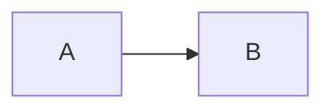

# Qiita Sync Implementation Plan

> **For agentic workers:** REQUIRED SUB-SKILL: Use superpowers:subagent-driven-development (recommended) or superpowers:executing-plans to implement this plan task-by-task. Steps use checkbox (`- [ ]`) syntax for tracking.

**Goal:** Publish opted-in Japanese blog posts to Qiita from this repo without duplicates, with only `ja/pi-agent-freedom-vs-convenience` allowed for now.

**Architecture:** A dependency-light Node ESM tool in `scripts/qiita/`, separate from the Astro build. It reads posts' frontmatter, converts Markdown using the built `dist/` as the URL source of truth, and syncs through the Qiita API v2 with a write-ahead map file (`scripts/qiita-map.json`) so a crashed create can never be blindly retried. A manual-only, two-job GitHub Actions workflow runs it (dry-run by default).

**Tech Stack:** Node 22+ ESM (`node:test`, global `fetch`), `yaml` 2.9.1 (already in the lockfile), GitHub Actions. No other dependencies.

**Spec:** `docs/superpowers/specs/2026-10-21-qiita-sync-design.md`

## Global Constraints

- Only `ja` posts, only slugs in `scripts/qiita/allowlist.json` (initially `["pi-agent-freedom-vs-convenience"]`), only with `qiita.publish: true`, never drafts or future-dated posts.
- `qiita.publish: false` or absent never deletes anything. Deletion only via `--unpublish <slug> --confirm <slug>`.
- No new dependencies beyond declaring `yaml` 2.9.1 (exact) as a devDependency. Tests use `node --test` only.
- Dry-run is the default everywhere (`--apply` is required to mutate); in dry-run the client throws on any non-GET and the sync makes no network call.
- `QIITA_TOKEN` comes only from the environment, is never logged (errors are redacted), and is never passed to dry-run jobs.
- Preserve the blog: do not change Astro rendering, styles, routes, or `deploy.yml`. The only change under `src/` is the optional `qiita` schema field.
- Node is not on PATH. Prefix every shell command with: `source ~/.nvm/nvm.sh --no-use && nvm use v26 >/dev/null && ` (the repo's `.nvmrc` is 26).
- End every commit message with `Co-Authored-By: Claude Sonnet 5.5 <noreply@anthropic.com>`.
- Do not add `qiita:` frontmatter to any existing post except in Task 16, after asking the user.
- Never run `--apply` against the real Qiita API; the user does that after the live probe.

## Review Focus

Failure modes the spec implies but does not enumerate (each is pinned by a test in the owning task):

1. **Typographic alt-text drift** (Task 4): the built page rewrites `--mode` to `–mode` and encodes entities in `alt`; source and built alt must still pair. A strict string compare would fail the real article.
2. **Code that looks like markup** (Task 4): `<div>`, `` and `[a](b)` inside fenced or inline code must be left untouched, not converted or rejected.
3. **Create succeeded but the response was unusable** (Task 9): a 201 with no `id`, or a 5xx, must leave `pending`, and the next run must not POST again.
4. **Corrupt or hand-edited map** (Task 7): an invalid state, wrong version or broken JSON must throw, never silently become an empty map, which would cause duplicates.
5. **Forgot to build** (Task 12): a flagged post with no `dist/` page must fail with "run `npm run build`", not publish a body with broken images.

---

### Task 1: Scaffolding, schema, spec amendments

**Files:**
- Modify: `docs/superpowers/specs/2026-10-21-qiita-sync-design.md`
- Modify: `package.json`, `package-lock.json`, `.gitignore`, `src/content.config.ts`
- Create: `scripts/qiita/allowlist.json`, `scripts/qiita-map.json`

**Interfaces:**
- Produces: npm scripts `qiita:sync` and `test:qiita`; the optional `qiita` frontmatter object (`publish`, `visibility`, `tags`); empty map file `{"version":1,"items":{}}`.

- [ ] **Step 1: Create the implementation branch**

```bash
git checkout -b feature/qiita-sync
```

- [ ] **Step 2: Amend the spec (four corrections found while planning)**

In `docs/superpowers/specs/2026-10-21-qiita-sync-design.md` make these exact replacements:

1. Old: `Counts and alt text must match, otherwise fail.`
   New: `Counts must match, and alt text must match after entity-decoding and dropping punctuation (the build rewrites \`--\` to an en dash); otherwise fail.`
2. Old: `- **Never retry a possibly-successful create.** If \`POST\` errored, timed out or returned an unparseable body, the slug stays \`pending\` and further creation is blocked.`
   New: `- **Never retry a possibly-successful create.** If \`POST\` hit a network error, timed out, returned 5xx, or returned a body without an \`id\`, the slug stays \`pending\` and further creation is blocked. A 4xx response means Qiita definitively rejected the request, so the \`pending\` entry is removed instead (a bad token or invalid payload needs no manual recovery).`
3. Old: `in CI also require \`confirm_slug\` equal to the slug.`
   New: `always require \`--confirm <slug>\` equal to the slug (workflow input \`confirm_slug\`), and refuse while the post still has \`qiita.publish: true\` (otherwise the next sync would recreate it).`
4. Old: `It commits only \`synced\` entries with a confirmed id, never \`pending\`. This deliberately deviates from "commit only after full success": discarding a confirmed id from a run that later failed would cause a duplicate on the next run.`
   New: `It commits the whole map, including \`pending\` entries: the runner is ephemeral, so an uncommitted \`pending\` entry is lost and the next run would create a duplicate. This deliberately deviates from "commit only after full success". (If a runner is killed before the artifact is saved, check Qiita for a duplicate and use \`--recover\`.)`

- [ ] **Step 3: Declare `yaml` and add scripts**

```bash
source ~/.nvm/nvm.sh --no-use && nvm use v26 >/dev/null && npm install --save-dev --save-exact yaml@2.9.1
git diff --stat package-lock.json
```
Expected: `package.json` gains `"yaml": "2.9.1"` under devDependencies; the lockfile diff is tiny (flags only, no new packages). Then add to `package.json` `scripts`:

```json
"qiita:sync": "node scripts/qiita/cli.mjs",
"test:qiita": "node --test \"scripts/qiita/**/*.test.mjs\""
```

- [ ] **Step 4: Ignore previews, add data files**

Append to `.gitignore`:
```
# Qiita sync dry-run output
.qiita-preview/
```
Create `scripts/qiita/allowlist.json`:
```json
["pi-agent-freedom-vs-convenience"]
```
Create `scripts/qiita-map.json`:
```json
{
  "version": 1,
  "items": {}
}
```

- [ ] **Step 5: Add the optional schema field**

In `src/content.config.ts`, inside `z.object({ ... })` after `author`, add:

```ts
      // Optional Qiita opt-in; read only by scripts/qiita/, ignored when rendering.
      qiita: z
        .object({
          publish: z.boolean().default(false),
          visibility: z.enum(['limited', 'public']).default('limited'),
          tags: z.array(z.string().min(1)).max(5).optional(),
        })
        .optional(),
```

- [ ] **Step 6: Verify the blog still builds**

Run: `source ~/.nvm/nvm.sh --no-use && nvm use v26 >/dev/null && npm run build`
Expected: completes with no errors (needs network for fonts on a cold cache).

- [ ] **Step 7: Commit**

```bash
git add -A
git commit -m "Scaffold Qiita sync: yaml devDependency, schema field, data files, spec amendments"
```

---

### Task 2: Config and payload

**Files:**
- Create: `scripts/qiita/config.mjs`, `scripts/qiita/payload.mjs`
- Test: `scripts/qiita/config.test.mjs`, `scripts/qiita/payload.test.mjs`

**Interfaces:**
- Produces (`config.mjs`): `REPO_ROOT, BLOG_DIR, DIST_DIR, MAP_PATH, ALLOWLIST_PATH, PREVIEW_DIR, SITE_URL, QIITA_LANG, QIITA_API`.
- Produces (`payload.mjs`): `CONVERTER_VERSION='v1'`, `MAX_TAGS=5`, `normalizeBody(body: string): string`, `normalizeTags(tags: string[]): string[]`, `buildPayload({title, body, tags, visibility}): {title, body, tags: {name, versions: []}[], private: boolean}`, `canonicalJson(value): string`, `hashPayload(payload): string` (hex sha256).

- [ ] **Step 1: Write the failing tests**

`scripts/qiita/config.test.mjs`:
```js
import test from 'node:test';
import assert from 'node:assert/strict';
import { readFileSync } from 'node:fs';
import path from 'node:path';
import { REPO_ROOT, SITE_URL } from './config.mjs';

test('SITE_URL matches astro.config.mjs', () => {
  const astro = readFileSync(path.join(REPO_ROOT, 'astro.config.mjs'), 'utf8');
  assert.match(astro, new RegExp(`site: '${SITE_URL}'`));
});
```

`scripts/qiita/payload.test.mjs`:
```js
import test from 'node:test';
import assert from 'node:assert/strict';
import { createHash } from 'node:crypto';
import { buildPayload, canonicalJson, hashPayload, normalizeBody, normalizeTags } from './payload.mjs';

const base = { title: 'T', body: 'hello\n', tags: ['a', 'b'], visibility: 'limited' };

test('normalizeBody uses LF, trims trailing whitespace, ends with one newline', () => {
  assert.equal(normalizeBody('a  \r\nb\t\r\n\r\n\r\n'), 'a\nb\n');
});

test('normalizeTags trims, drops empties, dedupes case-insensitively, keeps order', () => {
  assert.deepEqual(normalizeTags([' Pi ', '', 'pi', 'AI']), ['Pi', 'AI']);
});

test('normalizeTags rejects zero tags and more than five', () => {
  assert.throws(() => normalizeTags([]), /at least one tag/);
  assert.throws(() => normalizeTags(['a', 'b', 'c', 'd', 'e', 'f']), /at most 5/);
});

test('buildPayload maps visibility to private and shapes tags', () => {
  assert.equal(buildPayload(base).private, true);
  assert.equal(buildPayload({ ...base, visibility: 'public' }).private, false);
  assert.deepEqual(buildPayload(base).tags, [{ name: 'a', versions: [] }, { name: 'b', versions: [] }]);
  assert.throws(() => buildPayload({ ...base, visibility: 'secret' }), /visibility/);
  assert.throws(() => buildPayload({ ...base, title: '  ' }), /title/);
});

test('canonicalJson sorts keys at every depth', () => {
  assert.equal(canonicalJson({ b: 1, a: { d: [2, { z: 1, y: 2 }], c: 3 } }), '{"a":{"c":3,"d":[2,{"y":2,"z":1}]},"b":1}');
});

test('hash is the v1-prefixed sha256 of the canonical payload and ignores key order', () => {
  const p = buildPayload(base);
  const expected = createHash('sha256').update(`v1:${canonicalJson(p)}`).digest('hex');
  assert.equal(hashPayload(p), expected);
  const shuffled = { private: p.private, tags: p.tags, body: p.body, title: p.title };
  assert.equal(hashPayload(shuffled), expected);
});

test('hash changes when any payload field changes', () => {
  const h = hashPayload(buildPayload(base));
  assert.notEqual(h, hashPayload(buildPayload({ ...base, title: 'T2' })));
  assert.notEqual(h, hashPayload(buildPayload({ ...base, body: 'bye\n' })));
  assert.notEqual(h, hashPayload(buildPayload({ ...base, tags: ['a'] })));
  assert.notEqual(h, hashPayload(buildPayload({ ...base, visibility: 'public' })));
});
```

- [ ] **Step 2: Run to verify failure**

Run: `source ~/.nvm/nvm.sh --no-use && nvm use v26 >/dev/null && npm run test:qiita`
Expected: FAIL, modules not found.

- [ ] **Step 3: Implement**

`scripts/qiita/config.mjs`:
```js
import path from 'node:path';
import { fileURLToPath } from 'node:url';

export const REPO_ROOT = path.resolve(path.dirname(fileURLToPath(import.meta.url)), '../..');
export const BLOG_DIR = path.join(REPO_ROOT, 'src/content/blog');
export const DIST_DIR = path.join(REPO_ROOT, 'dist');
export const MAP_PATH = path.join(REPO_ROOT, 'scripts/qiita-map.json');
export const ALLOWLIST_PATH = path.join(REPO_ROOT, 'scripts/qiita/allowlist.json');
export const PREVIEW_DIR = path.join(REPO_ROOT, '.qiita-preview');
/** Must equal `site` in astro.config.mjs (checked by config.test.mjs). */
export const SITE_URL = 'https://hdquangsgt.github.io';
export const QIITA_LANG = 'ja';
export const QIITA_API = 'https://qiita.com/api/v2';
```

`scripts/qiita/payload.mjs`:
```js
import { createHash } from 'node:crypto';

/** Bump when conversion output changes on purpose, so every post re-syncs once. */
export const CONVERTER_VERSION = 'v1';
export const MAX_TAGS = 5;
const VISIBILITIES = ['limited', 'public'];

export function normalizeBody(body) {
  const lines = body
    .replace(/\r\n?/g, '\n')
    .split('\n')
    .map((l) => l.replace(/[ \t]+$/, ''));
  return lines.join('\n').replace(/\n+$/, '') + '\n';
}

export function normalizeTags(tags) {
  const seen = new Set();
  const out = [];
  for (const raw of tags ?? []) {
    const name = String(raw).trim();
    if (!name) continue;
    const key = name.toLowerCase();
    if (seen.has(key)) continue;
    seen.add(key);
    out.push(name);
  }
  if (out.length === 0) throw new Error('Qiita needs at least one tag');
  if (out.length > MAX_TAGS) {
    throw new Error(`Qiita allows at most ${MAX_TAGS} tags, got ${out.length}: ${out.join(', ')}`);
  }
  return out;
}

export function buildPayload({ title, body, tags, visibility = 'limited' }) {
  if (!title || !title.trim()) throw new Error('title is required');
  if (!VISIBILITIES.includes(visibility)) {
    throw new Error(`visibility must be one of ${VISIBILITIES.join(', ')}, got "${visibility}"`);
  }
  return {
    title: title.trim(),
    body: normalizeBody(body),
    tags: normalizeTags(tags).map((name) => ({ name, versions: [] })),
    private: visibility !== 'public',
  };
}

export function canonicalJson(value) {
  if (Array.isArray(value)) return `[${value.map(canonicalJson).join(',')}]`;
  if (value && typeof value === 'object') {
    return `{${Object.keys(value)
      .sort()
      .map((k) => `${JSON.stringify(k)}:${canonicalJson(value[k])}`)
      .join(',')}}`;
  }
  return JSON.stringify(value);
}

export function hashPayload(payload) {
  return createHash('sha256').update(`${CONVERTER_VERSION}:${canonicalJson(payload)}`).digest('hex');
}
```

- [ ] **Step 4: Run to verify pass**

Run: `source ~/.nvm/nvm.sh --no-use && nvm use v26 >/dev/null && npm run test:qiita`
Expected: all pass.

- [ ] **Step 5: Commit**

```bash
git add scripts/qiita
git commit -m "Add Qiita payload normalization and hashing"
```

---

### Task 3: Post loading and eligibility

**Files:**
- Create: `scripts/qiita/posts.mjs`, `scripts/qiita/select.mjs`
- Test: `scripts/qiita/posts.test.mjs`, `scripts/qiita/select.test.mjs`

**Interfaces:**
- Produces (`posts.mjs`): `parseFrontmatter(text): {data, body}`; `describePost(id, text, file): Post`; `loadPosts(blogDir): Post[]`. `Post = {id, lang, slug, data, body, file}` where `id` is the path under the blog dir without `.md` (e.g. `ja/pi-agent-freedom-vs-convenience`), `lang` is `en|vi|ja`, `slug` excludes the locale folder.
- Produces (`select.mjs`): `selectPosts(posts, allowlist, now?): {eligible: Post[], skipped: {slug, reason}[], errors: string[]}`; `findOrphans(posts, map): string[]`; `loadAllowlist(file): string[]`; `assertAllowlisted(slug, allowlist): void`; `assertNotFlagged(posts, slug): void`.

- [ ] **Step 1: Write the failing tests**

`scripts/qiita/posts.test.mjs`:
```js
import test from 'node:test';
import assert from 'node:assert/strict';
import { mkdirSync, mkdtempSync, writeFileSync } from 'node:fs';
import os from 'node:os';
import path from 'node:path';
import { describePost, loadPosts, parseFrontmatter } from './posts.mjs';

const doc = (data, body = 'body\n') => `---\n${JSON.stringify(data)}\n---\n${body}`;

test('parseFrontmatter splits data and body, including CRLF files', () => {
  const { data, body } = parseFrontmatter('---\r\ntitle: A\r\ntags: [x, y]\r\n---\r\nhello\r\n');
  assert.deepEqual(data, { title: 'A', tags: ['x', 'y'] });
  assert.equal(body, 'hello\r\n');
});

test('parseFrontmatter throws without frontmatter', () => {
  assert.throws(() => parseFrontmatter('no frontmatter'), /frontmatter/);
});

test('describePost derives lang and slug from the id', () => {
  assert.deepEqual(
    (({ lang, slug }) => ({ lang, slug }))(describePost('ja/pi', doc({ title: 'x' }), 'f')),
    { lang: 'ja', slug: 'pi' },
  );
  assert.equal(describePost('pi', doc({ title: 'x' }), 'f').lang, 'en');
  assert.equal(describePost('vi/pi', doc({ title: 'x' }), 'f').slug, 'pi');
});

test('loadPosts reads markdown recursively and ignores other files', () => {
  const dir = mkdtempSync(path.join(os.tmpdir(), 'qiita-posts-'));
  mkdirSync(path.join(dir, 'ja'));
  mkdirSync(path.join(dir, 'images'));
  writeFileSync(path.join(dir, 'a.md'), doc({ title: 'A' }));
  writeFileSync(path.join(dir, 'ja', 'b.md'), doc({ title: 'B' }));
  writeFileSync(path.join(dir, 'images', 'x.svg'), '<svg/>');
  const posts = loadPosts(dir);
  assert.deepEqual(posts.map((p) => p.id), ['a', 'ja/b']);
});
```

`scripts/qiita/select.test.mjs`:
```js
import test from 'node:test';
import assert from 'node:assert/strict';
import { describePost } from './posts.mjs';
import { assertAllowlisted, assertNotFlagged, findOrphans, selectPosts } from './select.mjs';

const mk = (id, data) => describePost(id, `---\n${JSON.stringify({ title: 'T', pubDate: '2026-01-01', ...data })}\n---\nbody\n`, id);
const NOW = new Date('2026-06-01T00:00:00Z');
const ALLOW = ['pi'];
const flagged = { qiita: { publish: true } };

test('publishes only flagged, allowlisted ja posts', () => {
  const r = selectPosts([mk('ja/pi', flagged)], ALLOW, NOW);
  assert.deepEqual(r.eligible.map((p) => p.slug), ['pi']);
  assert.deepEqual(r.errors, []);
});

test('allowlist alone publishes nothing', () => {
  const r = selectPosts([mk('ja/pi', {})], ALLOW, NOW);
  assert.equal(r.eligible.length, 0);
  assert.equal(r.errors.length, 0);
});

test('publish false or absent is ignored without error', () => {
  const r = selectPosts([mk('ja/pi', { qiita: { publish: false } }), mk('ja/welcome', {})], ALLOW, NOW);
  assert.deepEqual(r, { eligible: [], skipped: [], errors: [] });
});

test('flag on a non-ja post is an error', () => {
  const r = selectPosts([mk('pi', flagged), mk('vi/pi', flagged)], ALLOW, NOW);
  assert.equal(r.errors.length, 2);
  assert.match(r.errors[0], /only allowed on ja posts/);
  assert.equal(r.eligible.length, 0);
});

test('flag on a non-allowlisted ja post is an error', () => {
  const r = selectPosts([mk('ja/welcome', flagged)], ALLOW, NOW);
  assert.match(r.errors[0], /not in scripts\/qiita\/allowlist\.json/);
  assert.equal(r.eligible.length, 0);
});

test('drafts and scheduled posts are skipped with a reason', () => {
  const r = selectPosts(
    [mk('ja/pi', { ...flagged, draft: true }), mk('ja/pi', { ...flagged, pubDate: '2027-01-01T00:00:00Z' })],
    ALLOW,
    NOW,
  );
  assert.deepEqual(r.skipped.map((s) => s.reason), ['draft', 'scheduled']);
  assert.equal(r.eligible.length, 0);
});

test('findOrphans lists mapped slugs that are no longer flagged', () => {
  const map = { version: 1, items: { pi: {}, old: {} } };
  assert.deepEqual(findOrphans([mk('ja/pi', flagged), mk('ja/old', {})], map), ['old']);
});

test('assertAllowlisted and assertNotFlagged', () => {
  assert.throws(() => assertAllowlisted('welcome', ALLOW), /not in scripts\/qiita\/allowlist\.json/);
  assert.doesNotThrow(() => assertAllowlisted('pi', ALLOW));
  assert.throws(() => assertNotFlagged([mk('ja/pi', flagged)], 'pi'), /qiita\.publish: false/);
  assert.doesNotThrow(() => assertNotFlagged([mk('ja/pi', {})], 'pi'));
});
```

- [ ] **Step 2: Run to verify failure**

Run: `source ~/.nvm/nvm.sh --no-use && nvm use v26 >/dev/null && npm run test:qiita`
Expected: FAIL, modules not found.

- [ ] **Step 3: Implement**

`scripts/qiita/posts.mjs`:
```js
import { readdirSync, readFileSync } from 'node:fs';
import path from 'node:path';
import { parse } from 'yaml';

const PREFIXED_LOCALES = ['vi', 'ja'];

export function parseFrontmatter(text) {
  const m = /^---\r?\n([\s\S]*?)\r?\n---\r?\n?/.exec(text);
  if (!m) throw new Error('missing frontmatter');
  return { data: parse(m[1]) ?? {}, body: text.slice(m[0].length) };
}

/** English posts live at <slug>.md; translations at <lang>/<slug>.md (same convention as src/utils/posts.ts). */
export function describePost(id, text, file) {
  const { data, body } = parseFrontmatter(text);
  const first = id.split('/')[0];
  const lang = id.includes('/') && PREFIXED_LOCALES.includes(first) ? first : 'en';
  const slug = lang === 'en' ? id : id.slice(id.indexOf('/') + 1);
  return { id, lang, slug, data, body, file };
}

function walk(dir) {
  const out = [];
  for (const entry of readdirSync(dir, { withFileTypes: true })) {
    const full = path.join(dir, entry.name);
    if (entry.isDirectory()) out.push(...walk(full));
    else if (entry.name.endsWith('.md')) out.push(full);
  }
  return out;
}

export function loadPosts(blogDir) {
  return walk(blogDir)
    .sort()
    .map((file) => {
      const id = path.relative(blogDir, file).split(path.sep).join('/').replace(/\.md$/, '');
      return describePost(id, readFileSync(file, 'utf8'), file);
    });
}
```

`scripts/qiita/select.mjs`:
```js
import { readFileSync } from 'node:fs';
import { QIITA_LANG } from './config.mjs';

export function loadAllowlist(file) {
  const list = JSON.parse(readFileSync(file, 'utf8'));
  if (!Array.isArray(list) || !list.every((s) => typeof s === 'string' && s)) {
    throw new Error(`${file} must be a JSON array of slugs`);
  }
  return list;
}

export function assertAllowlisted(slug, allowlist) {
  if (!allowlist.includes(slug)) throw new Error(`"${slug}" is not in scripts/qiita/allowlist.json`);
}

/** Unpublishing a post that is still flagged would just recreate it on the next sync. */
export function assertNotFlagged(posts, slug) {
  const post = posts.find((p) => p.lang === QIITA_LANG && p.slug === slug);
  if (post?.data.qiita?.publish === true) {
    throw new Error(`"${slug}" still has qiita.publish: true; set it to qiita.publish: false first`);
  }
}

export function selectPosts(posts, allowlist, now = new Date()) {
  const eligible = [];
  const skipped = [];
  const errors = [];
  for (const post of posts) {
    if (post.data.qiita?.publish !== true) continue;
    if (post.lang !== QIITA_LANG) {
      errors.push(`${post.id}: qiita.publish is only allowed on ${QIITA_LANG} posts`);
      continue;
    }
    if (!allowlist.includes(post.slug)) {
      errors.push(`${post.id}: slug "${post.slug}" is not in scripts/qiita/allowlist.json`);
      continue;
    }
    if (post.data.draft === true) {
      skipped.push({ slug: post.slug, reason: 'draft' });
      continue;
    }
    if (new Date(post.data.pubDate) > now) {
      skipped.push({ slug: post.slug, reason: 'scheduled' });
      continue;
    }
    eligible.push(post);
  }
  return { eligible, skipped, errors };
}

/** Slugs that still have a Qiita item in the map but are no longer flagged for publishing. */
export function findOrphans(posts, map) {
  const flagged = new Set(
    posts.filter((p) => p.lang === QIITA_LANG && p.data.qiita?.publish === true).map((p) => p.slug),
  );
  return Object.keys(map.items).filter((slug) => !flagged.has(slug));
}
```

- [ ] **Step 4: Run to verify pass**

Run: `source ~/.nvm/nvm.sh --no-use && nvm use v26 >/dev/null && npm run test:qiita`
Expected: all pass.

- [ ] **Step 5: Commit**

```bash
git add scripts/qiita
git commit -m "Add post loading and Qiita eligibility with allowlist guard"
```

---

### Task 4: Markdown conversion

**Files:**
- Create: `scripts/qiita/convert.mjs`
- Test: `scripts/qiita/convert.test.mjs`

**Interfaces:**
- Produces: `ConversionError`; `decodeEntities(s)`; `altKey(s)`; `extractImages(html): {src, alt}[]` (only inside `<div class="prose">` up to `<footer class="article-footer"`); `makePageExists(distDir): (pathname) => boolean`; `convertBody(body, ctx): {markdown, warnings, assetUrls}` where `ctx = {canonicalUrl, siteUrl, builtHtml, pageExists, svgMode?: 'link'|'hotlink', allowedTags?: string[]}`.

- [ ] **Step 1: Write the failing tests**

`scripts/qiita/convert.test.mjs`:
```js
import test from 'node:test';
import assert from 'node:assert/strict';
import { altKey, ConversionError, convertBody, decodeEntities, extractImages } from './convert.mjs';

const SITE = 'https://example.test';
const CANON = `${SITE}/ja/blog/post/`;
const page = (imgs = '') =>
  `<html><body><div class="prose">${imgs}<h2 id="sec">S</h2></div><footer class="article-footer"></footer></body></html>`;
const img = (alt, src) => ``;
const ctx = (over = {}) => ({ canonicalUrl: CANON, siteUrl: SITE, builtHtml: page(), pageExists: () => true, ...over });

test('callouts become :::note and label spans become bold', () => {
  const md = '<div class="callout observed">\n\n<span class="label observed">Observed</span> text\n\n</div>\n';
  const { markdown } = convertBody(md, ctx());
  assert.match(markdown, /^:::note info$/m);
  assert.match(markdown, /^\*\*Observed\*\* text$/m);
  assert.match(markdown, /^:::$/m);
  assert.doesNotMatch(markdown, /<div|<span/);
});

test('appends the canonical footer', () => {
  const { markdown } = convertBody('hello\n', ctx());
  assert.ok(markdown.endsWith(`\n\n元記事: ${CANON}\n`));
});

test('fenced and inline code is left untouched (Review Focus 2)', () => {
  const md = ['```html', '<div class="callout x">', '', '[l](../x)', '```', 'inline `<div>` and `` and `[a](b)`'].join('\n');
  const { markdown, assetUrls } = convertBody(md, ctx());
  assert.ok(markdown.includes('<div class="callout x">\n\n[l](../x)'));
  assert.ok(markdown.includes('inline `<div>` and `` and `[a](b)`'));
  assert.deepEqual(assetUrls, []);
});

test('a callout may contain a code fence', () => {
  const md = '<div class="callout">\n\n```js\nconst a = "</div>";\n```\n\n</div>\n';
  const { markdown } = convertBody(md, ctx());
  assert.ok(markdown.includes('const a = "</div>";'));
  assert.match(markdown, /^:::$/m);
});

test('fails closed on HTML Qiita would mangle', () => {
  assert.throws(() => convertBody('<table><tr></tr></table>', ctx()), /unsupported HTML <table>/);
  assert.throws(() => convertBody('<!-- note -->', ctx()), /HTML comment/);
  assert.doesNotThrow(() => convertBody('line<br>break and <https://example.com>', ctx()));
});

test('fails on unbalanced callouts and unterminated fences', () => {
  assert.throws(() => convertBody('<div class="callout">\n', ctx()), ConversionError);
  assert.throws(() => convertBody('```js\ncode', ctx()), /unterminated/);
});

test('svg images become a text fallback with a link to the built asset', () => {
  const html = page(img('Diagram one', '/_astro/a.H1.svg'));
  const { markdown, assetUrls } = convertBody('\n', ctx({ builtHtml: html }));
  assert.match(markdown, /^> \*\*図:\*\* Diagram one$/m);
  assert.match(markdown, /^> \[図を開く \(SVG\)\]\(https:\/\/example\.test\/_astro\/a\.H1\.svg\)$/m);
  assert.deepEqual(assetUrls, ['https://example.test/_astro/a.H1.svg']);
});

test('hotlink mode and non-svg images stay images', () => {
  const svg = page(img('D', '/_astro/a.H1.svg'));
  assert.match(convertBody('\n', ctx({ builtHtml: svg, svgMode: 'hotlink' })).markdown, /^!\[D\]\(https:\/\/example\.test\/_astro\/a\.H1\.svg\)$/m);
  const png = page(img('P', '/_astro/p.H2.png'));
  assert.match(convertBody('\n', ctx({ builtHtml: png })).markdown, /^!\[P\]\(https:\/\/example\.test\/_astro\/p\.H2\.png\)$/m);
});

test('image count and alt must agree with the built page', () => {
  const html = page(img('One', '/_astro/a.H.svg'));
  assert.throws(() => convertBody('\n\n', ctx({ builtHtml: html })), /no counterpart/);
  assert.throws(() => convertBody('no images\n', ctx({ builtHtml: html })), /1 image\(s\)/);
  assert.throws(() => convertBody('\n', ctx({ builtHtml: html })), /alt text differs/);
});

test('alt pairing tolerates the build\'s typography and entities (Review Focus 1)', () => {
  const html = page(img('pi –mode rpc &#34;quoted&#34; &amp; more', '/_astro/a.H.svg'));
  assert.doesNotThrow(() => convertBody('\n', ctx({ builtHtml: html })));
});

test('extractImages ignores images outside the prose container', () => {
  const html = page(img('In prose', '/_astro/a.H.svg'));
  assert.deepEqual(extractImages(html), [{ src: '/_astro/a.H.svg', alt: 'In prose' }]);
});

test('altKey and decodeEntities', () => {
  assert.equal(altKey('pi --mode rpc!'), altKey('pi –mode rpc'));
  assert.equal(decodeEntities('a&amp;b &lt;c&gt; &#39;x&#39; &#x27;y&#x27;'), "a&b <c> 'x' 'y'");
});

test('relative links resolve against the canonical URL and must exist', () => {
  const seen = [];
  const pageExists = (p) => (seen.push(p), p !== '/blog/missing/');
  assert.match(convertBody('[a](/blog/other/)\n', ctx({ pageExists })).markdown, /\[a\]\(https:\/\/example\.test\/blog\/other\/\)/);
  assert.throws(() => convertBody('[a](/blog/missing/)\n', ctx({ pageExists })), /does not exist/);
});

test('anchors become blog URLs and must exist in the built page', () => {
  assert.match(convertBody('[s](#sec)\n', ctx()).markdown, new RegExp(`\\[s\\]\\(${CANON}#sec\\)`));
  assert.throws(() => convertBody('[s](#missing)\n', ctx()), /anchor #missing/);
});

test('absolute and mailto links are untouched', () => {
  const { markdown } = convertBody('[a](https://x.test/p) [m](mailto:a@b.c)\n', ctx({ pageExists: () => false }));
  assert.ok(markdown.includes('[a](https://x.test/p) [m](mailto:a@b.c)'));
});

test('warns about footnotes and images that share a line with text', () => {
  const html = page(img('D', '/_astro/a.H.svg'));
  const { warnings } = convertBody('text[^1] \n', ctx({ builtHtml: html }));
  assert.equal(warnings.length, 2);
});
```

- [ ] **Step 2: Run to verify failure**

Run: `source ~/.nvm/nvm.sh --no-use && nvm use v26 >/dev/null && npm run test:qiita`
Expected: FAIL, `convert.mjs` not found.

- [ ] **Step 3: Implement**

`scripts/qiita/convert.mjs`:
```js
// Converts the blog's Markdown into Qiita Markdown. URLs come from the built site in dist/, never from
// string-replacing source paths (Astro hashes asset names). Fails closed on anything Qiita might mangle.
import { existsSync } from 'node:fs';
import path from 'node:path';

export class ConversionError extends Error {}

const ALLOWED_TAGS = ['br'];
const FENCE = /^ {0,3}(`{3,}|~{3,})/;
const IMAGE = /!\[((?:[^\]\\]|\\.)*)\]\(([^)\s]+)(?:\s+"[^"]*")?\)/g;
const LINK = /(?<!!)\[((?:[^\]\\]|\\.)*)\]\(([^)\s]+)((?:\s+"[^"]*")?)\)/g;
const LABEL_SPAN = /<span class="label [a-z-]+">([^<]*)<\/span>/g;
const FOOTNOTE = /\[\^[^\]]+\]/;

export function decodeEntities(s) {
  return s.replace(/&(#x[0-9a-f]+|#\d+|amp|lt|gt|quot|apos);/gi, (_, e) => {
    const k = e.toLowerCase();
    if (k === 'amp') return '&';
    if (k === 'lt') return '<';
    if (k === 'gt') return '>';
    if (k === 'quot') return '"';
    if (k === 'apos') return "'";
    return String.fromCodePoint(k[1] === 'x' ? parseInt(k.slice(2), 16) : parseInt(k.slice(1), 10));
  });
}

/** Alt text as compared between source and built page: the build rewrites `--` to an en dash and encodes entities. */
export function altKey(s) {
  return decodeEntities(s).replace(/[^\p{L}\p{N}]+/gu, '');
}

/** `` elements inside the article body, in document order. */
export function extractImages(html) {
  const start = html.indexOf('<div class="prose"');
  if (start < 0) throw new ConversionError('built page has no .prose container');
  const end = html.indexOf('<footer class="article-footer"', start);
  const region = html.slice(start, end < 0 ? undefined : end);
  const images = [];
  for (const m of region.matchAll(/"']|"[^"]*"|'[^']*')*>/g)) {
    const attrs = {};
    for (const a of m[0].matchAll(/([a-zA-Z-]+)="([^"]*)"/g)) attrs[a[1]] = decodeEntities(a[2]);
    if (!attrs.src) throw new ConversionError(`built  without src: ${m[0].slice(0, 80)}`);
    images.push({ src: attrs.src, alt: attrs.alt ?? '' });
  }
  return images;
}

export function makePageExists(distDir) {
  return (pathname) => {
    const rel = decodeURIComponent(pathname).replace(/^\//, '');
    const full = path.join(distDir, rel);
    return existsSync(path.join(full, 'index.html')) || (!pathname.endsWith('/') && existsSync(full));
  };
}

function maskInlineCode(line) {
  const saved = [];
  const masked = line.replace(/(`+)(?!`)(.+?)(?<!`)\1(?!`)/g, (m) => {
    saved.push(m);
    return `\u0000${saved.length - 1}\u0000`;
  });
  return { masked, restore: (s) => s.replace(/\u0000(\d+)\u0000/g, (_, i) => saved[Number(i)]) };
}

function assertNoHtml(text, lineNo, allowedTags) {
  if (text.includes('<!--')) throw new ConversionError(`line ${lineNo}: HTML comment may be dropped or shown by Qiita`);
  for (const m of text.matchAll(/<\/?([a-zA-Z][a-zA-Z0-9-]*)(?=[\s>/])/g)) {
    if (!allowedTags.includes(m[1].toLowerCase())) {
      throw new ConversionError(`line ${lineNo}: unsupported HTML <${m[1]}> would be stripped or mangled by Qiita`);
    }
  }
}

function hasId(html, id) {
  return html.includes(`id="${id}"`);
}

export function convertBody(body, ctx) {
  const { canonicalUrl, siteUrl, builtHtml, pageExists, svgMode = 'link', allowedTags = ALLOWED_TAGS } = ctx;
  const builtImages = extractImages(builtHtml);
  const siteOrigin = new URL(siteUrl).origin;
  const assetUrls = [];
  const warnings = [];
  const out = [];
  let imageIndex = 0;
  let calloutDepth = 0;
  let fence = null;

  body.split('\n').forEach((raw, i) => {
    const lineNo = i + 1;
    const line = raw.replace(/\r$/, '');
    const f = FENCE.exec(line);
    if (fence) {
      out.push(line);
      if (f && f[1][0] === fence[0] && f[1].length >= fence.length && /^ {0,3}[`~]+\s*$/.test(line)) fence = null;
      return;
    }
    if (f) {
      fence = f[1];
      out.push(line);
      return;
    }
    if (/^<div class="callout[^"]*">\s*$/.test(line)) {
      calloutDepth++;
      out.push(':::note info');
      return;
    }
    if (calloutDepth > 0 && /^<\/div>\s*$/.test(line)) {
      calloutDepth--;
      out.push(':::');
      return;
    }

    const { masked, restore } = maskInlineCode(line);
    let text = masked.replace(LABEL_SPAN, '**$1**');

    text = text.replace(IMAGE, (match, alt, src, offset, whole) => {
      const n = imageIndex++;
      const built = builtImages[n];
      if (!built) throw new ConversionError(`line ${lineNo}: markdown image #${n + 1} (${src}) has no counterpart in the built page`);
      if (altKey(restore(alt)) !== altKey(built.alt)) {
        throw new ConversionError(`line ${lineNo}: image #${n + 1} alt text differs between the source and the built page`);
      }
      const url = new URL(built.src, siteUrl).href;
      assetUrls.push(url);
      if (whole.trim() !== match) warnings.push(`line ${lineNo}: image shares a line with other text`);
      const cleanAlt = restore(alt).replace(/\s+/g, ' ').trim();
      if (svgMode === 'link' && /\.svg(\?|#|$)/i.test(url)) {
        return `> **図:** ${cleanAlt}\n>\n> [図を開く (SVG)](${url})`;
      }
      return ``;
    });

    text = text.replace(LINK, (match, label, href, title) => {
      if (/^[a-z][a-z0-9+.-]*:/i.test(href)) return match;
      const url = new URL(href, canonicalUrl);
      if (href.startsWith('#')) {
        let id;
        try {
          id = decodeURIComponent(href.slice(1));
        } catch {
          id = href.slice(1);
        }
        if (!hasId(builtHtml, id)) throw new ConversionError(`line ${lineNo}: anchor ${href} not found in the built page`);
        return `[${label}](${url.href})${title}`;
      }
      if (url.origin === siteOrigin && !pageExists(url.pathname)) {
        throw new ConversionError(`line ${lineNo}: link ${href} points to ${url.pathname}, which does not exist in the built site`);
      }
      return `[${label}](${url.href})${title}`;
    });

    assertNoHtml(text, lineNo, allowedTags);
    if (FOOTNOTE.test(text)) warnings.push(`line ${lineNo}: footnotes may not render on Qiita`);
    out.push(restore(text));
  });

  if (fence) throw new ConversionError('unterminated code fence');
  if (calloutDepth !== 0) throw new ConversionError('unbalanced callout <div>');
  if (imageIndex !== builtImages.length) {
    throw new ConversionError(`markdown has ${imageIndex} image(s) but the built page has ${builtImages.length} image(s)`);
  }
  const markdown = `${out.join('\n').replace(/\n+$/, '')}\n\n元記事: ${canonicalUrl}\n`;
  return { markdown, warnings, assetUrls };
}
```

- [ ] **Step 4: Run to verify pass**

Run: `source ~/.nvm/nvm.sh --no-use && nvm use v26 >/dev/null && npm run test:qiita`
Expected: all pass. If the "unterminated"/"count" message assertions differ by a word, fix the implementation message, not the test intent.

- [ ] **Step 5: Commit**

```bash
git add scripts/qiita
git commit -m "Add Markdown-to-Qiita conversion with build-based URL resolution"
```

---

### Task 5: Golden test on the real Pi article

**Files:**
- Test: `scripts/qiita/convert.golden.test.mjs`

**Interfaces:**
- Consumes: `convertBody`, `makePageExists`, `describePost`/`loadPosts`, `DIST_DIR`, `BLOG_DIR`, `SITE_URL`.

- [ ] **Step 1: Build the site so `dist/` is current**

Run: `source ~/.nvm/nvm.sh --no-use && nvm use v26 >/dev/null && npm run build`
Expected: success.

- [ ] **Step 2: Write the golden test**

`scripts/qiita/convert.golden.test.mjs`:
```js
import test from 'node:test';
import assert from 'node:assert/strict';
import { existsSync, readFileSync } from 'node:fs';
import path from 'node:path';
import { BLOG_DIR, DIST_DIR, SITE_URL } from './config.mjs';
import { convertBody, makePageExists } from './convert.mjs';
import { describePost } from './posts.mjs';

const SLUG = 'pi-agent-freedom-vs-convenience';
const builtFile = path.join(DIST_DIR, 'ja', 'blog', SLUG, 'index.html');
const sourceFile = path.join(BLOG_DIR, 'ja', `${SLUG}.md`);

test('real Japanese Pi article converts cleanly', { skip: !existsSync(builtFile) && 'run `npm run build` first' }, () => {
  const post = describePost(`ja/${SLUG}`, readFileSync(sourceFile, 'utf8'), sourceFile);
  const { markdown, assetUrls, warnings } = convertBody(post.body, {
    canonicalUrl: `${SITE_URL}/ja/blog/${SLUG}/`,
    siteUrl: SITE_URL,
    builtHtml: readFileSync(builtFile, 'utf8'),
    pageExists: makePageExists(DIST_DIR),
  });
  assert.equal(assetUrls.length, 12);
  assert.ok(assetUrls.every((u) => /^https:\/\/hdquangsgt\.github\.io\/_astro\/.+\.svg$/.test(u)));
  assert.doesNotMatch(markdown, /!\[[^\]]*\]\([^)]*\.svg\)/);
  assert.doesNotMatch(markdown, /<div|<span/);
  assert.equal((markdown.match(/^:::note info$/gm) ?? []).length, 50);
  assert.equal((markdown.match(/^:::$/gm) ?? []).length, 50);
  assert.equal((markdown.match(/^> \[図を開く \(SVG\)\]/gm) ?? []).length, 12);
  assert.ok(markdown.endsWith(`元記事: ${SITE_URL}/ja/blog/${SLUG}/\n`));
  assert.deepEqual(warnings, []);
});
```

- [ ] **Step 3: Run it**

Run: `source ~/.nvm/nvm.sh --no-use && nvm use v26 >/dev/null && npm run test:qiita`
Expected: PASS. If it fails, the failure is real data about the article (an unsupported tag, a misparsed alt, a count mismatch). Fix `convert.mjs` and add a unit test in `convert.test.mjs` that reproduces it; do not loosen the golden assertions. If `warnings` is non-empty, read each one and either fix the converter or, if it is a legitimate note about the article, assert the exact list instead of `[]`.

- [ ] **Step 4: Commit**

```bash
git add scripts/qiita
git commit -m "Add golden conversion test for the Japanese Pi article"
```

---

### Task 6: Map persistence

**Files:**
- Create: `scripts/qiita/map.mjs`
- Test: `scripts/qiita/map.test.mjs`

**Interfaces:**
- Produces: `emptyMap(): {version: 1, items: {}}`; `loadMap(file): Map`; `saveMap(file, map): void` (atomic: temp file then rename); `serializeMap(map): string` (sorted keys, 2-space indent, trailing newline). Entry shape: `{state: 'pending'|'synced'|'unpublishing', title, hash, itemId?, url?, startedAt?}`.

- [ ] **Step 1: Write the failing tests**

`scripts/qiita/map.test.mjs`:
```js
import test from 'node:test';
import assert from 'node:assert/strict';
import { existsSync, mkdtempSync, readFileSync, readdirSync, writeFileSync } from 'node:fs';
import os from 'node:os';
import path from 'node:path';
import { emptyMap, loadMap, saveMap, serializeMap } from './map.mjs';

const tmp = () => path.join(mkdtempSync(path.join(os.tmpdir(), 'qiita-map-')), 'map.json');

test('loadMap returns an empty map only when the file does not exist', () => {
  assert.deepEqual(loadMap(tmp()), emptyMap());
});

test('save then load round-trips with sorted, stable output', () => {
  const file = tmp();
  const map = { version: 1, items: { b: { state: 'synced', title: 'B', hash: 'h', itemId: '2', url: 'u' }, a: { state: 'pending', title: 'A', hash: 'h', startedAt: 't' } } };
  saveMap(file, map);
  assert.deepEqual(loadMap(file), map);
  assert.equal(readFileSync(file, 'utf8'), serializeMap(map));
  assert.ok(serializeMap(map).indexOf('"a"') < serializeMap(map).indexOf('"b"'));
  assert.ok(serializeMap(map).endsWith('\n'));
});

test('saveMap leaves no temp files behind', () => {
  const file = tmp();
  saveMap(file, emptyMap());
  assert.deepEqual(readdirSync(path.dirname(file)), ['map.json']);
});

test('corrupt or invalid maps throw instead of becoming empty (Review Focus 4)', () => {
  const file = tmp();
  writeFileSync(file, '{not json');
  assert.throws(() => loadMap(file), /not valid JSON/);
  writeFileSync(file, JSON.stringify({ version: 2, items: {} }));
  assert.throws(() => loadMap(file), /version/);
  writeFileSync(file, JSON.stringify({ version: 1 }));
  assert.throws(() => loadMap(file), /items/);
  writeFileSync(file, JSON.stringify({ version: 1, items: { a: { state: 'weird', title: 't', hash: 'h' } } }));
  assert.throws(() => loadMap(file), /state/);
  writeFileSync(file, JSON.stringify({ version: 1, items: { a: { state: 'synced', title: 't', hash: 'h' } } }));
  assert.throws(() => loadMap(file), /itemId/);
  assert.equal(existsSync(file), true);
});
```

- [ ] **Step 2: Run to verify failure** (`npm run test:qiita`; expected: `map.mjs` not found)

- [ ] **Step 3: Implement**

`scripts/qiita/map.mjs`:
```js
import { existsSync, readFileSync, renameSync, writeFileSync } from 'node:fs';

const VERSION = 1;
const STATES = ['pending', 'synced', 'unpublishing'];

export function emptyMap() {
  return { version: VERSION, items: {} };
}

function validate(map, file) {
  if (!map || typeof map !== 'object' || map.version !== VERSION) {
    throw new Error(`${file}: unsupported map version (expected ${VERSION})`);
  }
  if (!map.items || typeof map.items !== 'object' || Array.isArray(map.items)) {
    throw new Error(`${file}: "items" must be an object`);
  }
  for (const [slug, e] of Object.entries(map.items)) {
    if (!STATES.includes(e?.state)) throw new Error(`${file}: "${slug}" has invalid state "${e?.state}"`);
    if (!e.title || !e.hash) throw new Error(`${file}: "${slug}" needs title and hash`);
    if (e.state !== 'pending' && !e.itemId) throw new Error(`${file}: "${slug}" (${e.state}) needs itemId`);
  }
  return map;
}

/** A missing file is an empty map; anything unreadable throws, because guessing "empty" would create duplicates. */
export function loadMap(file) {
  if (!existsSync(file)) return emptyMap();
  let parsed;
  try {
    parsed = JSON.parse(readFileSync(file, 'utf8'));
  } catch (e) {
    throw new Error(`${file} is not valid JSON: ${e.message}`);
  }
  return validate(parsed, file);
}

export function serializeMap(map) {
  const items = Object.fromEntries(Object.keys(map.items).sort().map((k) => [k, map.items[k]]));
  return `${JSON.stringify({ version: map.version, items }, null, 2)}\n`;
}

export function saveMap(file, map) {
  const tmp = `${file}.tmp-${process.pid}`;
  writeFileSync(tmp, serializeMap(map));
  renameSync(tmp, file);
}
```

- [ ] **Step 4: Run to verify pass** (`npm run test:qiita`; expected: all pass)

- [ ] **Step 5: Commit**

```bash
git add scripts/qiita
git commit -m "Add atomic, validated Qiita map persistence"
```

---

### Task 7: Qiita API client

**Files:**
- Create: `scripts/qiita/client.mjs`
- Test: `scripts/qiita/client.test.mjs`

**Interfaces:**
- Produces: errors `QiitaApiError {status, type, definitive}`, `QiitaNetworkError`, `DryRunError`; `isDefinitiveFailure(err): boolean` (true only for a `QiitaApiError` with 4xx status); `redact(text, token): string`; `createClient({token, fetchImpl?, baseUrl?, dryRun?, timeoutMs?})` returning `{request, createItem(payload), updateItem(id, payload), getItem(id), deleteItem(id), getAuthenticatedUser(), listMyItems()}`.
- Assumptions pending the live probe: Bearer auth header; `GET /authenticated_user`, `GET /authenticated_user/items?page&per_page`.

- [ ] **Step 1: Write the failing tests**

`scripts/qiita/client.test.mjs`:
```js
import test from 'node:test';
import assert from 'node:assert/strict';
import { createClient, DryRunError, isDefinitiveFailure, QiitaApiError, QiitaNetworkError, redact } from './client.mjs';

const TOKEN = 'secret-token-123';
const json = (body, status = 200) => new Response(JSON.stringify(body), { status, headers: { 'content-type': 'application/json' } });
function fake(responder) {
  const calls = [];
  const fetchImpl = async (url, init) => {
    calls.push({ url, init });
    return responder(url, init, calls.length);
  };
  return { calls, fetchImpl };
}

test('sends Bearer auth and JSON body to the right URL', async () => {
  const { calls, fetchImpl } = fake(() => json({ id: 'x', url: 'u' }, 201));
  const client = createClient({ token: TOKEN, fetchImpl });
  await client.createItem({ title: 'T' });
  assert.equal(calls[0].url, 'https://qiita.com/api/v2/items');
  assert.equal(calls[0].init.method, 'POST');
  assert.equal(calls[0].init.headers.Authorization, `Bearer ${TOKEN}`);
  assert.equal(calls[0].init.body, '{"title":"T"}');
});

test('dry-run throws on any non-GET before touching the network', async () => {
  const { calls, fetchImpl } = fake(() => json({}));
  const client = createClient({ token: TOKEN, fetchImpl, dryRun: true });
  await assert.rejects(client.createItem({}), DryRunError);
  await assert.rejects(client.updateItem('a', {}), DryRunError);
  await assert.rejects(client.deleteItem('a'), DryRunError);
  assert.equal(calls.length, 0);
  await client.getItem('a');
  assert.equal(calls.length, 1);
});

test('requires a token', async () => {
  const client = createClient({ token: '', fetchImpl: async () => json({}) });
  await assert.rejects(client.getItem('a'), /QIITA_TOKEN/);
});

test('4xx is a definitive API error; 5xx is not', async () => {
  const c4 = createClient({ token: TOKEN, fetchImpl: async () => json({ message: 'bad', type: 'unauthorized' }, 401) });
  const e4 = await c4.createItem({}).catch((e) => e);
  assert.ok(e4 instanceof QiitaApiError);
  assert.equal(e4.status, 401);
  assert.equal(e4.type, 'unauthorized');
  assert.equal(isDefinitiveFailure(e4), true);
  const c5 = createClient({ token: TOKEN, fetchImpl: async () => json({ message: 'oops' }, 503) });
  assert.equal(isDefinitiveFailure(await c5.createItem({}).catch((e) => e)), false);
});

test('network errors and unparseable success bodies are ambiguous network errors', async () => {
  const down = createClient({ token: TOKEN, fetchImpl: async () => { throw new Error('ECONNRESET'); } });
  const e1 = await down.createItem({}).catch((e) => e);
  assert.ok(e1 instanceof QiitaNetworkError);
  assert.equal(isDefinitiveFailure(e1), false);
  const garbage = createClient({ token: TOKEN, fetchImpl: async () => new Response('<html>', { status: 201 }) });
  assert.ok((await garbage.createItem({}).catch((e) => e)) instanceof QiitaNetworkError);
});

test('errors never contain the token', async () => {
  const c = createClient({ token: TOKEN, fetchImpl: async () => json({ message: `bad token ${TOKEN}` }, 401) });
  const e = await c.createItem({}).catch((err) => err);
  assert.doesNotMatch(e.message, new RegExp(TOKEN));
  assert.equal(redact(`a ${TOKEN} b`, TOKEN), 'a *** b');
});

test('DELETE with an empty 204 body succeeds', async () => {
  const c = createClient({ token: TOKEN, fetchImpl: async () => new Response(null, { status: 204 }) });
  assert.equal(await c.deleteItem('a'), undefined);
});

test('listMyItems pages until a short page', async () => {
  const page = (n) => Array.from({ length: n }, (_, i) => ({ id: String(i) }));
  const { calls, fetchImpl } = fake((url, _init, n) => json(n === 1 ? page(100) : page(3)));
  const items = await createClient({ token: TOKEN, fetchImpl }).listMyItems();
  assert.equal(items.length, 103);
  assert.match(calls[0].url, /\/authenticated_user\/items\?page=1&per_page=100$/);
  assert.match(calls[1].url, /page=2/);
});
```

- [ ] **Step 2: Run to verify failure** (expected: `client.mjs` not found)

- [ ] **Step 3: Implement**

`scripts/qiita/client.mjs`:
```js
import { QIITA_API } from './config.mjs';

export class QiitaApiError extends Error {
  constructor(status, type, message) {
    super(message);
    this.status = status;
    this.type = type;
  }
}
/** The outcome is unknown: the request may or may not have been applied. */
export class QiitaNetworkError extends Error {}
export class DryRunError extends Error {}

/** True only when Qiita answered 4xx, i.e. it definitively did not apply the request. */
export function isDefinitiveFailure(err) {
  return err instanceof QiitaApiError && err.status >= 400 && err.status < 500;
}

export function redact(text, token) {
  return token ? String(text).split(token).join('***') : String(text);
}

export function createClient({ token, fetchImpl = globalThis.fetch, baseUrl = QIITA_API, dryRun = false, timeoutMs = 30000 }) {
  async function request(method, pathname, body) {
    if (dryRun && method !== 'GET') throw new DryRunError(`dry-run: refusing ${method} ${pathname}`);
    if (!token) throw new Error('QIITA_TOKEN is not set');
    let res;
    try {
      res = await fetchImpl(`${baseUrl}${pathname}`, {
        method,
        headers: { Authorization: `Bearer ${token}`, 'Content-Type': 'application/json' },
        body: body === undefined ? undefined : JSON.stringify(body),
        signal: AbortSignal.timeout(timeoutMs),
      });
    } catch (e) {
      throw new QiitaNetworkError(redact(`${method} ${pathname}: ${e.message}`, token));
    }
    const text = await res.text();
    let parsed;
    if (text) {
      try {
        parsed = JSON.parse(text);
      } catch {
        parsed = undefined;
      }
    }
    if (!res.ok) {
      const message = parsed?.message ?? text.slice(0, 200);
      throw new QiitaApiError(res.status, parsed?.type, redact(`${method} ${pathname} -> ${res.status}: ${message}`, token));
    }
    if (text && parsed === undefined) throw new QiitaNetworkError(`${method} ${pathname}: unparseable response`);
    return parsed;
  }

  const enc = encodeURIComponent;
  return {
    request,
    createItem: (payload) => request('POST', '/items', payload),
    updateItem: (id, payload) => request('PATCH', `/items/${enc(id)}`, payload),
    getItem: (id) => request('GET', `/items/${enc(id)}`),
    deleteItem: (id) => request('DELETE', `/items/${enc(id)}`),
    getAuthenticatedUser: () => request('GET', '/authenticated_user'),
    async listMyItems() {
      const all = [];
      for (let page = 1; page <= 20; page++) {
        const items = await request('GET', `/authenticated_user/items?page=${page}&per_page=100`);
        all.push(...items);
        if (items.length < 100) break;
      }
      return all;
    },
  };
}
```

- [ ] **Step 4: Run to verify pass** (`npm run test:qiita`; expected: all pass)

- [ ] **Step 5: Commit**

```bash
git add scripts/qiita
git commit -m "Add Qiita API client with dry-run guard and token redaction"
```

---

### Task 8: Sync core (create, update, skip, failure handling)

**Files:**
- Create: `scripts/qiita/sync.mjs`
- Test: `scripts/qiita/sync.test.mjs`

**Interfaces:**
- Consumes: `saveMap`, `QiitaApiError/QiitaNetworkError/isDefinitiveFailure`.
- Produces: `class RecoveryRequiredError extends Error`; `planSync(prepared, map): {slug, action: 'create'|'update'|'skip'|'recover'|'blocked'}[]`; `runSync({prepared, map, mapPath, client, now?, log?}): Promise<{slug, action, url}[]>`. `prepared` item = `{slug, title, payload, hash}`. Task 9 adds `recoverPending` to the same file and `runSync` calls it.
- Tests for `pending` handling that need recovery are in Task 9.

- [ ] **Step 1: Write the failing tests**

`scripts/qiita/sync.test.mjs`:
```js
import test from 'node:test';
import assert from 'node:assert/strict';
import { mkdtempSync, readFileSync } from 'node:fs';
import os from 'node:os';
import path from 'node:path';
import { QiitaApiError, QiitaNetworkError } from './client.mjs';
import { emptyMap, loadMap } from './map.mjs';
import { planSync, runSync } from './sync.mjs';

export const mapFile = () => path.join(mkdtempSync(path.join(os.tmpdir(), 'qiita-sync-')), 'map.json');
export const item = (slug = 'pi', hash = 'h1', title = 'Pi') => ({ slug, title, hash, payload: { title, body: 'b\n', tags: [{ name: 'a', versions: [] }], private: true } });
export function fakeClient(over = {}) {
  const calls = [];
  return {
    calls,
    createItem: async (p) => (calls.push(['create', p.title]), { id: 'item1', url: 'https://qiita.com/u/items/item1' }),
    updateItem: async (id, p) => (calls.push(['update', id, p.title]), { id, url: `https://qiita.com/u/items/${id}` }),
    listMyItems: async () => [],
    getItem: async () => { throw new Error('unexpected getItem'); },
    deleteItem: async () => { throw new Error('unexpected deleteItem'); },
    getAuthenticatedUser: async () => ({ id: 'me' }),
    ...over,
  };
}
const run = (over) => runSync({ prepared: [item()], map: emptyMap(), mapPath: mapFile(), client: fakeClient(), ...over });

test('creates a new item and records it as synced on disk', async () => {
  const mapPath = mapFile();
  const map = emptyMap();
  const client = fakeClient();
  const results = await runSync({ prepared: [item()], map, mapPath, client });
  assert.deepEqual(client.calls, [['create', 'Pi']]);
  assert.deepEqual(results, [{ slug: 'pi', action: 'create', url: 'https://qiita.com/u/items/item1' }]);
  assert.deepEqual(loadMap(mapPath).items.pi, { state: 'synced', itemId: 'item1', url: 'https://qiita.com/u/items/item1', title: 'Pi', hash: 'h1' });
});

test('writes pending to disk before the POST (write-ahead)', async () => {
  const mapPath = mapFile();
  let onDisk;
  const client = fakeClient({
    createItem: async () => {
      onDisk = JSON.parse(readFileSync(mapPath, 'utf8')).items.pi;
      return { id: 'i', url: 'u' };
    },
  });
  await runSync({ prepared: [item()], map: emptyMap(), mapPath, client, now: () => new Date('2026-01-01T00:00:00Z') });
  assert.equal(onDisk.state, 'pending');
  assert.equal(onDisk.startedAt, '2026-01-01T00:00:00.000Z');
  assert.equal(onDisk.hash, 'h1');
});

test('skips when the hash is unchanged and updates when it changed', async () => {
  const mapPath = mapFile();
  const map = { version: 1, items: { pi: { state: 'synced', itemId: 'i9', url: 'u9', title: 'Pi', hash: 'h1' } } };
  const client = fakeClient();
  assert.equal((await runSync({ prepared: [item()], map, mapPath, client }))[0].action, 'skip');
  assert.deepEqual(client.calls, []);
  const r = await runSync({ prepared: [item('pi', 'h2')], map, mapPath, client });
  assert.equal(r[0].action, 'update');
  assert.deepEqual(client.calls, [['update', 'i9', 'Pi']]);
  assert.equal(loadMap(mapPath).items.pi.hash, 'h2');
});

test('a 5xx on create leaves pending, and the next run does not POST again (Review Focus 3)', async () => {
  const mapPath = mapFile();
  const map = emptyMap();
  const failing = fakeClient({ createItem: async () => { throw new QiitaApiError(503, undefined, 'down'); } });
  await assert.rejects(runSync({ prepared: [item()], map, mapPath, client: failing }), /down/);
  assert.equal(loadMap(mapPath).items.pi.state, 'pending');
  const again = fakeClient();
  await assert.rejects(runSync({ prepared: [item()], map: loadMap(mapPath), mapPath, client: again }), /no matching Qiita item/);
  assert.deepEqual(again.calls, []);
});

test('a 201 without an id leaves pending (Review Focus 3)', async () => {
  const mapPath = mapFile();
  const client = fakeClient({ createItem: async () => ({}) });
  await assert.rejects(runSync({ prepared: [item()], map: emptyMap(), mapPath, client }), QiitaNetworkError);
  assert.equal(loadMap(mapPath).items.pi.state, 'pending');
});

test('a network error on create leaves pending', async () => {
  const mapPath = mapFile();
  const client = fakeClient({ createItem: async () => { throw new QiitaNetworkError('reset'); } });
  await assert.rejects(runSync({ prepared: [item()], map: emptyMap(), mapPath, client }));
  assert.equal(loadMap(mapPath).items.pi.state, 'pending');
});

test('a 4xx on create removes the pending entry', async () => {
  const mapPath = mapFile();
  const client = fakeClient({ createItem: async () => { throw new QiitaApiError(401, 'unauthorized', 'nope'); } });
  await assert.rejects(runSync({ prepared: [item()], map: emptyMap(), mapPath, client }), /nope/);
  assert.deepEqual(loadMap(mapPath).items, {});
});

test('an interrupted unpublish blocks syncing that slug', async () => {
  const map = { version: 1, items: { pi: { state: 'unpublishing', itemId: 'i', url: 'u', title: 'Pi', hash: 'h1' } } };
  await assert.rejects(run({ map }), /unpublish was interrupted/);
});

test('planSync reports the action per slug without any I/O', () => {
  const map = {
    version: 1,
    items: {
      same: { state: 'synced', itemId: '1', url: 'u', title: 't', hash: 'h' },
      changed: { state: 'synced', itemId: '2', url: 'u', title: 't', hash: 'old' },
      stuck: { state: 'pending', title: 't', hash: 'h' },
      gone: { state: 'unpublishing', itemId: '3', url: 'u', title: 't', hash: 'h' },
    },
  };
  const plan = planSync(['new', 'same', 'changed', 'stuck', 'gone'].map((s) => item(s, s === 'changed' ? 'new' : 'h')), map);
  assert.deepEqual(plan.map((p) => p.action), ['create', 'skip', 'update', 'recover', 'blocked']);
});
```

- [ ] **Step 2: Run to verify failure** (expected: `sync.mjs` not found)

- [ ] **Step 3: Implement (Task 9 extends this file)**

`scripts/qiita/sync.mjs`:
```js
import { isDefinitiveFailure, QiitaNetworkError } from './client.mjs';
import { saveMap } from './map.mjs';

export class RecoveryRequiredError extends Error {}

export function planSync(prepared, map) {
  return prepared.map((p) => {
    const entry = map.items[p.slug];
    let action;
    if (!entry) action = 'create';
    else if (entry.state === 'pending') action = 'recover';
    else if (entry.state === 'unpublishing') action = 'blocked';
    else action = entry.hash === p.hash ? 'skip' : 'update';
    return { slug: p.slug, action };
  });
}

function assertItem(res) {
  if (!res || typeof res.id !== 'string' || !res.id || typeof res.url !== 'string') {
    throw new QiitaNetworkError('Qiita response is missing item id/url; the item may still have been created');
  }
  return res;
}

async function create(item, { map, mapPath, client, now }) {
  // Write-ahead: persist intent before the POST so a crash can never lead to a blind second create.
  map.items[item.slug] = { state: 'pending', title: item.payload.title, hash: item.hash, startedAt: now().toISOString() };
  saveMap(mapPath, map);
  let created;
  try {
    created = assertItem(await client.createItem(item.payload));
  } catch (e) {
    if (isDefinitiveFailure(e)) {
      delete map.items[item.slug];
      saveMap(mapPath, map);
    }
    throw e;
  }
  map.items[item.slug] = { state: 'synced', itemId: created.id, url: created.url, title: item.payload.title, hash: item.hash };
  saveMap(mapPath, map);
  return created.url;
}

async function update(item, entry, { map, mapPath, client }) {
  const updated = assertItem(await client.updateItem(entry.itemId, item.payload));
  map.items[item.slug] = { ...entry, url: updated.url, title: item.payload.title, hash: item.hash };
  saveMap(mapPath, map);
  return updated.url;
}

export async function runSync({ prepared, map, mapPath, client, now = () => new Date(), log = () => {} }) {
  const ctx = { map, mapPath, client, now, log };
  const results = [];
  for (const item of prepared) {
    let entry = map.items[item.slug];
    if (entry?.state === 'unpublishing') {
      throw new Error(`${item.slug}: an --unpublish was interrupted; rerun --unpublish ${item.slug} or inspect Qiita`);
    }
    if (entry?.state === 'pending') entry = await recoverPending(item.slug, entry, ctx);
    if (!entry) {
      log(`${item.slug}: creating`);
      results.push({ slug: item.slug, action: 'create', url: await create(item, ctx) });
    } else if (entry.hash === item.hash) {
      results.push({ slug: item.slug, action: 'skip', url: entry.url });
    } else {
      log(`${item.slug}: updating ${entry.itemId}`);
      results.push({ slug: item.slug, action: 'update', url: await update(item, entry, ctx) });
    }
  }
  return results;
}

// Replaced in Task 9; until then a pending slug can never be re-created.
async function recoverPending(slug) {
  throw new RecoveryRequiredError(`${slug}: a previous create may have succeeded; no matching Qiita item found`);
}
```

- [ ] **Step 4: Run to verify pass** (`npm run test:qiita`; expected: all pass, including the "no matching Qiita item" assertion, which this interim `recoverPending` satisfies)

- [ ] **Step 5: Commit**

```bash
git add scripts/qiita
git commit -m "Add Qiita sync core with write-ahead pending state"
```

---

### Task 9: Recovery, rename guard, asset preflight

**Files:**
- Modify: `scripts/qiita/sync.mjs`
- Test: `scripts/qiita/recovery.test.mjs`

**Interfaces:**
- Consumes: `fakeClient`, `item`, `mapFile` helpers (re-declared locally in this test file; do not import from `sync.test.mjs`, because importing a test file would re-run its tests).
- Produces: real `recoverPending(slug, entry, ctx)` (exact title match among `client.listMyItems()` with `created_at >= startedAt - 120000ms`; one match is adopted, zero or several throw `RecoveryRequiredError`); `recoverManual({slug, itemId, notCreated, allowlist, map, mapPath, client})`; `checkRenames({map, eligible, allSlugs})`; `preflightAssets(urls, fetchImpl?)`.

- [ ] **Step 1: Write the failing tests**

`scripts/qiita/recovery.test.mjs`:
```js
import test from 'node:test';
import assert from 'node:assert/strict';
import { mkdtempSync } from 'node:fs';
import os from 'node:os';
import path from 'node:path';
import { loadMap, saveMap } from './map.mjs';
import { checkRenames, preflightAssets, RecoveryRequiredError, recoverManual, runSync } from './sync.mjs';

const mapFile = () => path.join(mkdtempSync(path.join(os.tmpdir(), 'qiita-rec-')), 'map.json');
const item = (slug = 'pi', hash = 'h1', title = 'Pi') => ({ slug, title, hash, payload: { title, body: 'b\n', tags: [{ name: 'a', versions: [] }], private: true } });
const pendingMap = (over = {}) => ({ version: 1, items: { pi: { state: 'pending', title: 'Pi', hash: 'h1', startedAt: '2026-01-01T00:00:00.000Z', ...over } } });
const remote = (id, over = {}) => ({ id, url: `https://qiita.com/u/items/${id}`, title: 'Pi', created_at: '2026-01-01T00:00:30+00:00', user: { id: 'me' }, ...over });
function client(items = [], over = {}) {
  const calls = [];
  return {
    calls,
    createItem: async () => (calls.push('create'), { id: 'new', url: 'u' }),
    updateItem: async (id) => (calls.push(`update:${id}`), { id, url: `https://qiita.com/u/items/${id}` }),
    listMyItems: async () => items,
    getItem: async (id) => items.find((i) => i.id === id) ?? Promise.reject(new Error('404')),
    getAuthenticatedUser: async () => ({ id: 'me' }),
    ...over,
  };
}

test('pending with exactly one matching remote item is adopted without POSTing', async () => {
  const mapPath = mapFile();
  const c = client([remote('abc')]);
  const r = await runSync({ prepared: [item()], map: pendingMap(), mapPath, client: c });
  assert.equal(r[0].action, 'skip');
  assert.deepEqual(c.calls, []);
  assert.deepEqual(loadMap(mapPath).items.pi, { state: 'synced', itemId: 'abc', url: 'https://qiita.com/u/items/abc', title: 'Pi', hash: 'h1' });
});

test('an adopted item is updated when the content changed since the create', async () => {
  const c = client([remote('abc')]);
  const r = await runSync({ prepared: [item('pi', 'h2')], map: pendingMap(), mapPath: mapFile(), client: c });
  assert.equal(r[0].action, 'update');
  assert.deepEqual(c.calls, ['update:abc']);
});

test('items older than the pending start, or with another title, do not match', async () => {
  const c = client([remote('old', { created_at: '2025-01-01T00:00:00+00:00' }), remote('other', { title: 'Other' })]);
  await assert.rejects(runSync({ prepared: [item()], map: pendingMap(), mapPath: mapFile(), client: c }), (e) => e instanceof RecoveryRequiredError && /--recover pi/.test(e.message));
  assert.deepEqual(c.calls, []);
});

test('several candidates stop the run and list them', async () => {
  const c = client([remote('a1'), remote('a2')]);
  await assert.rejects(runSync({ prepared: [item()], map: pendingMap(), mapPath: mapFile(), client: c }), /several.*a1.*a2/s);
});

test('recoverManual --item-id verifies title and owner, then adopts', async () => {
  const mapPath = mapFile();
  const map = pendingMap();
  saveMap(mapPath, map);
  await recoverManual({ slug: 'pi', itemId: 'abc', allowlist: ['pi'], map, mapPath, client: client([remote('abc')]) });
  assert.equal(loadMap(mapPath).items.pi.itemId, 'abc');
  const map2 = pendingMap();
  await assert.rejects(recoverManual({ slug: 'pi', itemId: 'abc', allowlist: ['pi'], map: map2, mapPath, client: client([remote('abc', { title: 'X' })]) }), /title/);
  await assert.rejects(recoverManual({ slug: 'pi', itemId: 'abc', allowlist: ['pi'], map: pendingMap(), mapPath, client: client([remote('abc', { user: { id: 'someone' } })]) }), /owner/);
});

test('recoverManual --not-created clears pending; guards apply', async () => {
  const mapPath = mapFile();
  const map = pendingMap();
  saveMap(mapPath, map);
  await recoverManual({ slug: 'pi', notCreated: true, allowlist: ['pi'], map, mapPath, client: client() });
  assert.deepEqual(loadMap(mapPath).items, {});
  await assert.rejects(recoverManual({ slug: 'welcome', notCreated: true, allowlist: ['pi'], map: pendingMap(), mapPath, client: client() }), /allowlist/);
  await assert.rejects(recoverManual({ slug: 'pi', allowlist: ['pi'], map: pendingMap(), mapPath, client: client() }), /--item-id or --not-created/);
  await assert.rejects(recoverManual({ slug: 'pi', notCreated: true, allowlist: ['pi'], map: { version: 1, items: {} }, mapPath, client: client() }), /not pending/);
  const dup = { version: 1, items: { ...pendingMap().items, other: { state: 'synced', itemId: 'abc', url: 'u', title: 'O', hash: 'h' } } };
  await assert.rejects(recoverManual({ slug: 'pi', itemId: 'abc', allowlist: ['pi'], map: dup, mapPath, client: client([remote('abc')]) }), /already mapped/);
});

test('checkRenames flags a vanished slug whose title reappears under a new slug', () => {
  const map = { version: 1, items: { old: { state: 'synced', itemId: '1', url: 'u', title: 'Same', hash: 'h' } } };
  const eligible = [item('new', 'h', 'Same')];
  assert.throws(() => checkRenames({ map, eligible, allSlugs: new Set(['new']) }), /rename.*"old".*"new"/s);
  assert.doesNotThrow(() => checkRenames({ map, eligible, allSlugs: new Set(['new', 'old']) }));
  assert.doesNotThrow(() => checkRenames({ map, eligible: [item('new', 'h', 'Different')], allSlugs: new Set(['new']) }));
});

test('preflightAssets requires every unique URL to answer 200', async () => {
  const seen = [];
  const ok = async (u, init) => (seen.push([u, init.method]), { status: 200 });
  await preflightAssets(['https://x/a.svg', 'https://x/a.svg', 'https://x/b.svg'], ok);
  assert.deepEqual(seen, [['https://x/a.svg', 'HEAD'], ['https://x/b.svg', 'HEAD']]);
  const mixed = async (u) => (u.endsWith('b.svg') ? { status: 404 } : { status: 200 });
  await assert.rejects(preflightAssets(['https://x/a.svg', 'https://x/b.svg'], mixed), /b\.svg -> 404/);
  await assert.rejects(preflightAssets(['https://x/a.svg'], async () => { throw new Error('offline'); }), /offline/);
});
```

- [ ] **Step 2: Run to verify failure** (expected: `recoverManual`, `checkRenames`, `preflightAssets` not exported)

- [ ] **Step 3: Implement**

In `scripts/qiita/sync.mjs`: delete the interim `recoverPending` at the bottom, add `import { assertAllowlisted } from './select.mjs';` at the top, and append:

```js
const CLOCK_SKEW_MS = 120_000;

async function recoverPending(slug, entry, { map, mapPath, client, log }) {
  const items = await client.listMyItems();
  const since = Date.parse(entry.startedAt) - CLOCK_SKEW_MS;
  const matches = items.filter((i) => i.title === entry.title && Date.parse(i.created_at) >= since);
  if (matches.length === 1) {
    const [m] = matches;
    log(`${slug}: adopting existing Qiita item ${m.id} from an interrupted create`);
    map.items[slug] = { state: 'synced', itemId: m.id, url: m.url, title: entry.title, hash: entry.hash };
    saveMap(mapPath, map);
    return map.items[slug];
  }
  if (matches.length === 0) {
    throw new RecoveryRequiredError(
      `${slug}: a previous create may have succeeded, but no matching Qiita item found. Check Qiita, then run ` +
        `--recover ${slug} --item-id <id>  (it exists)  or  --recover ${slug} --not-created  (it does not).`,
    );
  }
  throw new RecoveryRequiredError(
    `${slug}: several Qiita items could be the interrupted create: ${matches.map((m) => `${m.id} (${m.url})`).join(', ')}. ` +
      `Delete the extras on Qiita, then run --recover ${slug} --item-id <id>.`,
  );
}

export async function recoverManual({ slug, itemId, notCreated, allowlist, map, mapPath, client }) {
  assertAllowlisted(slug, allowlist);
  const entry = map.items[slug];
  if (entry?.state !== 'pending') throw new Error(`${slug} is not pending; nothing to recover`);
  if (Boolean(itemId) === Boolean(notCreated)) throw new Error('pass exactly one of --item-id or --not-created');
  if (notCreated) {
    delete map.items[slug];
    saveMap(mapPath, map);
    return;
  }
  const other = Object.entries(map.items).find(([s, e]) => s !== slug && e.itemId === itemId);
  if (other) throw new Error(`item ${itemId} is already mapped to "${other[0]}"`);
  const [item, me] = await Promise.all([client.getItem(itemId), client.getAuthenticatedUser()]);
  if (item.title !== entry.title) throw new Error(`item ${itemId} title "${item.title}" does not match "${entry.title}"`);
  if (item.user?.id !== me.id) throw new Error(`item ${itemId} owner does not match the token's user`);
  map.items[slug] = { state: 'synced', itemId: item.id, url: item.url, title: entry.title, hash: entry.hash };
  saveMap(mapPath, map);
}

/** A mapped slug whose post vanished, plus a new post with the same title, is almost certainly a rename. */
export function checkRenames({ map, eligible, allSlugs }) {
  for (const [slug, entry] of Object.entries(map.items)) {
    if (allSlugs.has(slug)) continue;
    const clash = eligible.find((p) => !map.items[p.slug] && p.payload.title === entry.title);
    if (clash) {
      throw new Error(
        `"${slug}" is in scripts/qiita-map.json but its file is gone, and new post "${clash.slug}" has the same title. ` +
          `This looks like a rename: edit the map and rename the key "${slug}" to "${clash.slug}" so the Qiita item is updated, not duplicated.`,
      );
    }
  }
}

/** Every image URL must already be live, otherwise Qiita would show broken images. */
export async function preflightAssets(urls, fetchImpl = globalThis.fetch) {
  const bad = [];
  for (const url of new Set(urls)) {
    try {
      const res = await fetchImpl(url, { method: 'HEAD', redirect: 'follow', signal: AbortSignal.timeout(15000) });
      if (res.status !== 200) bad.push(`${url} -> ${res.status}`);
    } catch (e) {
      bad.push(`${url} -> ${e.message}`);
    }
  }
  if (bad.length) throw new Error(`asset preflight failed (is the site deployed?):\n${bad.join('\n')}`);
}
```

- [ ] **Step 4: Run to verify pass**

Run: `source ~/.nvm/nvm.sh --no-use && nvm use v26 >/dev/null && npm run test:qiita`
Expected: all pass. The Task 8 test "next run does not POST again" must still pass; its message `/no matching Qiita item/` is satisfied by the real `recoverPending`.

- [ ] **Step 5: Commit**

```bash
git add scripts/qiita
git commit -m "Add pending recovery, rename guard and asset preflight"
```

---

### Task 10: Unpublish

**Files:**
- Modify: `scripts/qiita/sync.mjs`
- Test: `scripts/qiita/unpublish.test.mjs`

**Interfaces:**
- Produces: `unpublish({slug, confirm, allowlist, map, mapPath, client}): Promise<{status: 'deleted'|'already-gone'}>`.
- Consumes: `QiitaApiError`, `assertAllowlisted`.

- [ ] **Step 1: Write the failing tests**

`scripts/qiita/unpublish.test.mjs`:
```js
import test from 'node:test';
import assert from 'node:assert/strict';
import { mkdtempSync, readFileSync } from 'node:fs';
import os from 'node:os';
import path from 'node:path';
import { QiitaApiError } from './client.mjs';
import { loadMap, saveMap } from './map.mjs';
import { unpublish } from './sync.mjs';

const mapFile = () => path.join(mkdtempSync(path.join(os.tmpdir(), 'qiita-unpub-')), 'map.json');
const entry = (over = {}) => ({ state: 'synced', itemId: 'abc', url: 'https://qiita.com/u/items/abc', title: 'Pi', hash: 'h', ...over });
const remote = (over = {}) => ({ id: 'abc', url: 'https://qiita.com/u/items/abc', title: 'Pi', user: { id: 'me' }, ...over });
function setup({ remoteItem = remote(), over = {} } = {}) {
  const mapPath = mapFile();
  const map = { version: 1, items: { pi: entry() } };
  saveMap(mapPath, map);
  const calls = [];
  const client = {
    calls,
    getItem: async () => (typeof remoteItem === 'function' ? remoteItem() : remoteItem),
    getAuthenticatedUser: async () => ({ id: 'me' }),
    deleteItem: async (id) => void calls.push(`delete:${id}`),
    ...over,
  };
  return { mapPath, map, client, args: { slug: 'pi', confirm: 'pi', allowlist: ['pi'], map, mapPath, client } };
}

test('deletes a validated item and removes it from the map', async () => {
  const { mapPath, client, args } = setup();
  assert.deepEqual(await unpublish(args), { status: 'deleted' });
  assert.deepEqual(client.calls, ['delete:abc']);
  assert.deepEqual(loadMap(mapPath).items, {});
});

test('marks unpublishing on disk while the DELETE is in flight', async () => {
  let during;
  const { mapPath, args } = setup();
  args.client.deleteItem = async () => { during = JSON.parse(readFileSync(mapPath, 'utf8')).items.pi.state; };
  await unpublish(args);
  assert.equal(during, 'unpublishing');
});

test('a failed DELETE leaves the entry as unpublishing', async () => {
  const { mapPath, args } = setup({ over: { deleteItem: async () => { throw new QiitaApiError(500, undefined, 'boom'); } } });
  await assert.rejects(unpublish(args), /boom/);
  assert.equal(loadMap(mapPath).items.pi.state, 'unpublishing');
});

test('refuses on any mismatch and deletes nothing', async () => {
  for (const [name, remoteItem, pattern] of [
    ['id', remote({ id: 'zzz' }), /id/],
    ['url', remote({ url: 'https://qiita.com/u/items/other' }), /url/],
    ['title', remote({ title: 'Edited on Qiita' }), /title/],
    ['owner', remote({ user: { id: 'someone' } }), /owner/],
  ]) {
    const { mapPath, client, args } = setup({ remoteItem });
    await assert.rejects(unpublish(args), pattern, name);
    assert.deepEqual(client.calls, [], name);
    assert.equal(loadMap(mapPath).items.pi.state, 'synced', name);
  }
});

test('requires the allowlist, a matching --confirm, and a synced entry', async () => {
  const { args } = setup();
  await assert.rejects(unpublish({ ...args, slug: 'welcome', confirm: 'welcome' }), /allowlist/);
  await assert.rejects(unpublish({ ...args, confirm: 'other' }), /--confirm/);
  await assert.rejects(unpublish({ ...args, confirm: undefined }), /--confirm/);
  await assert.rejects(unpublish({ ...args, map: { version: 1, items: {} } }), /no synced Qiita item/);
  await assert.rejects(unpublish({ ...args, map: { version: 1, items: { pi: { state: 'pending', title: 'Pi', hash: 'h' } } } }), /no synced Qiita item/);
});

test('a 404 on GET means already gone: the entry is removed, nothing is deleted', async () => {
  const { mapPath, client, args } = setup({ remoteItem: () => { throw new QiitaApiError(404, 'not_found', 'gone'); } });
  assert.deepEqual(await unpublish(args), { status: 'already-gone' });
  assert.deepEqual(client.calls, []);
  assert.deepEqual(loadMap(mapPath).items, {});
});

test('a 404 on DELETE after validation is treated as deleted', async () => {
  const { mapPath, args } = setup({ over: { deleteItem: async () => { throw new QiitaApiError(404, 'not_found', 'gone'); } } });
  assert.deepEqual(await unpublish(args), { status: 'deleted' });
  assert.deepEqual(loadMap(mapPath).items, {});
});
```

- [ ] **Step 2: Run to verify failure** (expected: `unpublish` not exported)

- [ ] **Step 3: Implement**

In `scripts/qiita/sync.mjs`, change the first import to `import { isDefinitiveFailure, QiitaApiError, QiitaNetworkError } from './client.mjs';` and append:

```js
const isNotFound = (e) => e instanceof QiitaApiError && e.status === 404;

export async function unpublish({ slug, confirm, allowlist, map, mapPath, client }) {
  assertAllowlisted(slug, allowlist);
  if (confirm !== slug) throw new Error(`--confirm must repeat the slug exactly ("${slug}")`);
  const entry = map.items[slug];
  if (!entry?.itemId || !['synced', 'unpublishing'].includes(entry.state)) {
    throw new Error(`"${slug}" has no synced Qiita item in the map`);
  }
  let remote;
  try {
    remote = await client.getItem(entry.itemId);
  } catch (e) {
    if (!isNotFound(e)) throw e;
    delete map.items[slug];
    saveMap(mapPath, map);
    return { status: 'already-gone' };
  }
  const me = await client.getAuthenticatedUser();
  const problems = [];
  if (remote.id !== entry.itemId) problems.push(`id ${remote.id} != ${entry.itemId}`);
  if (remote.url !== entry.url) problems.push(`url ${remote.url} != ${entry.url}`);
  if (remote.title !== entry.title) problems.push(`title "${remote.title}" != "${entry.title}"`);
  if (remote.user?.id !== me.id) problems.push("owner does not match the token's user");
  if (problems.length) throw new Error(`refusing to delete "${slug}": ${problems.join('; ')}`);

  map.items[slug] = { ...entry, state: 'unpublishing' };
  saveMap(mapPath, map);
  try {
    await client.deleteItem(entry.itemId);
  } catch (e) {
    if (!isNotFound(e)) throw e;
  }
  delete map.items[slug];
  saveMap(mapPath, map);
  return { status: 'deleted' };
}
```

- [ ] **Step 4: Run to verify pass** (`npm run test:qiita`; expected: all pass)

- [ ] **Step 5: Commit**

```bash
git add scripts/qiita
git commit -m "Add validated --unpublish"
```

---

### Task 11: Command-line entry point

**Files:**
- Create: `scripts/qiita/cli.mjs`
- Test: `scripts/qiita/cli.test.mjs`

**Interfaces:**
- Consumes: everything above.
- Produces: `main(argv: string[], env: object, deps?: object): Promise<number>` (exit code). `deps` overrides `{blogDir, distDir, mapPath, allowlistPath, previewDir, siteUrl, fetchImpl, log, err}` (defaults from `config.mjs`, `console`, global `fetch`). Flags: `--apply`, `--unpublish <slug>`, `--confirm <slug>`, `--recover <slug>`, `--item-id <id>`, `--not-created`, `--svg link|hotlink`. When run directly, `process.exit(await main(...))`. Writes `map_changed=true|false` to `$GITHUB_OUTPUT` when set.

- [ ] **Step 1: Write the failing tests**

`scripts/qiita/cli.test.mjs`:
```js
import test from 'node:test';
import assert from 'node:assert/strict';
import { existsSync, mkdirSync, mkdtempSync, readFileSync, writeFileSync } from 'node:fs';
import os from 'node:os';
import path from 'node:path';
import { main } from './cli.mjs';

const SITE = 'https://example.test';

function project({ frontmatter = { qiita: { publish: true } }, withDist = true, map } = {}) {
  const root = mkdtempSync(path.join(os.tmpdir(), 'qiita-cli-'));
  mkdirSync(path.join(root, 'blog/ja'), { recursive: true });
  const fm = { title: 'Pi', pubDate: '2026-01-01', tags: ['pi'], ...frontmatter };
  writeFileSync(path.join(root, 'blog/ja/pi.md'), `---\n${JSON.stringify(fm)}\n---\n\n\n\nHello\n`);
  if (withDist) {
    mkdirSync(path.join(root, 'dist/ja/blog/pi'), { recursive: true });
    writeFileSync(
      path.join(root, 'dist/ja/blog/pi/index.html'),
      '<html><div class="prose"></div><footer class="article-footer"></footer></html>',
    );
  }
  writeFileSync(path.join(root, 'allowlist.json'), JSON.stringify(['pi']));
  const mapPath = path.join(root, 'map.json');
  if (map) writeFileSync(mapPath, JSON.stringify(map));
  const calls = [];
  const logs = [];
  const errs = [];
  const fetchImpl = async (url, init = {}) => {
    calls.push(`${init.method ?? 'GET'} ${url}`);
    const json = (b, s = 200) => new Response(JSON.stringify(b), { status: s });
    if (init.method === 'HEAD') return new Response(null, { status: 200 });
    if (init.method === 'POST') return json({ id: 'item1', url: 'https://qiita.com/u/items/item1' }, 201);
    if (url.endsWith('/authenticated_user')) return json({ id: 'me' });
    if (url.endsWith('/items/item1') && init.method === 'DELETE') return new Response(null, { status: 204 });
    if (url.endsWith('/items/item1')) return json({ id: 'item1', url: 'https://qiita.com/u/items/item1', title: 'Pi', user: { id: 'me' } });
    return json({ message: 'unexpected' }, 500);
  };
  const deps = {
    blogDir: path.join(root, 'blog'),
    distDir: path.join(root, 'dist'),
    mapPath,
    allowlistPath: path.join(root, 'allowlist.json'),
    previewDir: path.join(root, 'preview'),
    siteUrl: SITE,
    fetchImpl,
    log: (m) => logs.push(m),
    err: (m) => errs.push(m),
  };
  return { root, deps, calls, logs, errs, mapPath };
}

test('dry-run (the default) makes no network call, writes a preview, and leaves the map alone', async () => {
  const p = project();
  assert.equal(await main([], { QIITA_TOKEN: 'tok' }, p.deps), 0);
  assert.deepEqual(p.calls, []);
  assert.equal(existsSync(p.mapPath), false);
  const preview = readFileSync(path.join(p.deps.previewDir, 'pi.md'), 'utf8');
  assert.match(preview, /図を開く/);
  assert.match(p.logs.join('\n'), /pi: create/);
});

test('--apply preflights assets, creates the item, saves the map and reports map_changed', async () => {
  const p = project();
  const out = path.join(p.root, 'gh-output');
  assert.equal(await main(['--apply'], { QIITA_TOKEN: 'tok', GITHUB_OUTPUT: out }, p.deps), 0);
  assert.deepEqual(p.calls, [`HEAD ${SITE}/_astro/d.H.svg`, 'POST https://qiita.com/api/v2/items']);
  assert.equal(JSON.parse(readFileSync(p.mapPath, 'utf8')).items.pi.itemId, 'item1');
  assert.match(readFileSync(out, 'utf8'), /map_changed=true/);
  p.calls.length = 0;
  assert.equal(await main(['--apply'], { QIITA_TOKEN: 'tok', GITHUB_OUTPUT: out }, p.deps), 0);
  assert.deepEqual(p.calls, [`HEAD ${SITE}/_astro/d.H.svg`]);
  assert.match(readFileSync(out, 'utf8'), /map_changed=false/);
});

test('--apply without a token fails before any request', async () => {
  const p = project();
  assert.equal(await main(['--apply'], {}, p.deps), 1);
  assert.deepEqual(p.calls, []);
  assert.match(p.errs.join('\n'), /QIITA_TOKEN/);
});

test('a flagged post that is not allowlisted fails the whole run', async () => {
  const p = project();
  writeFileSync(p.deps.allowlistPath, '[]');
  assert.equal(await main(['--apply'], { QIITA_TOKEN: 'tok' }, p.deps), 1);
  assert.deepEqual(p.calls, []);
  assert.match(p.errs.join('\n'), /allowlist/);
});

test('a flagged post without a built page tells you to build (Review Focus 5)', async () => {
  const p = project({ withDist: false });
  assert.equal(await main([], {}, p.deps), 1);
  assert.match(p.errs.join('\n'), /npm run build/);
});

test('an unflagged post publishes nothing', async () => {
  const p = project({ frontmatter: {} });
  assert.equal(await main(['--apply'], { QIITA_TOKEN: 'tok' }, p.deps), 0);
  assert.deepEqual(p.calls, []);
});

test('orphans are reported but never deleted', async () => {
  const map = { version: 1, items: { pi: { state: 'synced', itemId: 'item1', url: 'u', title: 'Pi', hash: 'h' } } };
  const p = project({ frontmatter: { qiita: { publish: false } }, map });
  assert.equal(await main(['--apply'], { QIITA_TOKEN: 'tok' }, p.deps), 0);
  assert.match(p.logs.join('\n'), /pi.*still on Qiita.*--unpublish/);
  assert.deepEqual(p.calls, []);
});

test('--unpublish refuses while the post is still flagged', async () => {
  const map = { version: 1, items: { pi: { state: 'synced', itemId: 'item1', url: 'https://qiita.com/u/items/item1', title: 'Pi', hash: 'h' } } };
  const p = project({ map });
  assert.equal(await main(['--apply', '--unpublish', 'pi', '--confirm', 'pi'], { QIITA_TOKEN: 'tok' }, p.deps), 1);
  assert.match(p.errs.join('\n'), /qiita\.publish: false/);
  assert.deepEqual(p.calls, []);
});

test('--unpublish without --apply only prints what it would do', async () => {
  const map = { version: 1, items: { pi: { state: 'synced', itemId: 'item1', url: 'https://qiita.com/u/items/item1', title: 'Pi', hash: 'h' } } };
  const p = project({ frontmatter: {}, map });
  assert.equal(await main(['--unpublish', 'pi', '--confirm', 'pi'], { QIITA_TOKEN: 'tok' }, p.deps), 0);
  assert.deepEqual(p.calls, []);
  assert.match(p.logs.join('\n'), /dry-run: would delete/);
});

test('--apply --unpublish deletes the validated item and clears the map', async () => {
  const map = { version: 1, items: { pi: { state: 'synced', itemId: 'item1', url: 'https://qiita.com/u/items/item1', title: 'Pi', hash: 'h' } } };
  const p = project({ frontmatter: {}, map });
  assert.equal(await main(['--apply', '--unpublish', 'pi', '--confirm', 'pi'], { QIITA_TOKEN: 'tok' }, p.deps), 0);
  assert.ok(p.calls.includes('DELETE https://qiita.com/api/v2/items/item1'));
  assert.deepEqual(JSON.parse(readFileSync(p.mapPath, 'utf8')).items, {});
});

test('errors never print the token', async () => {
  const p = project();
  p.deps.fetchImpl = async () => new Response(JSON.stringify({ message: 'bad tok-secret' }), { status: 401 });
  p.deps.fetchImpl = async (url, init = {}) => (init.method === 'HEAD' ? new Response(null, { status: 200 }) : new Response(JSON.stringify({ message: 'bad tok-secret' }), { status: 401 }));
  assert.equal(await main(['--apply'], { QIITA_TOKEN: 'tok-secret' }, p.deps), 1);
  assert.doesNotMatch(p.errs.join('\n'), /tok-secret/);
});
```

- [ ] **Step 2: Run to verify failure** (expected: `cli.mjs` not found)

- [ ] **Step 3: Implement**

`scripts/qiita/cli.mjs`:
```js
// Usage (see docs/maintenance.md):
//   npm run qiita:sync                      dry-run: converts, writes .qiita-preview/, prints the plan, no network
//   npm run qiita:sync -- --apply           create/update on Qiita (needs QIITA_TOKEN and a fresh `npm run build`)
//   npm run qiita:sync -- --apply --unpublish <slug> --confirm <slug>
//   npm run qiita:sync -- --apply --recover <slug> (--item-id <id> | --not-created)
import { appendFileSync, existsSync, mkdirSync, readFileSync, writeFileSync } from 'node:fs';
import path from 'node:path';
import { pathToFileURL } from 'node:url';
import { parseArgs } from 'node:util';
import { createClient, redact } from './client.mjs';
import { ALLOWLIST_PATH, BLOG_DIR, DIST_DIR, MAP_PATH, PREVIEW_DIR, QIITA_LANG, SITE_URL } from './config.mjs';
import { convertBody, makePageExists } from './convert.mjs';
import { loadMap, serializeMap } from './map.mjs';
import { buildPayload, hashPayload } from './payload.mjs';
import { loadPosts } from './posts.mjs';
import { assertAllowlisted, assertNotFlagged, findOrphans, loadAllowlist, selectPosts } from './select.mjs';
import { checkRenames, planSync, preflightAssets, recoverManual, runSync, unpublish } from './sync.mjs';

function prepare(post, deps, svgMode) {
  const builtFile = path.join(deps.distDir, post.lang, 'blog', post.slug, 'index.html');
  if (!existsSync(builtFile)) throw new Error(`${post.slug}: ${builtFile} not found. Run \`npm run build\` first.`);
  const converted = convertBody(post.body, {
    canonicalUrl: `${deps.siteUrl}/${post.lang}/blog/${post.slug}/`,
    siteUrl: deps.siteUrl,
    builtHtml: readFileSync(builtFile, 'utf8'),
    pageExists: makePageExists(deps.distDir),
    svgMode,
  });
  const q = post.data.qiita;
  const payload = buildPayload({
    title: post.data.title,
    body: converted.markdown,
    tags: q.tags ?? post.data.tags ?? [],
    visibility: q.visibility ?? 'limited',
  });
  return { slug: post.slug, title: payload.title, payload, hash: hashPayload(payload), assetUrls: converted.assetUrls, warnings: converted.warnings };
}

function writePreview(dir, item) {
  mkdirSync(dir, { recursive: true });
  writeFileSync(path.join(dir, `${item.slug}.md`), item.payload.body);
  const { body, ...meta } = item.payload;
  writeFileSync(path.join(dir, `${item.slug}.json`), `${JSON.stringify({ ...meta, hash: item.hash }, null, 2)}\n`);
}

export async function main(argv, env, overrides = {}) {
  const deps = {
    blogDir: BLOG_DIR,
    distDir: DIST_DIR,
    mapPath: MAP_PATH,
    allowlistPath: ALLOWLIST_PATH,
    previewDir: PREVIEW_DIR,
    siteUrl: SITE_URL,
    fetchImpl: globalThis.fetch,
    log: console.log,
    err: console.error,
    ...overrides,
  };
  const token = env.QIITA_TOKEN;
  let before;
  try {
    const { values } = parseArgs({
      args: argv,
      options: {
        apply: { type: 'boolean', default: false },
        unpublish: { type: 'string' },
        confirm: { type: 'string' },
        recover: { type: 'string' },
        'item-id': { type: 'string' },
        'not-created': { type: 'boolean', default: false },
        svg: { type: 'string', default: 'link' },
      },
    });
    if (!['link', 'hotlink'].includes(values.svg)) throw new Error('--svg must be "link" or "hotlink"');

    const allowlist = loadAllowlist(deps.allowlistPath);
    const posts = loadPosts(deps.blogDir);
    const map = loadMap(deps.mapPath);
    before = serializeMap(map);
    const client = createClient({ token, fetchImpl: deps.fetchImpl, dryRun: !values.apply });

    if (values.unpublish) {
      assertAllowlisted(values.unpublish, allowlist);
      assertNotFlagged(posts, values.unpublish);
      if (!values.apply) {
        deps.log(`dry-run: would delete the Qiita item for "${values.unpublish}" (rerun with --apply)`);
        return 0;
      }
      const r = await unpublish({ slug: values.unpublish, confirm: values.confirm, allowlist, map, mapPath: deps.mapPath, client });
      deps.log(`${values.unpublish}: ${r.status}`);
      return 0;
    }

    if (values.recover) {
      if (!values.apply) {
        deps.log(`dry-run: would recover "${values.recover}" (rerun with --apply)`);
        return 0;
      }
      await recoverManual({
        slug: values.recover,
        itemId: values['item-id'],
        notCreated: values['not-created'],
        allowlist,
        map,
        mapPath: deps.mapPath,
        client,
      });
      deps.log(`${values.recover}: recovered`);
      return 0;
    }

    const { eligible, skipped, errors } = selectPosts(posts, allowlist);
    if (errors.length) {
      errors.forEach((e) => deps.err(`error: ${e}`));
      return 1;
    }
    skipped.forEach((s) => deps.log(`skip: ${s.slug} (${s.reason})`));
    findOrphans(posts, map).forEach((slug) =>
      deps.log(`warn: "${slug}" is in the map (still on Qiita) but is not flagged; use --unpublish ${slug} to remove it`),
    );

    const prepared = eligible.map((post) => prepare(post, deps, values.svg));
    for (const item of prepared) {
      writePreview(deps.previewDir, item);
      item.warnings.forEach((w) => deps.log(`warn: ${item.slug}: ${w}`));
    }
    for (const step of planSync(prepared, map)) deps.log(`${step.slug}: ${step.action}`);
    if (!values.apply) {
      deps.log(`dry-run: previews written to ${deps.previewDir}; nothing was sent`);
      return 0;
    }

    if (!token) throw new Error('QIITA_TOKEN is not set');
    checkRenames({ map, eligible: prepared, allSlugs: new Set(posts.filter((p) => p.lang === QIITA_LANG).map((p) => p.slug)) });
    await preflightAssets(prepared.flatMap((p) => p.assetUrls), deps.fetchImpl);
    const results = await runSync({ prepared, map, mapPath: deps.mapPath, client, log: deps.log });
    results.forEach((r) => deps.log(`${r.slug}: ${r.action} ${r.url ?? ''}`.trim()));
    return 0;
  } catch (e) {
    deps.err(`error: ${redact(e.message, token)}`);
    return 1;
  } finally {
    if (env.GITHUB_OUTPUT && before !== undefined) {
      const after = serializeMap(loadMap(deps.mapPath));
      appendFileSync(env.GITHUB_OUTPUT, `map_changed=${after !== before}\n`);
    }
  }
}

if (process.argv[1] && import.meta.url === pathToFileURL(process.argv[1]).href) {
  process.exit(await main(process.argv.slice(2), process.env));
}
```

- [ ] **Step 4: Run to verify pass**

Run: `source ~/.nvm/nvm.sh --no-use && nvm use v26 >/dev/null && npm run test:qiita`
Expected: all pass. Notes if something fails: the "errors never print the token" test intentionally assigns `fetchImpl` twice; delete the first (redundant) assignment line if it bothers you, it has no effect.

- [ ] **Step 5: Commit**

```bash
git add scripts/qiita
git commit -m "Add Qiita sync CLI with dry-run default"
```

---

### Task 12: Live probe (step 0 tool and fixture)

**Files:**
- Create: `scripts/qiita/probe.mjs`, `scripts/qiita/fixtures/probe.md`

**Interfaces:**
- Consumes: `createClient`. Not unit-tested (it needs a real token and a human); verified with `node --check` and a no-token usage error.

- [ ] **Step 1: Create the fixture**

`scripts/qiita/fixtures/probe.md`:
````markdown
Qiita 連携の動作確認用の記事です。確認後に削除されます。

:::note info
これは `:::note info` ブロックです。
:::

:::note warn
これは `:::note warn` ブロックです。
:::

## HTML の扱い

<div class="callout observed">
div と span がそのまま表示されるか、除去されるかを確認します。<span class="label observed">Observed</span>
</div>

## SVG 画像


> **図:** probe svg
>
> [図を開く (SVG)]({{SVG_URL}})

## Mermaid



## リンク

[ブログ](https://hdquangsgt.github.io/ja/blog/)
````

- [ ] **Step 2: Create the probe**

`scripts/qiita/probe.mjs`:
```js
// Step-0 live probe. Creates ONE limited-sharing item from a fixture, walks you through checking it,
// optionally deletes it. Never touches blog posts or the map.
//   QIITA_TOKEN=... node scripts/qiita/probe.mjs scripts/qiita/fixtures/probe.md --svg-url <public https SVG URL>
import { readFileSync } from 'node:fs';
import { createInterface } from 'node:readline/promises';
import { parseArgs } from 'node:util';
import { createClient } from './client.mjs';

const { values, positionals } = parseArgs({ allowPositionals: true, options: { 'svg-url': { type: 'string' } } });
const [fixture] = positionals;
if (!fixture || !values['svg-url'] || !process.env.QIITA_TOKEN) {
  console.error('usage: QIITA_TOKEN=... node scripts/qiita/probe.mjs <fixture.md> --svg-url <public https SVG URL>');
  process.exit(2);
}

const rl = createInterface({ input: process.stdin, output: process.stdout });
const ask = (q) => rl.question(`\n${q}\n> `);
const client = createClient({ token: process.env.QIITA_TOKEN });
const results = [];
const record = (key, value) => {
  results.push([key, value]);
  console.log(`  ${key}: ${value}`);
};
const attempt = async (label, fn) => {
  try {
    const r = await fn();
    record(label, 'ok');
    return r;
  } catch (e) {
    record(label, `FAILED ${e.message}`);
    return undefined;
  }
};

const body = readFileSync(fixture, 'utf8').replaceAll('{{SVG_URL}}', values['svg-url']);
const base = { title: `[probe] ${new Date().toISOString()}`, body, tags: [{ name: 'test', versions: [] }], private: true };
let item;
try {
  await attempt('auth (GET /authenticated_user with Bearer header)', () => client.getAuthenticatedUser());
  item = await attempt('create (POST, private: true)', () => client.createItem(base));
  if (!item) process.exitCode = 1;
  else {
    console.log(`\nItem: ${item.url}`);
    record('response.private', String(item.private));
    record('response.tags', JSON.stringify(item.tags));
    await ask('Open the URL in a LOGGED-OUT private window. Is it visible by URL? Does the SVG image render? Do :::note, the div/span and mermaid render? Note your answers, then press Enter.');
    await ask('While logged out, search Qiita for the probe title. Does it appear? Note it, then press Enter.');
    await attempt('update (PATCH title + body)', () => client.updateItem(item.id, { ...base, title: `${base.title} (patched)` }));
    const items = await attempt('list own items (GET /authenticated_user/items)', () => client.listMyItems());
    if (items) record('listing contains the probe item', String(items.some((i) => i.id === item.id)));
    await attempt('6 tags (a rejection means the limit is 5)', () =>
      client.updateItem(item.id, { ...base, tags: ['a', 'b', 'c', 'd', 'e', 'f'].map((name) => ({ name, versions: [] })) }),
    );
    await attempt('tag with a space and punctuation', () => client.updateItem(item.id, { ...base, tags: [{ name: 'a b!', versions: [] }] }));
  }
} finally {
  if (item) {
    const answer = await ask(`Delete probe item ${item.id}? (y/N)`);
    if (answer.trim().toLowerCase() === 'y') await attempt('delete (DELETE)', () => client.deleteItem(item.id));
    else console.log(`Left in place: ${item.url}. Delete it on Qiita yourself.`);
  }
  rl.close();
  console.log(`\nRecord these in docs/maintenance.md (Qiita sync, probe results):\n${results.map(([k, v]) => `- ${k}: ${v}`).join('\n')}`);
}
```

- [ ] **Step 3: Verify syntax and the usage guard**

```bash
source ~/.nvm/nvm.sh --no-use && nvm use v26 >/dev/null && node --check scripts/qiita/probe.mjs && node scripts/qiita/probe.mjs; echo "exit=$?"
```
Expected: usage message printed, `exit=2`.

- [ ] **Step 4: Commit**

```bash
git add scripts/qiita
git commit -m "Add Qiita live probe tool and fixture"
```

---

### Task 13: GitHub Actions workflow

**Files:**
- Create: `.github/workflows/qiita-sync.yml`

**Interfaces:**
- Consumes: `npm run qiita:sync`, output `map_changed` written by the CLI to `$GITHUB_OUTPUT`.

- [ ] **Step 1: Write the workflow**

`.github/workflows/qiita-sync.yml`:
```yaml
# Manual-only sync of opted-in Japanese posts to Qiita. Dry-run by default.
# Real runs use the `qiita` Environment (holds QIITA_TOKEN; add required reviewers there if you want a gate).
# The job holding the token has read-only repo access; the job that can push never sees the token.
name: Sync to Qiita

on:
  workflow_dispatch:
    inputs:
      dry_run:
        description: 'Dry run: convert and print the plan, send nothing'
        type: boolean
        default: true
      unpublish_slug:
        description: 'Delete this slug from Qiita (real runs only; the post must have qiita.publish: false)'
        type: string
        default: ''
      confirm_slug:
        description: 'Repeat the slug to confirm an unpublish'
        type: string
        default: ''

concurrency:
  group: qiita-sync
  cancel-in-progress: false

permissions: {}

jobs:
  dry-run:
    if: ${{ inputs.dry_run }}
    runs-on: ubuntu-latest
    permissions:
      contents: read
    steps:
      - uses: actions/checkout@v7
      - uses: actions/setup-node@v4
        with:
          node-version: 24
          cache: npm
      - run: npm ci
      - run: npm run test:qiita
      - run: npm run build
      - name: Plan (no network, no token)
        run: npm run qiita:sync

  apply:
    if: ${{ !inputs.dry_run }}
    runs-on: ubuntu-latest
    environment: qiita
    permissions:
      contents: read
    outputs:
      map_changed: ${{ steps.sync.outputs.map_changed }}
    steps:
      - uses: actions/checkout@v7
        with:
          persist-credentials: false
      - uses: actions/setup-node@v4
        with:
          node-version: 24
          cache: npm
      - run: npm ci
      - run: npm run test:qiita
      - run: npm run build
      - name: Sync
        id: sync
        env:
          QIITA_TOKEN: ${{ secrets.QIITA_TOKEN }}
          UNPUBLISH_SLUG: ${{ inputs.unpublish_slug }}
          CONFIRM_SLUG: ${{ inputs.confirm_slug }}
        run: |
          if [ -n "$UNPUBLISH_SLUG" ]; then
            npm run qiita:sync -- --apply --unpublish "$UNPUBLISH_SLUG" --confirm "$CONFIRM_SLUG"
          else
            npm run qiita:sync -- --apply
          fi
      - name: Save the map
        if: ${{ always() }}
        uses: actions/upload-artifact@v4
        with:
          name: qiita-map
          path: scripts/qiita-map.json
          if-no-files-found: error

  commit-map:
    needs: apply
    # always(): a run that created an item and then failed must still persist the map (including `pending`
    # entries), otherwise the next run would create a duplicate.
    if: ${{ always() && needs.apply.outputs.map_changed == 'true' }}
    runs-on: ubuntu-latest
    permissions:
      contents: write
    steps:
      - uses: actions/checkout@v7
      - uses: actions/download-artifact@v4
        with:
          name: qiita-map
          path: .qiita-artifact
      - name: Commit the map
        run: |
          cp .qiita-artifact/qiita-map.json scripts/qiita-map.json
          git config user.name "github-actions[bot]"
          git config user.email "41898282+github-actions[bot]@users.noreply.github.com"
          git add scripts/qiita-map.json
          git commit -m "Update Qiita sync map" || exit 0
          git pull --rebase origin "${GITHUB_REF_NAME}"
          git push origin "HEAD:${GITHUB_REF_NAME}"
```

- [ ] **Step 2: Validate the YAML parses and has the expected jobs**

```bash
source ~/.nvm/nvm.sh --no-use && nvm use v26 >/dev/null && node -e "
const {parse}=require('yaml');const w=parse(require('fs').readFileSync('.github/workflows/qiita-sync.yml','utf8'));
console.log(Object.keys(w.jobs), w.on.workflow_dispatch.inputs.dry_run.default);
if(JSON.stringify(Object.keys(w.jobs))!==JSON.stringify(['dry-run','apply','commit-map'])||w.on.workflow_dispatch.inputs.dry_run.default!==true)process.exit(1)"
```
Expected: prints `[ 'dry-run', 'apply', 'commit-map' ] true`. Also confirm `deploy.yml` is unchanged: `git diff --stat main -- .github/workflows/deploy.yml` prints nothing.

- [ ] **Step 3: Commit**

```bash
git add .github/workflows/qiita-sync.yml
git commit -m "Add manual Qiita sync workflow (dry-run default, split privileges)"
```

---

### Task 14: Documentation

**Files:**
- Modify: `README.md`, `docs/maintenance.md`

- [ ] **Step 1: README.** In the frontmatter example of "Writing an article", add after the `coverImage` block:

```yaml
   # qiita:                       # optional, Japanese posts only; see "Publishing to Qiita"
   #   publish: true
   #   visibility: limited        # limited (default) or public
   #   tags: [AI, Claude]         # optional, max 5; defaults to the post's tags
```

Append a new section at the end of `README.md`:

````markdown
## Publishing to Qiita (optional)

Selected Japanese posts can be mirrored to Qiita. The blog itself is unaffected; the sync lives in `scripts/qiita/` and is never part of the deploy.

A post is published only if **all** of these hold: it is under `src/content/blog/ja/`, its slug is listed in `scripts/qiita/allowlist.json`, and its frontmatter has `qiita: { publish: true }`. Drafts and future-dated posts are skipped. Removing the flag never deletes anything on Qiita.

```sh
npm run test:qiita                          # unit tests (node --test, no extra dependencies)
npm run build && npm run qiita:sync         # dry-run: converts, writes .qiita-preview/, prints the plan, sends nothing
```

Real runs happen from **Actions → Sync to Qiita → Run workflow** (untick *Dry run*), which needs a `qiita` Environment with a `QIITA_TOKEN` secret (token scopes `read_qiita` and `write_qiita`). New items are created as limited sharing until the post says `visibility: public`. See [docs/maintenance.md](docs/maintenance.md#qiita-sync) for recovery and unpublishing.
````

- [ ] **Step 2: `docs/maintenance.md`.** Add a row to the "Where decisions live" table:

```
| Qiita sync (opt-in, allowlist, conversion, API client, map) | `scripts/qiita/`, `scripts/qiita-map.json`, `.github/workflows/qiita-sync.yml` | Separate from the Astro build; spec in `docs/superpowers/specs/2026-10-21-qiita-sync-design.md` |
```

Append a new top-level section to the end of the file:

````markdown
## Qiita sync

### Configuration

- Frontmatter (`qiita.publish`, `qiita.visibility`, `qiita.tags`) is validated by `src/content.config.ts`; rendering ignores it.
- `scripts/qiita/allowlist.json` is a second, independent gate: a flagged post whose slug is not listed fails the run. Adding a post takes two edits (allowlist and frontmatter).
- `visibility` is part of the content hash. `limited` is the default; nothing is public until `visibility: public` is committed.
- `scripts/qiita-map.json` maps each slug to its Qiita item (`pending`, `synced` or `unpublishing`). Do not edit it by hand except for the rename and recovery cases below.

### Commands

| Goal | Command |
| --- | --- |
| Preview | `npm run build && npm run qiita:sync` (reads `dist/`, writes `.qiita-preview/<slug>.md`, no network) |
| Publish or update | Actions → *Sync to Qiita* with *Dry run* unticked, or locally `QIITA_TOKEN=… npm run qiita:sync -- --apply` after a build |
| Switch an SVG fallback to hotlinked images | add `--svg hotlink` (only after the probe shows Qiita renders them) |
| Unpublish | set `qiita.publish: false`, merge, then `--apply --unpublish <slug> --confirm <slug>` (workflow inputs `unpublish_slug` and `confirm_slug`) |

Images cannot be uploaded through the API, so each diagram becomes a text caption plus a link to the SVG on the blog; the site must already be deployed (the sync checks every asset URL first). Callouts become `:::note info`; any HTML Qiita might mangle stops the run instead of being dropped.

### Recovery

- **`pending` entry** (a create may or may not have succeeded): rerun the sync; it looks for exactly one matching item created after the attempt and adopts it. If it cannot decide, check Qiita and run `--apply --recover <slug> --item-id <id>` (the item exists) or `--apply --recover <slug> --not-created` (it does not). Never delete a `pending` entry by hand without checking Qiita first, or the next run may create a duplicate.
- **`unpublishing` entry**: the delete was interrupted. Rerun the same `--unpublish` command.
- **Rename**: the sync refuses when a mapped slug's file disappears and a new post has the same title. Rename the key in `scripts/qiita-map.json` to the new slug.
- **Runner killed mid-run**: the map artifact may be missing. Check Qiita for a duplicate before rerunning.
- **Push of the map blocked** (branch protection): download the `qiita-map` artifact and commit `scripts/qiita-map.json` yourself.

### Verified and unverified Qiita behavior

Verified from the API docs: create/update/delete endpoints and required fields, item `id` and `url` in responses, the 1000 requests/hour limit, no image upload endpoint. Not yet verified against a live account (run `scripts/qiita/probe.mjs` and record the results below): that `private: true` is URL-only and unsearchable, the Bearer header, tag limits and characters, SVG rendering, which HTML survives sanitizing, and the authenticated-user item listing used for recovery.

Probe results: _not run yet._
````

- [ ] **Step 3: Verify the build still passes and links resolve**

Run: `source ~/.nvm/nvm.sh --no-use && nvm use v26 >/dev/null && npm run build`
Expected: success. Check that the heading `## Qiita sync` exists so the README anchor `#qiita-sync` resolves.

- [ ] **Step 4: Commit**

```bash
git add README.md docs/maintenance.md
git commit -m "Document the Qiita sync workflow, commands and recovery"
```

---

### Task 15: Final verification and opt-in checkpoint

**Files:**
- Modify (only after the user agrees in Step 3): `src/content/blog/ja/pi-agent-freedom-vs-convenience.md`

- [ ] **Step 1: Full verification**

```bash
source ~/.nvm/nvm.sh --no-use && nvm use v26 >/dev/null && npm run test:qiita && npm run build && git status --short
```
Expected: all Qiita tests pass (including the golden test, now running against the fresh build), the build passes, and `git status` shows no unexpected files (`.qiita-preview/` is ignored).

- [ ] **Step 2: Confirm nothing is opted in yet**

```bash
source ~/.nvm/nvm.sh --no-use && nvm use v26 >/dev/null && npm run qiita:sync
```
Expected: no `create`/`update` lines, no errors, "previews written", and `git status` unchanged. This proves the default publishes nothing.

- [ ] **Step 3: STOP AND ASK THE USER**

Ask: "Everything is built and tested. May I add `qiita: { publish: true, visibility: limited }` to the frontmatter of `src/content/blog/ja/pi-agent-freedom-vs-convenience.md` so we can dry-run the real article? It sends nothing; a real sync only happens when you run the workflow." Do not edit the post without an explicit yes.

- [ ] **Step 4: If yes, opt in and dry-run the real article**

Add to that file's frontmatter:
```yaml
qiita:
  publish: true
  visibility: limited
```
Then: `source ~/.nvm/nvm.sh --no-use && nvm use v26 >/dev/null && npm run build && npm run qiita:sync`
Expected: `pi-agent-freedom-vs-convenience: create`, no warnings or only understood ones, and `.qiita-preview/pi-agent-freedom-vs-convenience.md` exists. Read the preview: 12 `図` blocks with SVG links, 50 `:::note info` blocks, a final `元記事:` line, no `<div`/`<span`. Confirm `.qiita-preview/*.json` shows `"private": true` and at most 5 tags.

- [ ] **Step 5: Commit and report**

```bash
git add src/content/blog/ja/pi-agent-freedom-vs-convenience.md
git commit -m "Opt the Japanese Pi article in to Qiita sync (limited sharing)"
```
Report to the user, and tell them the remaining manual steps (this plan does not perform them): create the `qiita` Environment and `QIITA_TOKEN` secret, run the live probe (`! QIITA_TOKEN=… node scripts/qiita/probe.mjs scripts/qiita/fixtures/probe.md --svg-url <live svg url>`), record results in `docs/maintenance.md`, merge, wait for the deploy, run the workflow as a dry run, then once for real, and check the item logged-out before ever setting `visibility: public`.
