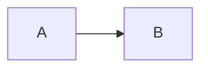

Qiita 連携の動作確認用の記事です。確認後に削除されます。

:::note info
これは `:::note info` ブロックです。
:::

:::note warn
これは `:::note warn` ブロックです。
:::

## HTML の扱い

div と span がそのまま表示されるか、除去されるかを確認します。Observed

## SVG 画像

> **図:** probe svg
>
> [図を開く (SVG)]({{SVG_URL}})

## Mermaid

## リンク

[ブログ](https://hdquangsgt.github.io/ja/blog/)
