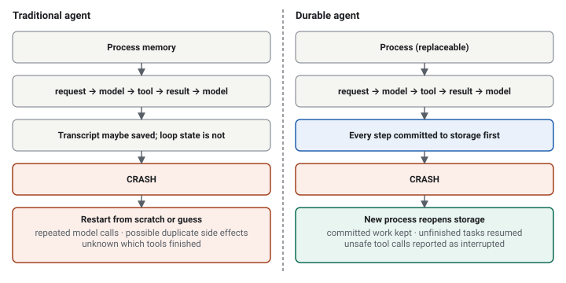
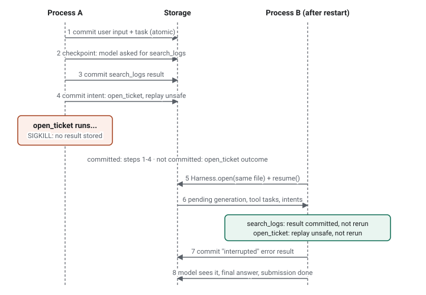

<div class="callout">

**この記事の読み方。** Pi Durable は若いプロジェクトで API も変わるため、主張にはラベルを付けている。

- <span class="label documented">ドキュメント</span>：公式のアナウンス、パッケージの README、または Cloudflare のドキュメントに記載されている内容。主張のすぐ横にリンクを示す。
- <span class="label verified">検証済み</span>：私が実際に動かして確認した内容。コードは本記事に載せている。リポジトリは公開していないので、ここからコピーしてほしい。
- <span class="label opinion">意見</span>：私の解釈。
- <span class="label proposal">提案</span>：設計から導けると私が考えるアーキテクチャ。パッケージが提供するものではない。

**バージョン。** 本記事の内容はすべて `@earendil-works/pi-durable` **1.3.0**、`@earendil-works/pi-ai` 1.3.0、`@earendil-works/chord` 1.3.0（2026 年 10 月 21 日時点の npm の `latest` タグ）を対象とし、Node.js 26.9.0 で実行した（パッケージは `node >=22.19.0` を宣言している）。Pi Durable は**実験的**であり、README は "the API changes without notice between releases." と述べている。ここに示すシグネチャはすべてスナップショットとして扱ってほしい。

</div>

## 1. 40 分のバグ調査が 38 分目で死ぬ

AI コーディングエージェントが、不安定な注文失敗を追っている。ログを grep し、4 つのファイルを読み、テストスイートを 2 回実行し、仮説を立てた。調査結果をチケットとして起票しようとしたところで、プロセスが kill される。デプロイ、メモリ不足による強制終了、閉じられたノート PC の蓋。原因は何でもよい。

何を失っただろうか。実行の記録がチャットのトランスクリプトだけなら、そのトランスクリプトを使ってエージェントを再起動できる。しかしトランスクリプトに書かれているのは「テストを実行した」ことであって、チケット作成の呼び出しがトラッカーまで届いたかどうかではない。直前のリクエストをそのまま再実行すれば、チケットが重複して作られるかもしれない。最初からやり直せば、同じモデル呼び出しの費用をもう一度払い、少し違う結論に着く。

これが**会話履歴**（何が語られたか）と**実行状態**（何が進行中で、何が完了し、何を二度実行してはならないか）の間にある溝である。単純なチャットツールならこれを無視できる。数分から数時間動き、サーバー上で、複数人に操作されるエージェントには無視できない。

本記事が追う問いは、*クラッシュしても最初からやり直さず、再開できるエージェントは作れるか* である。そして、もう少し居心地の悪い続きの問いがある。*「再開」は正確には何を約束し、何を約束しないのか。*

### 1.1 「Durable」が意味すること、意味しないこと

3 つの層があり、それぞれが前の層より多くを必要とする。

1. **会話の永続化。** 設定されたストレージにコミットされたエントリは、再起動後も残っている。
2. **実行の回復。** 再オープン時に、フレームワークは中断されたタスク（モデルリクエストやツール呼び出し）を見つけ、回復ルールを適用する。継続する、再送する、再実行する、あるいはタスクを中断として報告する、のいずれかである。
3. **エンドツーエンドのワークフローの耐久性。** 複数ステップのワークフローが安全に再開できる。ただしそれは、ストレージ、ツール、そしてツールが呼ぶ外部システムが、必要な保証を提供している場合に限る。フレームワークはそれを内側から用意することはできない。

内部状態が durable であることは、それだけでは次のことを**保証しない**。

- 外部の副作用が exactly-once で実行されること。
- 外部の操作が成功したか失敗したかを知ること。
- あらゆるインフラやストレージの障害から回復すること（プロセスの強制終了は、停電やディスク破損とは違う）。
- 冪等でない操作を安全にリトライできること。
- 外部システムとエージェントの内部状態の間の整合性。

これらのうちどれが得られるかは、障害の種類、ストレージの設定、フレームワークの回復ルール、そして各ツールの書き方によって決まる。第 5 節と第 6 節では、1 種類の障害（プロセスが kill される）を 1 種類のストレージ（SQLite）でテストし、テストがどこで終わるかを明示する。

## 2. Pi Durable とは何か

<div class="callout documented">

<span class="label documented">ドキュメント</span> Pi Durable は、JavaScript ランタイムがあればどこでも動く、長時間実行でクラッシュに耐えるエージェントのための TypeScript フレームワークである。[アナウンス](https://earendil.com/posts/pi-durable/)は、Pi 1.0 と同時に実験的にリリースされたと説明している。[README](https://github.com/joyanes97/pi-coding-agent/blob/main/packages/durable/README.md) はこのパッケージを durable agent harness と記述している。

</div>

アナウンスは、これが **Pi コーディングエージェントの置き換えではない**ことを明言している。別のフレームワークであり、コード（統一モデル API の `pi-ai` など）と設計原則を Pi と共有している。ここで得た教訓が Pi に戻ってくる可能性はある。

| | Pi コーディングエージェント | Pi Durable |
|---|---|---|
| 形 | 対話型のエージェント。1 人がターミナルで 1 つのプロセスを操作する | エージェントアプリケーションを作るためのライブラリ |
| 状態 | 操作している単一のプロセスとともにある | ストレージが信頼できる唯一の情報源であり、プロセスは入れ替え可能 |
| 典型的なホスト | 開発者のターミナル | バックエンドサービス、ボット、Cloudflare Durable Object |
| クライアント | 1 つ | 1 つの会話に任意の数が接続できる |

<div class="callout documented">

<span class="label documented">ドキュメント</span> アナウンスは、対象とするものを挙げている。任意のマシンで動き、複数のサーフェスから到達でき、非常に長い会話を扱え、クラッシュを生き延び、複数人が同じエージェントを操作できるエージェントである。

</div>

<div class="callout opinion">

<span class="label opinion">意見</span> Pi Durable を「Pi の本番版」と呼ぶのは適切ではないと思う。アナウンスは教訓の一部が戻ってくるかもしれないと述べており、両者はコードも共有しているが、現時点では、アプリケーションをその上に作るフレームワークであって、起動して使う製品ではない。

</div>

## 3. 従来のエージェントループが失うもの

従来のループは短い。

```text
User request → LLM → tool call → tool result → LLM → … → final response
```

作業状態はすべてプロセスの中にある。メッセージ配列、実行中のツール呼び出し、戻ってきた結果、キューに入ったフォローアップ。*メッセージ*を永続化すること（第 1.1 節の層 1）はよくある改善である。それによってトランスクリプトを表示し、検索し、続きから再開できる。しかしそれが解決するのは、クラッシュが生む問題とは別の問題である。クラッシュが生む問題とは、モデルリクエストが進行中だったこと、ツール呼び出しが途中だったことを知っていること（層 2）である。3 つ目の層である durable なワークフローは、タイマー、待機、子の作業を加え、そのすべてをチェックポイントする。

クラッシュ後、トランスクリプトしか持たないエージェントには次の問題がある。

- どのツール呼び出しが完了したのか判断できない。ツール結果がトランスクリプトに入るのは、ループがそれを書き込むところまで進んだ場合だけである。
- リトライが副作用を繰り返すかもしれない。チケットの重複、2 通目のメール、二重課金。
- ストリーミング出力や、書き込まれなかった中間結果は失われる。
- 最初からやり直すと、モデルのトークンをまた消費する。

Pi Durable は、ループの状態をストレージに移すことで、プロセスを使い捨てにできるようにする。



上の図は、本記事の後半で検証する回復フローである。まずは構成要素から見ていく。

## 4. アーキテクチャ


### 4.1 Harness

<div class="callout documented">

<span class="label documented">ドキュメント</span> harness とは "one open storage plus the machinery that runs agents on it."（開かれた 1 つのストレージと、その上でエージェントを動かす仕組み）である。すべての変更は 1 本の線上のアトミックなコミットを通り、コミットが保存される前に、オブザーバーに何かが見えることはない（[README, Concepts](https://github.com/joyanes97/pi-coding-agent/blob/main/packages/durable/README.md)）。

</div>

harness が担うのは、スケジューリング、モデル呼び出し、ツール実行、リトライ、コンパクションである。アプリケーションが担うのは、モデルの選択、どのツールが存在し何が再実行に安全か、クライアントの接続方法、認証、そしてコミット境界の外側にあるすべてである。

### 4.2 会話とエントリ

会話は**イミュータブルなエントリ**のトランスクリプトである。ユーザーメッセージ（`pi.user`）、モデルの応答（`pi.assistant`）、ツール結果（`pi.tool-result`）、システムプロンプトの変更（`pi.system`）、リセット（`pi.reset`）、そして自分で定義するエントリ種別がある。`Conversation` ハンドルは状態を持たないので、ハンドルは `id` で比較する。モデルが見るのは、最新のリセット以降のエントリである。

会話は、作成でき、ストレージから再開でき、履歴をコピーせずに別のトランスクリプトの任意の地点から fork できる（[アナウンス](https://earendil.com/posts/pi-durable/)）。

履歴が状態のすべてではない理由。トランスクリプトが語るのは、モデルが何を見たかである。どのタスクが保留中か、どのツール呼び出しに intent が記録されたが結果がないか、どの submission がキューにあるか。スケジューラが持つこれらの認識は、トランスクリプトの隣にある**ドキュメントとタスクレコード**（`pi.live`、`pi.inbox`、`pi.agent` など）に置かれている。

### 4.3 タスクとチェックポイント

<div class="callout documented">

<span class="label documented">ドキュメント</span> タスクとは "a durable state machine that saves a checkpoint at every step, so a restarted process continues from the last one."（すべてのステップでチェックポイントを保存する durable なステートマシンで、再起動したプロセスは最後のチェックポイントから続行する）である。すべてのタスクには所有者がいて、それは会話か別のタスクのどちらかである。README は、1 つの入力に答えるまでの流れを次のように示している。

</div>

```text
submit(input) → pi.user
  pi.generation → pi.system (only if the prompt or tools changed), pi.assistant (tool calls)
    pi.tool × n → pi.tool-result × n   (owned by the generation, which waits for them)
  pi.generation → pi.assistant (answer) → submission done
```

つまり、モデル呼び出しはタスク（`pi.generation`）であり、各ツール呼び出しもそれぞれ独立したタスク（`pi.tool`）である。再オープン時に harness は未完了のタスクを見つけ、タスクごとに、継続するか、リトライするか、中断を報告するかを決める。そのルールは第 5 節で示す。

### 4.4 ドキュメントとアトミックなコミット

**ドキュメント**とは、トランスクリプトとともに保存され、同じコミットで変更される型付きの JSON 状態である。`conversation.commit((tx) => …)` は、エントリの追加、ドキュメントの編集、タスクの作成をまとめて行える。"either all of it is stored or none of it."（すべてが保存されるか、何も保存されないか）である。組み込みのドキュメントは、エージェントの選択、キューにある submission、実行中の generation、消費量を保持する。独自のドキュメント（ToDo リスト、プランなど）も定義できる。

<div class="callout documented">

<span class="label documented">ドキュメント</span> このアトミック性は**ストレージの内側**に限られる。コミットに、課題管理システムへの HTTP 呼び出しを含めることはできない。アナウンスと README は外部サービスをまたぐトランザクションを主張しておらず、私も主張しない。

</div>

### 4.5 ストレージ

<div class="callout documented">

<span class="label documented">ドキュメント</span> [README のストレージ表](https://github.com/joyanes97/pi-coding-agent/blob/main/packages/durable/README.md)より。

</div>

| バックエンド | 再起動後も残る | 備考 |
|---|---|---|
| `MemoryStorage` | いいえ | テストとデモ用 |
| SQLite（`openNodeSqliteStorage`） | はい | WAL モード、`synchronous = NORMAL`。コミットはプロセスのクラッシュを生き延びるが、停電やホスト障害では最新のコミットが失われうる |
| JSONL（`openNodeJsonlStorage`） | はい | 追記専用のファイル。`{ fsync: true }` で各コミットマーカーの前にフラッシュする。履歴全体をメモリに保持するので、長時間動くエージェントには SQLite を使う |
| Cloudflare Durable Object | はい | `openDurableObjectSqliteStorage(ctx.storage)`。コミットはオブジェクトのストレージトランザクションになる |

SQLite と JSONL のコアは Node の API を使わないため、小さなアダプターを書けば Bun や Durable Object でも動く。ストレージインターフェースは別のストアに実装できるほど小さく、そのための適合性テストスイートもパッケージに同梱されている。

設計上重要な制約が 2 つある。**ストレージを所有できるのは同時に 1 つのプロセスだけで、プロセス間のロックはない**ことと、ストレージエラーが harness を閉じること（第 8 節）である。単一サーバーのサービスには SQLite、ホストが Cloudflare なら Durable Object、人間が読んで差分も取れるファイルが欲しければ JSONL、メモリはテストだけに使う。

## 5. クラッシュ回復の仕組み

ここでは、各ステップで何が起きるとドキュメントと私の実行結果が述べているのかを、シナリオに沿って示す。

1. ユーザーが「注文失敗を調査して」と submit する。モデルの作業が始まる前に、入力はコミットとして**durable に受理**される。
2. モデルが `search_logs` を要求する。ツールタスクは、`execute()` が走る*前*に、その **intent**（最終的な引数と replay ポリシー）を記録する（[README, Tools](https://github.com/joyanes97/pi-coding-agent/blob/main/packages/durable/README.md)）。
3. `search_logs` が終了し、その結果がコミットされる。
4. モデルが `open_ticket` を要求する。その intent がコミットされ、`execute()` が始まり、プロセスが kill される。
5. 新しいプロセスが同じストレージを開き、`resume()` を呼ぶ。
6. harness は未完了のタスクを見つける。コミット済みの状態はそのまま保たれる。
7. 中断されたツール呼び出しは、**replay ポリシー**で決まる。`replay: "safe"` と宣言されている場合に限り再実行する。そうでなければ、モデルはそれまでにコミットされた出力を含む `interrupted` エラー結果を受け取り、そこから実行が続く。

<div class="callout verified">

<span class="label verified">検証済み（ソース読解）</span> 1.3.0 の `dist/harness/tool.js` では、回復ハンドラは、intent とともに保存されたポリシー**と**ツールの現在の宣言の両方が `safe` と言っている場合に限り、呼び出しを再実行する。README が記述しているのは宣言されたフラグだけなので、デプロイの間にフラグが変更されたツールは、古い intent では再実行されない。

</div>

<div class="callout documented">

アナウンスと README は、回復できるそのほかの要素も説明している。

- <span class="label documented">ドキュメント</span> 中断された**モデルリクエスト**は再送され、部分的な回答は保持されて aborted として印が付く（[アナウンス](https://earendil.com/posts/pi-durable/)）。
- <span class="label documented">ドキュメント</span> **クラッシュループには上限がある**。`settings.restartLimit`（デフォルトは 5）による。上限を超えたタスクは parked（保留）状態になり、`harness.retryTask(id)` でリトライできる。
- <span class="label documented">ドキュメント</span> `requestId` を持つ submission は **exactly-once で受理**される。同じ ID を再送すると、既存の submission が返る。

</div>

この分類が核心である。

| クラッシュ時点の状態 | 回復 |
|---|---|
| コミット済み（エントリ、完了したツール結果、ドキュメント） | 保持される。再計算されない。 |
| 進行中のモデルリクエスト | 再送される。部分的な回答は保持され、aborted として印が付く |
| 進行中のツール呼び出し、`replay: "safe"` | 再実行される |
| 進行中のツール呼び出し、デフォルト | 再実行されない。モデルは `interrupted` エラーを受け取り、どうするかを決める |
| まだ memo されていない hook の判断 | 再実行される。判断は `api.memo`（最初の書き込みが勝つ）で保存する |

この表が示すのは*内部*状態に何が起きるかである。次の図は、ストレージには見えない部分を加える。同じライフサイクルに、2 つの境界を描き込んだものである。


**内部の耐久性境界**（青）に含まれるのは、設定されたストレージにコミットされたものだけである。**外部の副作用境界**（赤）に含まれるのは、ツールが外の世界に対して行ったことのすべてである。両者は別々のシステムで、共有するトランザクションがないため、クラッシュはその間に落ちうる。ステップ 6 では、トラッカーはストレージが何も知らないチケットを保持している。intent は「呼び出す直前」と言い、結果がないことは「不明」と言うが、「起きた」と言うものはどこにもない。したがって回復は真実を復元できず、ポリシーを適用するだけであり、結果が分かれるのはそのポリシーの部分である。第 6.5 節で両方の分岐をテストする。

### これが保証しないこと

<div class="callout documented">

<span class="label documented">ドキュメント</span> ツールから呼ばれるツール呼び出しについての README は、はっきり述べている。"a replay-safe tool with external effects still needs its own idempotency."（外部への効果を持つ replay-safe なツールにも、独自の冪等性が必要である）。durable な実行は、外の世界の exactly-once 実行ではない。

</div>

上の図の曖昧さの窓を考えてみよう。`open_ticket` がトラッカーを呼び、トラッカーがチケットを作成し、結果がコミットされる前にプロセスが死んだ。harness には知りようがない。デフォルトのポリシーでは呼び出しを再実行せず、モデルには呼び出しが "was interrupted and may have partially run"（中断され、部分的に実行された可能性がある）と伝えられる。その後に取れる誠実な選択肢は、アプリケーション側のものである。

- **プルリクエストを開く。** 作成する前に、そのブランチの open な PR を検索する。決定的なブランチ名は、自然な冪等性キーになる。
- **メールを送る。** プロバイダーが重複排除するメッセージ ID を渡すか、キー付きで「送信の意図」をログに残し、リトライの前にプロバイダーを確認する。
- **データベースを更新する。** 書き込みを、インクリメントではなく、リクエストをキーとする upsert にする。

<div class="callout opinion">

<span class="label opinion">意見</span> `replay` フラグは、ツールの作者が書く最も重要な 1 行である。「safe」は、*再実行しても害がない*ことを意味すべきであり、「たいていうまくいく」ことではない。読み取りは safe である。課金する、送信する、作成するといったものは、冪等性キーを持つまでは safe ではない。

</div>



## 6. ハンズオン：`kill -9` を生き延びる durable なエージェント

ここのコードはすべて、上記のバージョンで実行した。faux provider がモデルの役を演じるので、テストは決定的で、API キーも不要である。チュートリアルでは、模擬した障害ではなく、本物の `SIGKILL` を使う。

### 6.1 セットアップ

```bash
mkdir pi-durable-demo && cd pi-durable-demo
npm init -y && npm pkg set type=module
npm install @earendil-works/pi-durable @earendil-works/pi-ai @earendil-works/chord
npm install -D typescript @types/node
```

パッケージが宣言しているのは Node 22.19 以降である。私が使ったのは Node 26 で、`.ts` ファイルを直接実行できる（型ストリッピング）ので、デモにビルド手順は要らない。実際のモデルを使うなら、faux provider を、たとえば `@earendil-works/pi-ai/providers/openai` の `openaiProvider()` のようなものに置き換える。これは `OPENAI_API_KEY` を読む（[README, Quick Start](https://github.com/joyanes97/pi-coding-agent/blob/main/packages/durable/README.md)）。ストレージは SQLite ファイルを開くことで初期化され、初回の使用時に作成される。

サンプルは `src/` 以下の 7 ファイルである。`agent.ts`、`worker.ts`、`demo.ts`（第 6.2 節から第 6.4 節）と、`tracker.ts`、`agent-tracker.ts`、`worker-tracker.ts`、`demo-tracker.ts`（第 6.5 節）。リンクできるリポジトリがないため、そのすべてを以下に全文掲載する。

### 6.2 ツール、モデル、harness

`src/agent.ts` は 2 つのツールを定義する。`search_logs` は読み取るだけなので `replay: "safe"` にする。`open_ticket` は外部への効果を持つので、デフォルトのままにする。どちらも ledger ファイルに追記するので、プロセスをまたいで実際の実行回数を数えられる。クラッシュモードでは、`open_ticket` は ledger に書き込んだあとで自分自身のプロセスを kill する。

```ts
import { appendFile } from "node:fs/promises";
import { BACKGROUND_CONTEXT } from "@earendil-works/chord/context";
import { Type } from "@earendil-works/pi-ai";
import { createModels } from "@earendil-works/pi-ai/models";
import { fauxAssistantMessage, fauxProvider, fauxText, fauxToolCall } from "@earendil-works/pi-ai/providers/faux";
import { createRegistry, defineExtension, defineTool, Harness } from "@earendil-works/pi-durable";
import { openNodeSqliteStorage } from "@earendil-works/pi-durable/storage/sqlite/node";

export const context = BACKGROUND_CONTEXT;

export async function ledger(file: string, line: string) {
	await appendFile(file, `${line}\n`);
}

export function createAgent(ledgerFile: string, crashInTicketTool: boolean) {
	const searchLogs = defineTool({
		name: "search_logs",
		description: "Search the service logs for a pattern",
		parameters: Type.Object({ pattern: Type.String() }),
		replay: "safe",
		execute: async (args) => {
			await ledger(ledgerFile, `search_logs ${args.pattern}`);
			return { output: [{ type: "text", text: "3 matches: NullPointerException in OrderService.java:42" }] };
		},
	});

	const openTicket = defineTool({
		name: "open_ticket",
		description: "Open a ticket in the issue tracker",
		parameters: Type.Object({ title: Type.String() }),
		execute: async (args) => {
			await ledger(ledgerFile, `open_ticket ${args.title}`);
			if (crashInTicketTool) process.kill(process.pid, "SIGKILL"); // no cleanup, no close()
			return { output: [{ type: "text", text: "Opened TICKET-1" }] };
		},
	});

	const registry = createRegistry();
	registry.install(defineExtension({ name: "triage", tools: [searchLogs, openTicket] }));

	// A scripted model that decides from the transcript, so every process behaves the same.
	const faux = fauxProvider();
	const call = (name: string, args: Record<string, string>, id: string) =>
		fauxAssistantMessage([fauxToolCall(name, args, { id })], { stopReason: "toolUse" });
	faux.setResponses(
		Array.from({ length: 10 }, () => (ctx) => {
			const last = ctx.messages[ctx.messages.length - 1];
			if (last.role === "toolResult" && last.toolName === "open_ticket") {
				return fauxAssistantMessage([
					fauxText(last.isError ? "The ticket call was interrupted; check the tracker before retrying." : "Ticket opened."),
				]);
			}
			if (last.role === "toolResult" && last.toolName === "search_logs") {
				return call("open_ticket", { title: "NPE in OrderService" }, "t1");
			}
			return call("search_logs", { pattern: "NullPointerException" }, "s1");
		}),
	);
	const models = createModels();
	models.setProvider(faux.provider);
	return { models, registry };
}

export async function openHarness(dbFile: string, ledgerFile: string, crash: boolean) {
	const { models, registry } = createAgent(ledgerFile, crash);
	const harness = await Harness.open(await openNodeSqliteStorage(dbFile), { models, registry }, context);
	const root = await harness.root(context, { agent: { model: { provider: "faux", modelId: "faux-1" } } });
	return { harness, root };
}
```

**本番に関係する部分：** `replay` フラグを持つ `defineTool`、`createRegistry` と `defineExtension`、永続ストレージを使う `Harness.open`、そして `requestId` を付けた `root.submit`。**テスト専用の足場：** ledger ファイル、ツールの中の `process.kill`、そしてスクリプト化された応答を持つ faux provider。

各オプションの役割。`Harness.open(storage, { models, registry }, context)` は 1 つのストレージを開き、モデルレジストリと自分の拡張機能を結びつける。`harness.root()` はルート会話を返し、初回の使用時には、与えられたエージェントの選択で作成する。すべての非同期呼び出しはキャンセルを運ぶ Chord の `Context` を取る。`BACKGROUND_CONTEXT` は決してキャンセルされず、待機のキャンセルが取り消すのは待機だけで、作業そのものは取り消さない。

### 6.3 タスクを submit する

`src/worker.ts` が、これから kill するプロセスである。`requestId` 付きで submit し、未完了の作業を再開し、待機する。

```ts
import { context, openHarness } from "./agent.ts";

const [dbFile, ledgerFile, mode] = process.argv.slice(2);
const { harness, root } = await openHarness(dbFile, ledgerFile, mode === "crash");

const submission = await root.submit(
	{ type: "input", content: "Investigate the order failures.", requestId: "investigate-1" },
	context,
);
harness.resume(); // continue anything the previous process left unfinished
const settled = await submission.wait(context);
console.log(JSON.stringify({ submission: submission.id, status: settled.status }));
await harness.close(context);
```

`submit()` は入力を durable に受理して `Submission` を返す。`wait()` は `done` か `unanswered` で解決する。generation と 2 つのツール呼び出しはタスクであり、そのエントリはコミットされるたびにトランスクリプトへ入る。

### 6.4 クラッシュ、再起動、検証

`src/demo.ts` が制御されたテストである。プロセス 1 はクラッシュモードで動き、`SIGKILL` で死ななければならない。プロセス 2 は同じ SQLite ファイルで通常どおり動く。そのあとデモは、ledger とトランスクリプトに対してアサーションを行う。

```ts
import assert from "node:assert/strict";
import { spawnSync } from "node:child_process";
import { mkdtemp, readFile } from "node:fs/promises";
import { tmpdir } from "node:os";
import { join } from "node:path";
import type { ToolResultMessage } from "@earendil-works/pi-ai";
import { ToolResultEntry } from "@earendil-works/pi-durable";
import { context, openHarness } from "./agent.ts";

const dir = await mkdtemp(join(tmpdir(), "pi-durable-demo-"));
const db = join(dir, "agent.sqlite");
const ledgerFile = join(dir, "ledger.txt");
const run = (mode: string) =>
	spawnSync(process.execPath, ["src/worker.ts", db, ledgerFile, mode], { encoding: "utf8" });

const first = run("crash"); // 1. dies with SIGKILL inside open_ticket
console.log("process 1 signal:", first.signal);
assert.equal(first.signal, "SIGKILL");

const second = run("normal"); // 2. reopens the same file and resumes
console.log("process 2 output:", second.stdout.trim());
assert.equal(second.status, 0, second.stderr);
assert.equal(JSON.parse(second.stdout).status, "done");

const lines = (await readFile(ledgerFile, "utf8")).trim().split("\n"); // 3. verify
console.log("ledger:", lines);
assert.equal(lines.filter((l) => l.startsWith("open_ticket")).length, 1, "ticket tool must not rerun");
assert.equal(lines.filter((l) => l.startsWith("search_logs")).length, 1, "search_logs finished before the crash");

const { harness, root } = await openHarness(db, ledgerFile, false);
const page = await root.entries({}, 50, undefined, context);
const results = [...page.items].reverse().filter(ToolResultEntry.is).map((e) => e.model![0] as ToolResultMessage);
for (const r of results) console.log(r.toolName, "isError:", r.isError, JSON.stringify(r.content));
assert.equal(results.find((r) => r.toolName === "search_logs")?.isError, false);
assert.equal(results.find((r) => r.toolName === "open_ticket")?.isError, true);
await harness.close(context);
console.log("OK");
```

`node src/demo.ts` で実行する。私の実行での出力は次のとおり。

```text
process 1 signal: SIGKILL
process 2 output: {"submission":8,"status":"done"}
ledger: [
  'search_logs NullPointerException',
  'open_ticket NPE in OrderService'
]
search_logs isError: false [{"type":"text","text":"3 matches: NullPointerException in OrderService.java:42"}]
open_ticket isError: true [{"type":"text","text":"<harness>\n[error] Tool open_ticket was interrupted and may have partially run\n</harness>"}]
OK
```

<div class="callout verified">

<span class="label verified">検証済み</span> `tsc --strict` は 7 つのサンプルファイルすべてで通り、両方のデモのアサーションが私の実行で成立した。

</div>

### 6.5 2 つ目のシナリオ：効果は着地し、結果は着地しない

最初のデモの ledger は試行回数を数えるだけだった。ここでは、それをモックのトラッカーに置き換える。トラッカーはエージェントのストレージの外にあるファイルに本物のチケットを保持するので、クラッシュ後に境界の両側を調べられる。同じクラッシュを 3 回実行し、変えるのは `open_ticket` の宣言の仕方だけである。

- **default：** `replay` フラグなし。
- **safe, no key：** `replay: "safe"`、冪等性キーなしでトラッカーを呼ぶ。
- **safe, keyed：** `replay: "safe"`、キー `ticket:<title>` を付けてトラッカーを呼ぶ。

`src/tracker.ts` が外部システムである。これはテスト専用の足場であり、`key` による重複排除は、実際のプロバイダーの冪等性キーが行うことの代役である。

```ts
import { existsSync, readFileSync, writeFileSync } from "node:fs";

export type Ticket = { id: string; title: string; key?: string };

const read = (file: string): Ticket[] => (existsSync(file) ? JSON.parse(readFileSync(file, "utf8")) : []);

export function listTickets(file: string): Ticket[] {
	return read(file);
}

// With an idempotency key the tracker deduplicates, like a real provider would. Without one it cannot.
export function createTicket(file: string, title: string, key?: string): Ticket {
	const tickets = read(file);
	const existing = key === undefined ? undefined : tickets.find((t) => t.key === key);
	if (existing) return existing;
	const ticket: Ticket = { id: `TICKET-${tickets.length + 1}`, title, key };
	writeFileSync(file, JSON.stringify([...tickets, ticket]));
	return ticket;
}
```

`src/agent-tracker.ts` がツールを持つ。重要な 2 行には印を付けてある。外部への効果、そして結果がコミットされる前のクラッシュである。

```ts
import { Type } from "@earendil-works/pi-ai";
import { createModels } from "@earendil-works/pi-ai/models";
import { fauxAssistantMessage, fauxProvider, fauxText, fauxToolCall } from "@earendil-works/pi-ai/providers/faux";
import { createRegistry, defineExtension, defineTool, Harness } from "@earendil-works/pi-durable";
import { openNodeSqliteStorage } from "@earendil-works/pi-durable/storage/sqlite/node";
import { context } from "./agent.ts";
import { createTicket } from "./tracker.ts";

export type Policy = "default" | "safe-naive" | "safe-keyed";

export async function openHarness(dbFile: string, trackerFile: string, policy: Policy, crash: boolean) {
	const openTicket = defineTool({
		name: "open_ticket",
		description: "Open a ticket in the issue tracker",
		parameters: Type.Object({ title: Type.String() }),
		...(policy === "default" ? {} : { replay: "safe" as const }),
		execute: async (args) => {
			const key = policy === "safe-keyed" ? `ticket:${args.title}` : undefined;
			const ticket = createTicket(trackerFile, args.title, key); // 1. the external effect happens
			if (crash) process.kill(process.pid, "SIGKILL"); // 2. the process dies before the result is committed
			return { output: [{ type: "text", text: `Opened ${ticket.id}` }] };
		},
	});
	const registry = createRegistry();
	registry.install(defineExtension({ name: "tracker", tools: [openTicket] }));

	const faux = fauxProvider();
	faux.setResponses(
		Array.from({ length: 10 }, () => (ctx) => {
			const last = ctx.messages[ctx.messages.length - 1];
			if (last.role === "toolResult") {
				return fauxAssistantMessage([fauxText(last.isError ? "The ticket call was interrupted." : "Ticket opened.")]);
			}
			return fauxAssistantMessage([fauxToolCall("open_ticket", { title: "NPE in OrderService" }, { id: "t1" })], {
				stopReason: "toolUse",
			});
		}),
	);
	const models = createModels();
	models.setProvider(faux.provider);
	const harness = await Harness.open(await openNodeSqliteStorage(dbFile), { models, registry }, context);
	const root = await harness.root(context, { agent: { model: { provider: "faux", modelId: "faux-1" } } });
	return { harness, root };
}
```

`src/worker-tracker.ts` は、`worker.ts` に引数としてポリシーを加えたものである。

```ts
import { context } from "./agent.ts";
import { openHarness, type Policy } from "./agent-tracker.ts";

const [dbFile, trackerFile, policy, mode] = process.argv.slice(2);
const { harness, root } = await openHarness(dbFile, trackerFile, policy as Policy, mode === "crash");
const submission = await root.submit({ type: "input", content: "Open a ticket for the NPE.", requestId: "ticket-1" }, context);
harness.resume();
const settled = await submission.wait(context);
console.log(JSON.stringify({ status: settled.status }));
await harness.close(context);
```

`src/demo-tracker.ts` は、各バリアントを 2 つの本物のプロセス（クラッシュ、そして回復）で実行し、トラッカーとトランスクリプトを読み、その両方に対してアサーションを行う。

```ts
import assert from "node:assert/strict";
import { spawnSync } from "node:child_process";
import { mkdtemp } from "node:fs/promises";
import { tmpdir } from "node:os";
import { join } from "node:path";
import type { ToolResultMessage } from "@earendil-works/pi-ai";
import { ToolResultEntry } from "@earendil-works/pi-durable";
import { context } from "./agent.ts";
import { openHarness, type Policy } from "./agent-tracker.ts";
import { listTickets } from "./tracker.ts";

// Crash after the tracker created the ticket but before the tool result is committed; restart; inspect both sides.
async function scenario(policy: Policy) {
	const dir = await mkdtemp(join(tmpdir(), "pi-durable-tracker-"));
	const db = join(dir, "agent.sqlite");
	const tracker = join(dir, "tracker.json");
	const run = (mode: string) => spawnSync(process.execPath, ["src/worker-tracker.ts", db, tracker, policy, mode], { encoding: "utf8" });

	const first = run("crash");
	assert.equal(first.signal, "SIGKILL");
	const afterCrash = listTickets(tracker).length;

	const second = run("normal"); // the recovery process runs the same tool with crash disabled
	assert.equal(second.status, 0, second.stderr);
	assert.equal(JSON.parse(second.stdout).status, "done");

	const { harness, root } = await openHarness(db, tracker, policy, false);
	const page = await root.entries({}, 50, undefined, context);
	const result = [...page.items].reverse().filter(ToolResultEntry.is).map((e) => e.model![0] as ToolResultMessage)[0];
	await harness.close(context);
	return { afterCrash, tickets: listTickets(tracker), result };
}

const out: Record<string, Awaited<ReturnType<typeof scenario>>> = {};
for (const policy of ["default", "safe-naive", "safe-keyed"] as const) {
	out[policy] = await scenario(policy);
	const o = out[policy];
	console.log(policy, "| tickets in tracker after crash:", o.afterCrash, "| after recovery:", o.tickets.length, "| tool result isError:", o.result.isError, JSON.stringify(o.result.content));
}

// A. Default policy: the ticket exists externally, the harness does not rerun, and its record says "interrupted", not "created".
assert.equal(out.default.afterCrash, 1);
assert.equal(out.default.tickets.length, 1, "default policy must not rerun the tool");
assert.equal(out.default.result.isError, true);
assert.ok(!JSON.stringify(out.default.result.content).includes("TICKET-1"), "internal state never learned the ticket id");

// B. replay: "safe" without a key: the tool reruns and the tracker holds a duplicate.
assert.equal(out["safe-naive"].tickets.length, 2, "safe replay with no idempotency key duplicates the effect");
assert.equal(out["safe-naive"].result.isError, false);

// C. replay: "safe" with a key: the tool reruns, the tracker deduplicates, and the committed result carries the id.
assert.equal(out["safe-keyed"].tickets.length, 1);
assert.equal(out["safe-keyed"].result.isError, false);
assert.ok(JSON.stringify(out["safe-keyed"].result.content).includes("TICKET-1"));
console.log("OK");
```

`node src/demo-tracker.ts` で実行する。私の実行での出力は次のとおり。

```text
default | tickets in tracker after crash: 1 | after recovery: 1 | tool result isError: true [{"type":"text","text":"<harness>\n[error] Tool open_ticket was interrupted and may have partially run\n</harness>"}]
safe-naive | tickets in tracker after crash: 1 | after recovery: 2 | tool result isError: false [{"type":"text","text":"Opened TICKET-2"}]
safe-keyed | tickets in tracker after crash: 1 | after recovery: 1 | tool result isError: false [{"type":"text","text":"Opened TICKET-1"}]
OK
```

| 宣言 | クラッシュ後のチケット数 | 回復後のチケット数 | コミットされたツール結果 |
|---|---|---|---|
| default | 1 | 1 | `interrupted` エラー |
| `replay: "safe"`、キーなし | 1 | **2** | `Opened TICKET-2` |
| `replay: "safe"`、キーあり | 1 | 1 | `Opened TICKET-1` |

<div class="callout verified">

<span class="label verified">検証済み</span> 1.3.0 とモックのトラッカーでの結果。どのクラッシュの後も最初のチケットは存在する。デフォルトのポリシーはツールを再実行せず、チケットに一切触れない `interrupted` エラーをコミットする。replay-safe なツールは再実行され、キーがなければトラッカーには重複が残る。ストレージとトラッカーは、1 行目（チケットは存在するのに、トランスクリプトはそれを語らない）と 2 行目（トランスクリプトは `TICKET-2` を挙げ、`TICKET-1` は孤立する）で食い違っている。

</div>

ここから持ち帰ること。

- **default も safe も、真実を回復しない。** default は曖昧さを正直に報告し、突き合わせ（reconciliation）をアプリケーションに任せる。`replay: "safe"` は、再実行しても害はないと推測することでそれを解決するが、これが正しいのは、その効果が冪等な場合だけである。
- **keyed の行は、ツール作者の仕事である。** チケットが 1 つなのは、ツールがキーを送り、サービスがそのキーで重複排除したからである。Pi Durable は何もしておらず、README もそう述べている。外部への効果を持つ replay-safe なツールにも、独自の冪等性が必要である。
- <span class="label proposal">提案</span> default の行については、突き合わせの手順はアプリケーション側に置く。リトライの前に、トラッカーでそのキーによってチケットを検索する。ここではそれを実装もテストもしていない。

### 6.6 これが証明すること、証明しないこと

2 つのデモを合わせると、テストしたバージョンとこれらのシナリオについて、次のことが示される。

- コミット済みの状態は `SIGKILL` を生き延びる。再オープン後も、`search_logs` の結果とトランスクリプトは無傷である。
- 完了していた読み取り専用のツールは、2 回ではなく 1 回だけ実行された。
- 進行中だった replay-safe でないツールは、再実行されなかった。ledger には `open_ticket` の開始が 1 回だけ記録され、モデルは呼び出しが中断されたと伝えられた。それだけでは、チケットが存在するかどうかは何も分からない。第 6.5 節では、それを知っているトラッカーを加えた。
- 2 つ目のプロセスで、実行は `done` に到達した。
- クラッシュを生き延びる状態を持つトラッカーでは、デフォルトのポリシーは、チケットが外部に存在するのに、コミットされたトランスクリプトには `interrupted` だけが記録される状態を残す。`replay: "safe"` はツールを再実行し、トラッカーがキーで重複排除しない限り、チケットを重複させる（第 6.5 節）。

次のことは**示していない**。

- harness が `open_ticket` の結果を知っていること。知らない。デフォルトポリシーでの回復後、ストレージが持つのは `interrupted` エラーだけであり、チケットが存在するかどうかを知っているのはトラッカーだけである。
- いかなる意味での exactly-once の振る舞い。keyed のバリアントがチケットを 1 つにするのは、*私のモックのトラッカーが重複排除する*からである。それはツールとサービスの性質であって、Pi Durable の性質ではない。
- 実際のトラッカーとの統合。モックは JSON ファイルである。タイムアウト、部分的なレスポンス、トラッカー自体が一時的に使えない状況は、シミュレートしていない。
- 停電時の振る舞い。WAL モードで `synchronous = NORMAL` の SQLite は、停電時に最新のコミットを失う可能性がある（[README](https://github.com/joyanes97/pi-coding-agent/blob/main/packages/durable/README.md)）。プロセスの `SIGKILL` は、それより穏やかな障害である。
- 実際のモデルの振る舞い。faux provider はスクリプト化されている。実際のモデルは、中断された結果に対して、呼び出しをリトライする、人間に尋ねる、あきらめる、のいずれかで反応するかもしれない。それはテストしていない。
- 再送されるモデルリクエスト。アナウンスはそれを記述しているが、私がプロセスを kill したのは常にツールの内部であり、generation の途中ではない。
- ほかの地点でのクラッシュ。すべてのテストは、intent のコミット後の `execute()` の内部でプロセスを kill している。ツールが戻ってから結果がコミットされるまでの間のクラッシュも同じ形をしているが、それを個別に注入してはいない。
- 並行性、複数のクライアント、コンパクション、Cloudflare でのホスティング。

## 7. 単一の会話を超えて

<div class="callout documented">

<span class="label documented">ドキュメント</span> パッケージは、次のものを直接サポートしている。

- **harness あたり複数の会話。** 1 つの harness が多数の会話を並行して動かし、それぞれが自分専用の保存されたエージェント（モデル、thinking レベル、拡張機能、ツール、指示、作業ディレクトリ）を持つ。レビュー用の会話には、より安価なモデルと読み取り専用のツールを使える。
- **Fork。** 会話は、履歴をコピーせずに、別の会話のトランスクリプトの任意の地点から fork できる。アナウンスの例は、チャンネルのメッセージから fork された Slack のスレッドである。
- **複数のクライアント。** 任意の数のクライアントが 1 つの会話に接続でき、現在のビューとそれ以降の差分更新を受け取り、実行中の会話を操作したり、フォローアップをキューに入れたりできる。
- **サブエージェント**は、所有される会話を作るツールから組み立てる。アナウンスは、組み込みのサブエージェントはないと述べている。
- **会話ごとの環境。** `env` 関数が、各会話のツールをどこで動かすかを選ぶ。ノート PC、リモートの VM、インメモリのサンドボックスなどである。

</div>

<div class="callout proposal">

<span class="label proposal">提案</span> これらの部品から導けるが、出荷されてはいないパターンがある。

- デプロイツールに対する人間の承認ゲート。ブロックする `beforeTool` フックを使い、承認の判断を `api.memo` で保存して、クラッシュしても二度尋ねないようにする。アナウンスはこの方向の承認ゲートの例を示している。周辺の承認 UI は自分で作る。
- 受け取った課題 1 件ごとを 1 つの会話とし、ワーカーがキューの背後で自由に再起動するトリアージサービス。

</div>

README とアナウンスが述べる範囲で、組み込まれて*いない*ものは、マルチユーザーの認可、テナント分離、プロセスをまたぐ分散協調である。ストレージを所有するのは 1 つのプロセスで、ほかのクライアントはそのプロセスを通じて接続する。複数のワーカーが必要なら、会話をストレージに分割するのは自分の仕事である。

<div class="callout documented">

<span class="label documented">ドキュメント</span> Cloudflare については、[Pi harness のドキュメント](https://developers.cloudflare.com/agents/harnesses/pi/)が `PiHarness` を説明している。これは Pi のテーブルを Durable Object の SQLite データベースに保存し、ハートビートのジョブ（30 秒ごと）で退避された（evicted）オブジェクトを再起動して、Pi が再開できるようにする。そのページは `PiHarness` を beta と明記し、独自の制限も挙げている。たとえば、ツール呼び出しの承認ステップがまだないこと、カーソルから再開できないイベントストリーム、アラームの呼び出しが 15 分に制限されていることなどである。

</div>

## 8. 本番運用で考えること

各項目について、パッケージが提供するものと、自分のものとして残るものを示す。

**実験的な API とバージョン管理。** *パッケージ：* 変更履歴（changelog）が npm パッケージに同梱されている。*あなた：* バージョンを正確に固定し、アップグレードのたびに changelog を読み、挙動の変化がビルドの失敗として現れるように、エンドツーエンドのクラッシュテスト（第 6 節のようなもの）を CI に置く。README は、API が予告なく変わると述べている。

**ストレージの耐久性。** *パッケージ：* アトミックなコミットと、バックエンドごとに定義されたポリシー。ストレージエラーは harness を終了させ、再オープン時には "commits are atomic, so the store is consistent"（コミットはアトミックなので、ストアは整合している）（[README, Errors](https://github.com/joyanes97/pi-coding-agent/blob/main/packages/durable/README.md)）。harness は何もリトライしない。カスタムストレージは、自分の一時的な障害を自分でリトライする。*あなた：* 最新のコミットを失うことが許されないなら `fsync` かそれに相当するものを選び、ファイルをバックアップし、ディスク自体が使えない、あるいは壊れた場合にどうするかを決める。パッケージはそれを修復するとは主張していない。

**ツールの replay と冪等性。** *パッケージ：* 実行前に記録される intent、`replay` フラグ、submission のための `requestId`、hook の判断のための `memo`。*あなた：* すべての外部への効果に冪等性キーを付けること、そして「部分的に実行された可能性がある」ケースの突き合わせ。

**モデルのコンテキスト。** *パッケージ：* コンパクションはバックグラウンドのタスクとして動き、ターンの境界で要約を作る。プロバイダーがリクエストを長すぎるとして拒否した場合、harness はコンパクションして 1 回だけリトライする。古いメッセージはストレージに残る。*あなた：* 履歴が永続化されていることは、それがウィンドウに収まることを意味しない。コンパクションの設定（`reserveTokens` とモデルごとのオーバーライド）を選び、引き継ぎメモに何を残すかを決める。

**可観測性。** *パッケージ：* 報告されたエラーのための `onReport`、`harness.inspect()` とタスクグラフのビュー、使用量とコストのドキュメント、正確なコミットのための `watch()`、コーディングエージェント風のイベントのための `watchEvents()`。*あなた：* これらをログとメトリクスに流し、parked になったタスク（`restartLimit` に達したもの）にアラートを設定し、止まったタスクに目を配る。

**セキュリティ。** *パッケージ：* 会話ごとのツールセットと環境、誰がツールを呼べるかを決める `callers`、呼び出しをブロックまたは書き換える hook。*あなた：* 環境変数かシークレットマネージャーに置く API キー、SQLite ファイルのファイル権限（会話全体とツール出力が入っている）、`afterTool` hook でのリダクション、そしてテナント分離。ドキュメントにテナント分離は見つからなかったので、自分の仕事だと考えておくこと。

**運用上の信頼性。** *パッケージ：* クラッシュループの上限、`retryTask`、ホストが障害時に再オープンできるようにする `harness.closed`。*あなた：* 再起動のスーパーバイザー、バックアップ、定期的な回復訓練、そして parked のままのタスクのためのランブック。

## 9. どんなときに使うか

| ユースケース | 従来のエージェントワークフロー | durable なエージェントワークフロー |
|---|---|---|
| ターミナルでの対話的なコーディングセッション | 向いている。セッションを失っても数分の損失で済む。 | 不要なオーバーヘッド |
| 夜通しのリサーチやマイグレーションのジョブ | クラッシュすると最初からやり直し | 最後のチェックポイントから再開し、消費は繰り返されない |
| チーム向けのバックエンドボット | プロセスごとの状態。再起動で進行中の作業が失われる | 自然な適合。ストレージが信頼できる唯一の情報源 |
| 高価、または取り消せないツールを使うワークフロー | リトライは場当たり的 | replay ポリシーが、ツールごとに決めることを強いる |
| 短くステートレスな Q&A | 問題ない | 不要 |

重要な判断基準は、実行がどれだけ続くか、中間の作業を失うとどれだけ（金額や副作用で）コストがかかるか、プロセスがどれくらいの頻度で中断されるか、人間が同じエージェントに接続する必要があるか、そして運用の表面積（ストレージ、バックアップ、再起動のスーパーバイザー）を負担できるか、である。

<div class="callout opinion">

<span class="label opinion">意見</span> durable であることは無料ではなく、普遍的に優れているわけでもない。ストレージへの依存、すべてのツールに適用しなければならない replay の規律、そして実験的な API が加わる。失われた実行のコストが 2 分なら、それに対価を払う必要はない。

</div>

## 10. まとめ

- 長時間動くエージェントには、会話履歴以上のものが必要である。何がコミットされ、何が進行中で、何が繰り返されてよいかを知っている必要がある。
- Pi Durable はそれを明示的にする。すべてのステップがチェックポイントされるタスクであり、すべての変更がアトミックなコミットであり、すべてのツールが、再実行が安全かどうかを宣言する。
- 外部への効果の exactly-once 実行は提供しない。`interrupted` という結果は、結果が曖昧であることを harness が伝えているのであり、それを解決するのは自分である。
- 回復は、仮定するものではなく、テストする振る舞いである。上のデモは、私が CI に残しておきたい種類のテストである。
- 小さなプルーフオブコンセプトから始め、実験的なパッケージを重要なワークロードに向ける前には慎重になること。

*エージェントが障害のあとに確実に作業を再開できるとしたら、あなたは何を作るだろうか。*

## 参考文献

以下は、執筆中に参照したものすべてである。そこから得た主張は、本文の近くにリンクしてある。

- Earendil、[Pi Durable announcement](https://earendil.com/posts/pi-durable/)。
- [`@earendil-works/pi-durable` の README](https://github.com/joyanes97/pi-coding-agent/blob/main/packages/durable/README.md)（npm パッケージにも同梱、バージョン 1.3.0）。
- Cloudflare、[Pi harness on Cloudflare Agents](https://developers.cloudflare.com/agents/harnesses/pi/)。
- npm パッケージ `@earendil-works/pi-durable`、`@earendil-works/pi-ai`、`@earendil-works/chord`、バージョン 1.3.0。サンプルを書くために、その型定義を読んだ。
- リポジトリの `13-recovery.ts` サンプル。`memo` と、再オープンしてから続行するパターンを示していた。
