## AI エージェントの Thinking Effort を理解する

<p class="slide-kicker">第I部 · 思い込みを問い直す</p>

**AI に「もっと考えさせる」ことが、なぜ常に良い結果につながるとは限らないのか。**

thinking effort の設定は実際に何を変えるのか、そしていつ上げるべきなのか。このスライドは、この問いを 18 枚のスライドで追う。概念、reasoning とエージェント実行の違い、実際のエンジニアリング事例、そして直感ではなく証拠で判断する方法である。

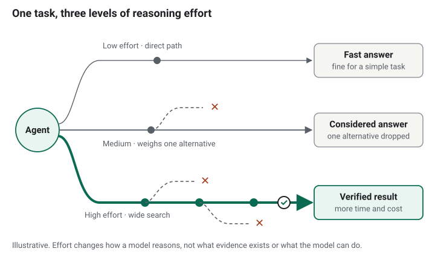

<div class="callout article-only">

**この記事の読み方。** 主張にはラベルが付いている。<span class="label documented">ドキュメント</span>は、すぐ横にリンクした公式ドキュメントに基づく内容、<span class="label opinion">意見</span>は筆者の解釈、<span class="label proposal">提案</span>は筆者が推奨するアーキテクチャで、どのベンダーも提供しているものではない。図は、キャプションに断りがない限り概念図である。API に関する事実は 2026 年 10 月 22 日時点のベンダーのドキュメントで確認した。モデル名や受け付けられる値は頻繁に変わるため、コピーする前にリンク先を確認してほしい。

</div>

## 同じモデル、同じプロンプトなのに結果が違う？

<p class="slide-kicker">第I部 · 思い込みを問い直す</p>

同じに見えるリクエストを 2 回実行して、1 回目はきれいな答え、2 回目は的外れな答えが返ってくることがある。ある設定のせいにする前に、変わったものをすべて挙げてみよう。タスクには、道が 1 つしかなく直接解けるものがある。一方で、妥当な道が複数あり、システムが慎重に検討したり追加の証拠を集めたりすると答えが良くなるものもある。

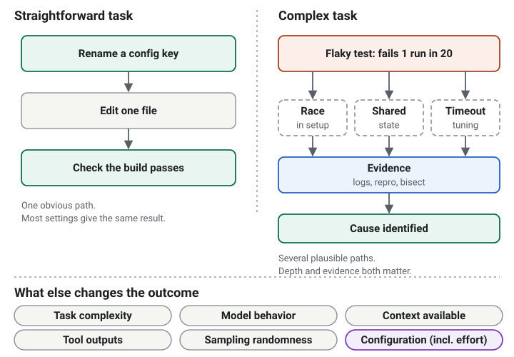

- **タスクの複雑さと曖昧さ**によって、妥当な答えがいくつあるかが変わる。
- **利用できるコンテキストとツールの出力**が、モデルが実際に知り得ることを決める。
- **サンプリングのランダム性**により、同じプロンプトでも 2 回の実行が食い違うことがある。
- **モデルの挙動と設定**も影響し、effort は設定の一部にすぎない。

<div class="takeaway">

コンテキスト不足、弱いツール結果、単なるばらつきを除外するまでは、悪い結果を effort のせいにしないこと。

</div>

## effort を上げても、自動的に賢くなるわけではない

<p class="slide-kicker">第I部 · 思い込みを問い直す</p>

よくある思い込みは 3 つあり、どれも役に立つ形で間違っている。

1. **「effort を上げれば必ず良い答えが出る。」** 一部のタスクでは助けになる。しかし正しさは保証されず、簡単なタスクではコストが増えるだけのことが多い。
2. **「長く考えるほど、深く正確な推論になる。」** 長さは質ではない。長い推論の連鎖でも、長いだけで間違っていることがある。
3. **「エージェントのステップが多いほど有能になる。」** ステップが増えると、誤りを直すのと同じくらい簡単に誤りが積み重なる。

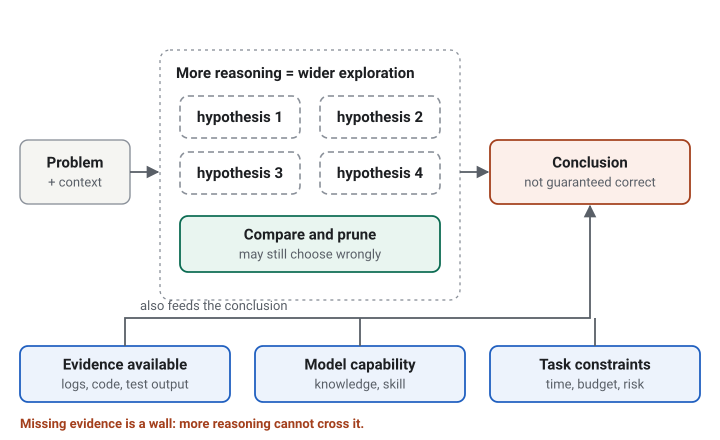

<div class="callout documented">

<span class="label documented">ドキュメント</span> Anthropic 自身の、最上位 effort レベルに関するガイダンスは、一部のワークロードでは「比較的小さな品質向上のために大きなコストが加わる」ことがあり、要求の低いタスクでは考えすぎにつながり得ると警告している（[Anthropic: Effort](https://platform.claude.com/docs/en/build-with-claude/effort)）。

</div>

## Thinking Effort は推論リソースの話であり、待ち時間を延ばすことではない

<p class="slide-kicker">第II部 · 技術の基礎</p>

thinking effort は、**モデルやプラットフォーム固有の制御（存在する場合）**であり、タスクの推論にどれだけの労力を割くかに影響する。これは公開 API 上の設定であって、モデル内部をのぞく窓ではない。

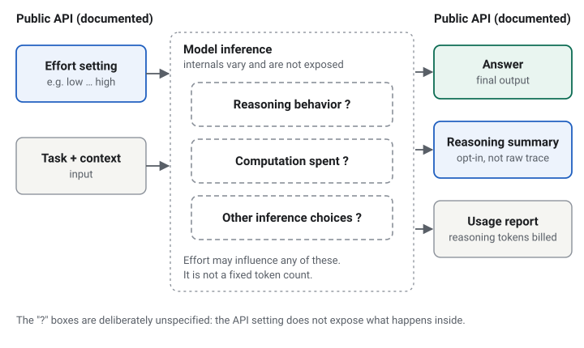

<div class="callout documented">

<span class="label documented">ドキュメント</span> 各ベンダーが自らの言葉で述べていること：

- OpenAI：reasoning token は output token として課金され、`max_output_tokens` に含まれ、`usage.output_tokens_details.reasoning_tokens` に現れる。生の reasoning は返されず、要約はオプトインである（[OpenAI: Reasoning models](https://developers.openai.com/api/docs/guides/reasoning)）。
- Anthropic：effort は「厳密な token 予算ではなく、挙動に関するシグナル」であり、thinking だけでなく、テキストやツール呼び出しを含むすべての出力 token に影響する（[Anthropic: Effort](https://platform.claude.com/docs/en/build-with-claude/effort)）。
- Google：`thinking_level` が受け付けるレベルはモデルごとに異なり、thought の要約はオプトインである（[Gemini: Thinking](https://ai.google.dev/gemini-api/docs/thinking)）。

</div>

つまり、同じ言葉でも API によって意味が異なる。各レベルが固定の token 数、ステップ数、計算量に対応すると想定してはいけない。

## タスクの複雑さが reasoning effort を左右すべきである

<p class="slide-kicker">第II部 · 技術の基礎</p>

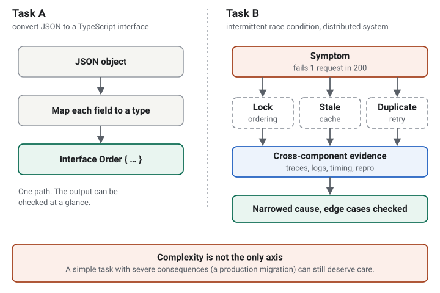

**タスク A** は、JSON オブジェクトを TypeScript のインターフェースに変換する作業だ。出力は一目で確認できる。追加の熟考で結果が変わることはほとんどない。

**タスク B** は、分散システムで断続的に起きる競合状態の調査だ。ここでは慎重な推論が効く。仮説を比較し、エッジケースを考え、コンポーネント間の挙動をつなぎ合わせる。

ただし、複雑さだけが軸ではない。本番データのマイグレーションのように、説明は短くても結果が深刻なタスクは、慎重な推論、追加の確認、人によるレビューに値することがある。

## モデルの推論とエージェントの実行は別物である

<p class="slide-kicker">第II部 · 技術の基礎</p>

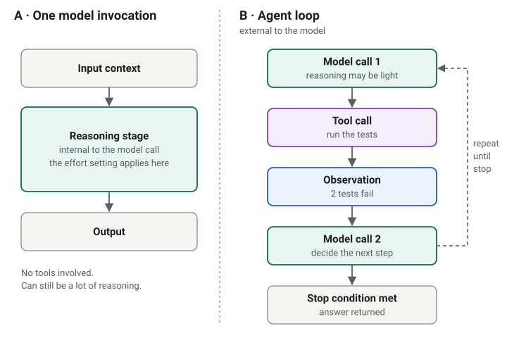

**thinking effort** は、モデルと API がこの制御に対応している場合に、*1 回の*モデル呼び出しの中で適用される推論のことだ。

**エージェントループ** は外側のサイクルである。モデルがコンテキストを受け取り、応答またはツール呼び出しを生成し、ツールの結果を受け取り、停止条件に達するまで続ける（推論と行動を交互に行う古典的な説明が [ReAct](https://arxiv.org/abs/2210.03629) である）。

この 2 つは独立して変化する。1 回の呼び出しで多くの推論を行い、ツールを一切使わないこともある。逆に、エージェントが数十回ツールを呼びながら、各ステップ自体は単純なこともある。

## AI エージェントはモデルだけではない

<p class="slide-kicker">第II部 · 技術の基礎</p>

概念上の流れ：ユーザーのタスクとコンテキスト → モデルの推論 → 回答するかツールを呼ぶかの判断 → ツールの実行 → 更新されたコンテキスト → 次の判断。タスクが完了するか停止条件が働くまで繰り返される。

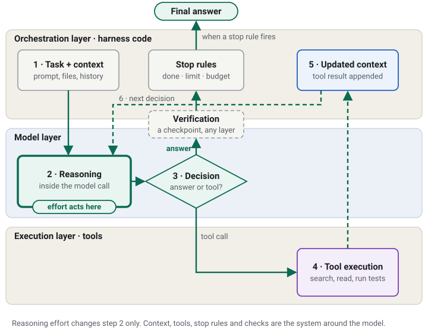

effort が作用するのは、このループの 1 つのステップ、つまりモデル呼び出しの内部の推論だ。全体の性能は、コンテキストの質、どのツールがあるか、ハーネスがリトライや停止をどう制御するか、そして何かが結果を検証するかどうかにも左右される。

<div class="callout documented">

<span class="label documented">ドキュメント</span> Anthropic の [Building effective agents](https://www.anthropic.com/engineering/building-effective-agents) も関連する指摘をしている。エージェント的なシステムはタスク性能と引き換えにレイテンシとコストを払うので、増える複雑さは正当化されるべきだという。

</div>

## effort のレベルの違いは、トレードオフの違いである

<p class="slide-kicker">第II部 · 技術の基礎</p>

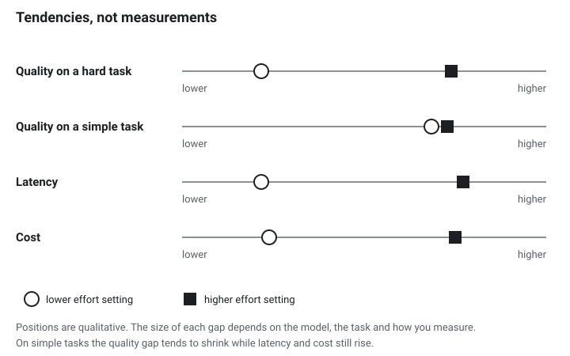

| | 低い effort | 高い effort |
| --- | --- | --- |
| レイテンシ | 低くなる傾向 | 高くなる傾向 |
| コスト | 低くなる傾向 | 高くなる傾向 |
| 難しい複数ステップのタスク | 徹底さが足りないことがある | より徹底することがある |
| 単純なタスク | たいてい十分 | 効果は小さく、コストは増える |

**これらは傾向であり、保証ではない。** 差の大きさは、モデル、タスク、測り方によって変わる。一般化できる数値はないため、この記事では改善幅の数字を示さない。自分の数値を得る方法はスライド 15 で示す。

## effort を上げる価値があるのはいつか？

<p class="slide-kicker">第III部 · 実際のエンジニアリング事例</p>

API が断続的に HTTP 500 を返す。reasoning effort の高いモデルは、複数の仮説を同時に保持し、依存関係を調べ、エッジケースを考えるのが得意かもしれない。それでも、誰も収集していないログを読むことはできない。


良いワークフローは、推論と観測を交互に行う。

1. 仮説を立て、それぞれを裏付ける、または否定する証拠が何かを明確にする。
2. その証拠（ログ、メトリクス、トレース）を集める。
3. 仮説を更新する。証拠が否定したものは捨てる。
4. 修正を適用し、症状が消えたことを検証する。

<div class="takeaway">

推論を増やすと、証拠を*活用*しやすくなる。収集されなかった証拠を生み出すことはできない。

</div>

## 1 行の変更とシステム全体のリファクタリングに、同じ戦略は要らない

<p class="slide-kicker">第III部 · 実際のエンジニアリング事例</p>

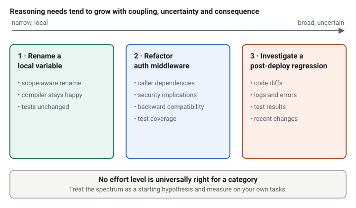

- **ローカル変数の名前変更。** ほぼ機械的な作業。コンパイラかテストスイートで決着がつく。
- **認証ミドルウェアのリファクタリング。** 推論は、呼び出し側、セキュリティへの影響、後方互換性、そして挙動が保たれていることを示すテストをカバーする必要がある。
- **デプロイ後のリグレッションの調査。** 推論は、読めるものの範囲までしか役に立たない。差分、ログ、テスト結果、最近の変更履歴である。

<div class="callout opinion">

<span class="label opinion">意見</span> この並びは、規則ではなく出発点となる仮説として扱ってほしい。動的型付け言語では名前変更が危険なこともあるし、難しいリグレッションでは熟考よりも証拠のほうが必要になることもある。

</div>

## 問題に合った手段を選ぶ

<p class="slide-kicker">第III部 · 実際のエンジニアリング事例</p>

エージェントが間違えたとき、「もっと考えさせる」は複数ある手段の 1 つであり、常に正しいとは限らない。

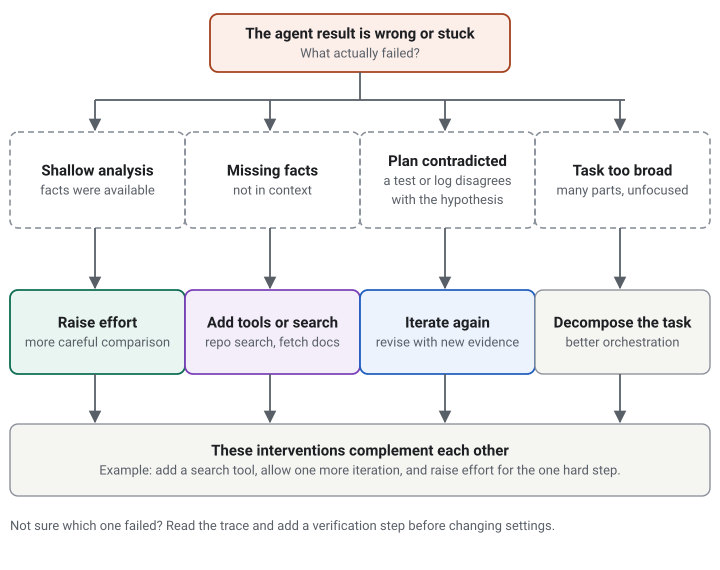

- モデルが利用できる仮説を十分に検討していないなら、**reasoning effort を上げる**と効くかもしれない。
- リポジトリの情報が足りないなら、考える量を増やすより**検索ツール**のほうが役に立つ。
- テスト結果が最初の仮説と矛盾するなら、その結果を使って**もう一度エージェントを反復させる**のが正しい。
- タスクが広すぎるなら、どんな単一の設定よりも**分解**が効く。

## 説得力のある説明は、正しさの証明ではない

<p class="slide-kicker">第III部 · 実際のエンジニアリング事例</p>

モデルは、情報の不足、誤った前提、その他の限界から、もっともらしいが間違った結論を出すことがある。説明が流暢かどうかは、それが真実かどうかをほとんど教えてくれない。

<div class="callout documented">

<span class="label documented">ドキュメント</span> reasoning モデルに関する研究では、示された推論が、実際に答えに影響した要因を省くことが多いと報告されている。つまり、説明を読むだけでは信頼できる監査にならない（[Chen et al., 2025](https://arxiv.org/abs/2505.05410)）。

</div>

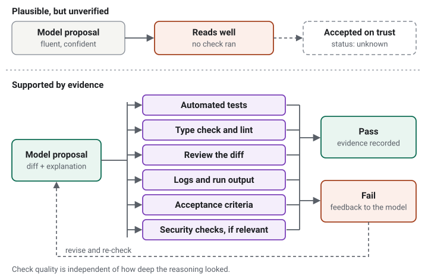

コーディングエージェントでの検証とは、具体的な仕組みを指す。自動テスト、型チェックと lint、生成された差分の確認、ログと実行結果の確認、受け入れ基準の照合、そして適切な場合にはセキュリティチェックの実行である。これらのチェックの質は、推論がどれだけ深く見えたかとは独立に評価すること。

## 品質、レイテンシ、コスト

<p class="slide-kicker">第IV部 · 本番システムでの活用</p>

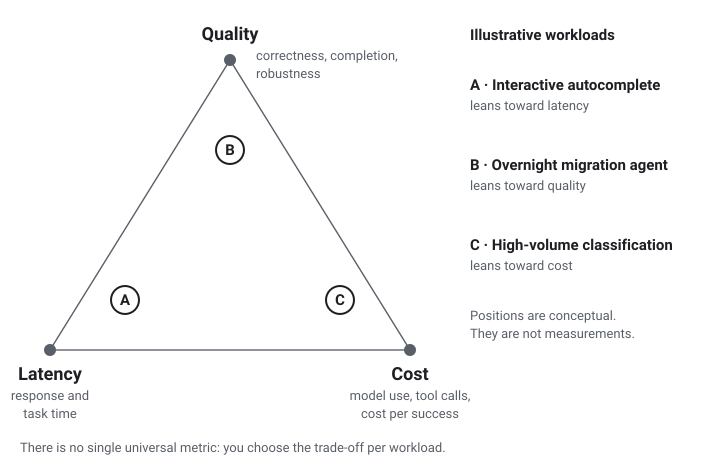

- **品質：** 正しさ、タスクの完了、堅牢性、エッジケースの扱い。
- **レイテンシ：** 応答時間と、タスクを完了するまでの総時間。
- **コスト：** モデルの使用量、該当する場合は reasoning に関わる推論コスト、ツール呼び出し、そして何よりも*成功したタスクあたりの総コスト*。

目標は、どんな価格でも最高の品質にすることでも、何を犠牲にしても最小のレイテンシにすることでもない。ワークロードとそのビジネス要件にとって許容できるトレードオフを見つけることだ。この 3 つを 1 つの万能なスコアにまとめることはできない。

## すべてのリクエストで最大 effort を既定にしない

<p class="slide-kicker">第IV部 · 本番システムでの活用</p>

適応的な戦略では、effort をタスクごとの判断として扱う。タスクを受け取り、複雑さ、不確実性、リスクを評価し、サポートされている設定を選び、実行し、検証し、検証に失敗したらエスカレーション、リトライ、または追加の証拠収集を行う。


ルーティングには、ルール、分類器、モデルベースのルーター、フィードバック駆動のポリシーが使える。

<div class="callout documented">

<span class="label documented">ドキュメント</span> test-time compute に関する研究では、プロンプトごとに推論の労力を適応的に配分すると、一律に使うよりも優れた結果が得られ得ることが示された（[Snell et al., 2024](https://arxiv.org/abs/2408.03314)）。これは適応的な配分一般を支持する論拠であって、あなたのワークロードでの保証ではない。

</div>

注意点が 2 つある。タスクの分類自体が間違うことがあるので、ルーターも他のコンポーネントと同様に評価すること。そして、選んだモデルや API がサポートする effort レベルだけを使うこと。

## effort を上げて本当に効果があるかを測る

<p class="slide-kicker">第IV部 · 本番システムでの活用</p>

実際のワークロードを代表する評価セットを作り、モデルがサポートする設定を、同等のタスクと同等の条件で比較する。

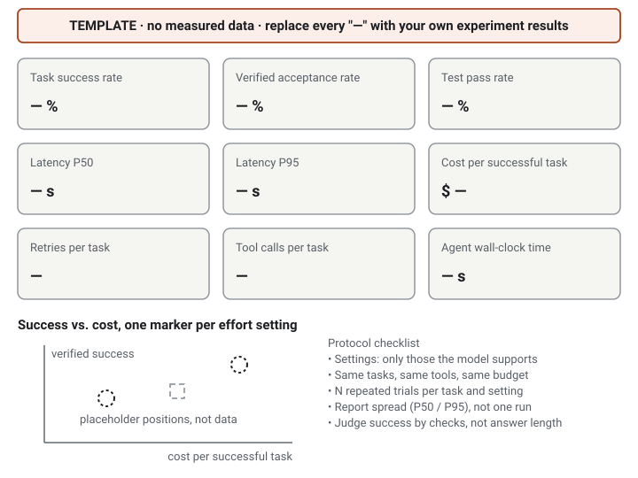

| 指標 | 理由 |
| --- | --- |
| タスク成功率と検証済み受け入れ率 | 本当に欲しいもの |
| テスト合格率 | テストがある場合の客観的なチェック |
| レイテンシ P50 と P95 | 典型的な体験と、現実的に最悪の体験 |
| *成功した*タスクあたりのコスト | 安い失敗は安くない |
| リトライ頻度、ツール呼び出し回数、総経過時間 | エージェントループが何を要するか |

モデルやエージェントは非決定的なので、試行を繰り返し、1 回の実行ではなくばらつきを報告すること。回答の長さや reasoning token の数で成功を判断してはいけない。どちらも費やした労力を測るものであり、得られた品質を測るものではない。公表する数値は、記録された実験から得たものであるべきだ。上のダッシュボードは意図的に空にしてある。

## reasoning effort を明示的なエンジニアリング上の判断にする

<p class="slide-kicker">第IV部 · 本番システムでの活用</p>

プロバイダーが対応している場合、effort はリクエストのパラメータである。ドキュメントに記載された形の OpenAI Responses API リクエストを示す。

```javascript
const response = await client.responses.create({
  model: "gpt-6-astra",
  reasoning: {
    effort: "high", // このスライドが扱う設定
  },
  input: "Analyze this production bug...",
});

console.log(response.output_text);
```

<div class="callout documented">

<span class="label documented">ドキュメント</span> 2026 年 10 月 22 日に確認したドキュメントでは、`responses.create` に `reasoning: { effort: ... }` があり、値として `none`、`minimal`、`low`、`medium`、`high`、`xhigh`、`max` が挙げられ、サポートされる値はモデルによって異なると記されている。例えば GPT-6 Astra は `none` を HTTP 400 で拒否する（[OpenAI: Reasoning models](https://developers.openai.com/api/docs/guides/reasoning)）。ここで使ったモデル名はドキュメントが使っているものである。このリクエストは実行していないので、頼る前にモデルのページで、モデルと値を確認してほしい。

</div>

この設定は、どれだけ推論を適用するかを表すものだ。モデルの非公開の推論を返すものではなく、利用できるのはオプトインの要約だけである。

**他のプロバイダーは書き方が異なる。** 共通の形式はない。

| プロバイダー | パラメータ | 出典 |
| --- | --- | --- |
| OpenAI (Responses API) | `reasoning: { effort }` | [Reasoning models](https://developers.openai.com/api/docs/guides/reasoning) |
| Anthropic (Messages API) | `output_config: { effort }` | [Effort](https://platform.claude.com/docs/en/build-with-claude/effort) |
| Google (Gemini API) | `thinking_level` | [Thinking](https://ai.google.dev/gemini-api/docs/thinking) |

## thinking effort を上げる前に、この 5 つの問いを確認する

<p class="slide-kicker">第V部 · 実践のためのまとめ</p>

<div class="checklist">

1. <strong>そのタスクは本当に複雑、または不確実か？</strong><span>定型で確認しやすいなら、追加の推論はコストを増やすだけになりがち。</span>
2. <strong>モデルは推論に苦労しているのか、それとも重要な情報が欠けているのか？</strong><span>欠けている事実には、熟考ではなく検索やツールが必要。</span>
3. <strong>別のツールや検証ステップのほうが効果的ではないか？</strong><span>テストの実行は、もう一段落の熟考にしばしば勝る。</span>
4. <strong>期待される品質の向上は、増えるレイテンシとコストに見合うか？</strong><span>リクエストあたりではなく、成功したタスクあたりのコストで比べる。</span>
5. <strong>代表的な実タスクで差を測ったか？</strong><span>測っていないなら、他の 4 つへの答えは推測として扱う。</span>

</div>

これは繰り返し使える判断カードとして残してほしい。問い 1 と問い 5 に「はい」と答えられないなら、設定を上げるのはまだ早いだろう。

## 最良のエージェントは、最も多く考えるものではない。必要なところに effort を配分するものだ。

<p class="slide-kicker">第V部 · 実践のためのまとめ</p>

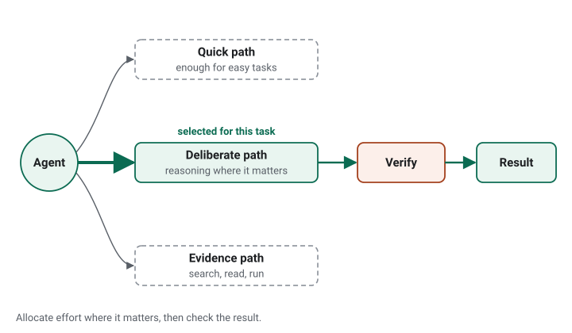

1. thinking effort は、モデルがタスクを処理する方法に影響し得る。ただし正しさは保証しない。
2. reasoning、ツール利用、コンテキストの取得、検証は、*それぞれ異なる*問題を解く。
3. 適切な設定は、自分のワークロードを評価して決まる。

<p class="pull-question">「どうすれば AI にもっと考えさせられるか」ではなく、「このタスクを確実に完了するには、どれだけの推論が必要か」と問おう。</p>

### 参考文献とさらに読む

- OpenAI, [Reasoning models](https://developers.openai.com/api/docs/guides/reasoning)：`reasoning.effort`、reasoning token、要約。
- Anthropic, [Effort](https://platform.claude.com/docs/en/build-with-claude/effort) と [Steering thinking](https://platform.claude.com/docs/en/build-with-claude/thinking-steering-and-cost)：effort レベル、adaptive thinking、thinking token とコスト。
- Google, [Gemini thinking](https://ai.google.dev/gemini-api/docs/thinking)：`thinking_level` と thought の要約。
- Anthropic, [Building effective agents](https://www.anthropic.com/engineering/building-effective-agents)（2024 年 12 月）：ワークフロー、エージェント、複雑さを加えるべき場面。
- Yao et al., [ReAct: Synergizing Reasoning and Acting in Language Models](https://arxiv.org/abs/2210.03629)（2022）。
- Snell et al., [Scaling LLM Test-Time Compute Optimally can be More Effective than Scaling Model Parameters](https://arxiv.org/abs/2408.03314)（2024）。
- Chen et al., [Reasoning Models Don't Always Say What They Think](https://arxiv.org/abs/2505.05410)（2025）。
