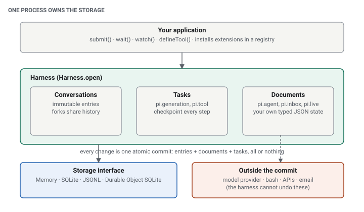

<div class="callout">

**How to read this article.** Pi Durable is young and its API moves, so claims carry labels:

- <span class="label documented">Documented</span>: stated in the official announcement, the package README, or the Cloudflare docs, linked next to the claim.
- <span class="label verified">Verified</span>: I ran it. The code is in this article and in the repository.
- <span class="label opinion">Opinion</span>: my interpretation.
- <span class="label proposal">Proposal</span>: an architecture I think follows from the design. Not something the package ships.

**Versions.** Everything refers to `@earendil-works/pi-durable` **1.3.0**, `@earendil-works/pi-ai` 1.3.0 and `@earendil-works/chord` 1.3.0, the npm `latest` tags on October 21, 2026, run on Node.js 26.9.0 (the package declares `node >=22.19.0`). Pi Durable is **experimental**: the README says "the API changes without notice between releases." Treat every signature here as a snapshot.

</div>

## 1. The 40-minute bug hunt that dies at minute 38

An AI coding agent is chasing a flaky order failure. It has grepped the logs, read four files, run the test suite twice, and formed a theory. It is about to open a ticket with the findings. Then the process is killed: a deploy, an out-of-memory kill, a laptop lid.

What did you lose? If the only record of the run was a chat transcript, you can restart the agent with that transcript. But the transcript says "I ran the tests" and not whether the ticket call got as far as the tracker. A restart that replays the last request may open a duplicate ticket. A restart from scratch pays for the same model calls again and reaches a slightly different conclusion.

This is the gap between **conversation history** (what was said) and **execution state** (what is in flight, what finished, what must not run twice). Simple chat tools can ignore it. Agents that run for minutes or hours, on a server, driven by more than one person, cannot.

The question this article follows: *what if an agent could resume after a crash instead of starting over?* And the less comfortable follow-up: *what exactly does "resume" promise, and what does it not?*

## 2. What Pi Durable is

<div class="callout documented">

<span class="label documented">Documented</span> Pi Durable is a TypeScript framework for long-running, crash-tolerant agents that can run anywhere a JavaScript runtime exists. The [announcement](https://earendil.com/posts/pi-durable/) describes it as released experimentally alongside Pi 1.0. The [README](https://github.com/joyanes97/pi-coding-agent/blob/main/packages/durable/README.md) describes the package as a durable agent harness.

</div>

The announcement is explicit that it is **not a replacement for the Pi coding agent**. It is a separate framework that shares code (such as `pi-ai`, the unified model API) and design principles with Pi. Lessons from it may flow back into Pi.

| | Pi Coding Agent | Pi Durable |
|---|---|---|
| Shape | An interactive agent, one person driving one process in a terminal | A library for building agent applications |
| State | Lives with the single process that drives it | Storage is the source of truth; the process is replaceable |
| Typical host | A developer's terminal | A backend service, a bot, a Cloudflare Durable Object |
| Clients | One | Any number can attach to one conversation |

<div class="callout documented">

<span class="label documented">Documented</span> The announcement lists what it targets: agents that run on any machine, are reachable from several surfaces, handle very long conversations, survive crashes, and let several people steer the same agent.

</div>

<div class="callout opinion">

<span class="label opinion">Opinion</span> I would not describe Pi Durable as "the production version of Pi". The announcement says some of its lessons may flow back, and the two share code, but today it is a framework you build an application on, not a product you launch.

</div>

## 3. What a traditional agent loop loses

The conventional loop is short:

```text
User request → LLM → tool call → tool result → LLM → … → final response
```

All of its working state lives in the process: the messages array, which tool call is running, which results have come back, queued follow-ups. Persisting the *messages* is a common improvement, and it fixes a different problem than the one a crash creates.

Three things are easy to confuse:

- **Conversation persistence** stores the transcript. You can show it, search it, continue it with a new prompt.
- **Execution recovery** knows that a model request was in flight and a tool call was half done, and what to do about each.
- **Durable workflows** go further: multi-step processes with timers, waiting, and child work, all checkpointed.

After a crash, a transcript-only agent has these problems:

- It cannot tell which tool calls finished. A tool result is in the transcript only if the loop got to write it.
- A retry may repeat side effects: a duplicate ticket, a second email, a double charge.
- Streamed output and intermediate results that were never written are gone.
- Restarting from scratch spends model tokens again.

Pi Durable moves the loop's state into storage so that the process becomes disposable:


The diagram above is the recovery flow I verify later in this article. First the building blocks.

## 4. Architecture



### 4.1 Harness

<div class="callout documented">

<span class="label documented">Documented</span> A harness is "one open storage plus the machinery that runs agents on it." All changes go through one line of atomic commits, and nothing is shown to observers before its commit is stored ([README, Concepts](https://github.com/joyanes97/pi-coding-agent/blob/main/packages/durable/README.md)).

</div>

The harness owns scheduling, the model call, tool execution, retries, and compaction. The application owns the model choice, which tools exist and what is safe to replay, how clients connect, authentication, and everything outside the commit boundary.

### 4.2 Conversations and entries

A conversation is a transcript of **immutable entries**: user messages (`pi.user`), model responses (`pi.assistant`), tool results (`pi.tool-result`), system prompt changes (`pi.system`), resets (`pi.reset`), or entry kinds you define. A `Conversation` handle holds no state, so you compare handles by `id`. The model sees entries from the newest reset onward.

Conversations can be created, resumed from storage, and forked from any point in another transcript without copying history ([announcement](https://earendil.com/posts/pi-durable/)).

Why history is not the whole state: the transcript says what the model saw. The scheduler's idea of which task is pending, which tool call has an intent recorded but no result, and which submissions are queued lives in **documents and task records** next to it, such as `pi.live`, `pi.inbox`, and `pi.agent`.

### 4.3 Tasks and checkpoints

<div class="callout documented">

<span class="label documented">Documented</span> A task is "a durable state machine that saves a checkpoint at every step, so a restarted process continues from the last one." Every task has an owner, either its conversation or another task. The README gives one answered input as:

</div>

```text
submit(input) → pi.user
  pi.generation → pi.system (only if the prompt or tools changed), pi.assistant (tool calls)
    pi.tool × n → pi.tool-result × n   (owned by the generation, which waits for them)
  pi.generation → pi.assistant (answer) → submission done
```

So a model call is a task (`pi.generation`), and each tool call is its own task (`pi.tool`). On reopen the harness finds the unfinished ones and decides, per task, whether to continue, retry, or report interruption. Section 5 gives those rules.

### 4.4 Documents and atomic commits

A **document** is typed JSON state stored with the transcript and changed in the same commits. `conversation.commit((tx) => …)` can append entries, edit documents, and create tasks together: "either all of it is stored or none of it." Built-in documents hold agent choices, queued submissions, running generation, and spend; you can define your own (a todo list, a plan).

<div class="callout documented">

<span class="label documented">Documented</span> The atomicity is **inside storage**. A commit cannot include an HTTP call to your issue tracker. The announcement and README make no claim of transactions across external services, and I make none either.

</div>

### 4.5 Storage

<div class="callout documented">

<span class="label documented">Documented</span> From the [README storage table](https://github.com/joyanes97/pi-coding-agent/blob/main/packages/durable/README.md):

</div>

| Backend | Persists restarts | Notes |
|---|---|---|
| `MemoryStorage` | No | For tests and demos |
| SQLite (`openNodeSqliteStorage`) | Yes | WAL mode, `synchronous = NORMAL`: commits survive a process crash; the newest may be lost on power or host failure |
| JSONL (`openNodeJsonlStorage`) | Yes | Append-only files; `{ fsync: true }` flushes before each commit marker; keeps the whole history in memory, so use SQLite for long-running agents |
| Cloudflare Durable Object | Yes | `openDurableObjectSqliteStorage(ctx.storage)`; commits are the object's storage transactions |

The SQLite and JSONL cores use no Node APIs, so with a small adapter they can run on Bun or in a Durable Object. The storage interface is small enough to implement on another store, and the package ships a conformance suite for that.

Two limits matter for design: **one process owns a storage at a time, with no cross-process locking**, and a storage error closes the harness (section 8). Pick SQLite for a single-server service, a Durable Object where Cloudflare is the host, JSONL when you want files you can read and diff, and memory only for tests.

## 5. How crash recovery works

Here is the scenario, with what the documentation and my run say happens at each step.

1. A user submits "investigate the order failures". The input is **durably admitted** in a commit before any model work starts.
2. The model asks for `search_logs`. The tool task records its **intent** (final arguments and replay policy) *before* `execute()` runs ([README, Tools](https://github.com/joyanes97/pi-coding-agent/blob/main/packages/durable/README.md)).
3. `search_logs` finishes and its result is committed.
4. The model asks for `open_ticket`. Its intent is committed, `execute()` starts, and the process is killed.
5. A new process opens the same storage and calls `resume()`.
6. The harness sees the unfinished tasks. Committed state is kept as is.
7. For the interrupted tool call the **replay policy** decides: rerun it only if it is declared `replay: "safe"`, otherwise the model receives an `interrupted` error result containing the output committed so far, and the run continues from there.

<div class="callout documented">

The announcement and README also describe the other recoverable pieces:

- <span class="label documented">Documented</span> An interrupted **model request** is resent, with the partial answer kept and marked aborted ([announcement](https://earendil.com/posts/pi-durable/)).
- <span class="label documented">Documented</span> **Crash loops are capped** by `settings.restartLimit` (default 5). Tasks over the limit are parked, and `harness.retryTask(id)` retries them.
- <span class="label documented">Documented</span> A submission carrying a `requestId` is **exactly-once admitted**: resubmitting the same ID returns the existing submission.

</div>

That classification is the heart of it:

| State at the moment of the crash | Recovery |
|---|---|
| Committed (entries, finished tool results, documents) | Kept. Never recomputed. |
| In-flight model request | Resent; partial answer kept and marked aborted |
| In-flight tool call, `replay: "safe"` | Rerun |
| In-flight tool call, default | Not rerun; the model gets an `interrupted` error and decides what to do |
| Hook decision not yet memoized | Reruns, so store decisions with `api.memo` (first write wins) |

### What this does not give you

<div class="callout documented">

<span class="label documented">Documented</span> The README for tool calls from tools says it directly: "a replay-safe tool with external effects still needs its own idempotency." Durable execution is not exactly-once execution of the outside world.

</div>

Consider the window in the sequence diagram: `open_ticket` called the tracker, the tracker created the ticket, and the process died before the result was committed. The harness cannot know. With the default policy it will not rerun the call, and the model is told the call "was interrupted and may have partially run". The honest options after that are the application's:

- **Opening a pull request.** Look up an open PR for the branch before creating one. A deterministic branch name is a natural idempotency key.
- **Sending an email.** Pass a message ID the provider deduplicates, or log "intent to send" with a key and check the provider before retrying.
- **Updating a database.** Make the write an upsert keyed on the request, not an increment.

<div class="callout opinion">

<span class="label opinion">Opinion</span> The `replay` flag is the most important line a tool author writes. "Safe" should mean *rerunning this cannot hurt*, not "this usually works". Reads are safe. Anything that charges, sends or creates is not, until it carries an idempotency key.

</div>


## 6. Hands-on: a durable agent that survives `kill -9`

All code here ran against the versions above. The faux provider plays the model, so the test is deterministic and needs no API key. The tutorial uses real `SIGKILL`, not a mocked failure.

### 6.1 Setup

```bash
mkdir pi-durable-demo && cd pi-durable-demo
npm init -y && npm pkg set type=module
npm install @earendil-works/pi-durable @earendil-works/pi-ai @earendil-works/chord
npm install -D typescript @types/node
```

Node 22.19 or newer is declared by the package. I ran Node 26, which runs `.ts` files directly (type stripping), so the demo needs no build step. For a real model you would replace the faux provider with one such as `openaiProvider()` from `@earendil-works/pi-ai/providers/openai`, which reads `OPENAI_API_KEY` ([README, Quick Start](https://github.com/joyanes97/pi-coding-agent/blob/main/packages/durable/README.md)). Storage is initialized by opening a SQLite file; it is created on first use.

### 6.2 Tools, model and harness

`src/agent.ts` defines two tools. `search_logs` only reads, so it is `replay: "safe"`. `open_ticket` has an external effect, so it keeps the default. Both append to a ledger file so that we can count real executions across processes. In crash mode, `open_ticket` kills its own process after writing to the ledger.

```ts
import { appendFile } from "node:fs/promises";
import { BACKGROUND_CONTEXT } from "@earendil-works/chord/context";
import { Type } from "@earendil-works/pi-ai";
import { createModels } from "@earendil-works/pi-ai/models";
import { fauxAssistantMessage, fauxProvider, fauxText, fauxToolCall } from "@earendil-works/pi-ai/providers/faux";
import { createRegistry, defineExtension, defineTool, Harness } from "@earendil-works/pi-durable";
import { openNodeSqliteStorage } from "@earendil-works/pi-durable/storage/sqlite/node";

export const context = BACKGROUND_CONTEXT;

export async function ledger(file: string, line: string) {
	await appendFile(file, `${line}\n`);
}

export function createAgent(ledgerFile: string, crashInTicketTool: boolean) {
	const searchLogs = defineTool({
		name: "search_logs",
		description: "Search the service logs for a pattern",
		parameters: Type.Object({ pattern: Type.String() }),
		replay: "safe",
		execute: async (args) => {
			await ledger(ledgerFile, `search_logs ${args.pattern}`);
			return { output: [{ type: "text", text: "3 matches: NullPointerException in OrderService.java:42" }] };
		},
	});

	const openTicket = defineTool({
		name: "open_ticket",
		description: "Open a ticket in the issue tracker",
		parameters: Type.Object({ title: Type.String() }),
		execute: async (args) => {
			await ledger(ledgerFile, `open_ticket ${args.title}`);
			if (crashInTicketTool) process.kill(process.pid, "SIGKILL"); // no cleanup, no close()
			return { output: [{ type: "text", text: "Opened TICKET-1" }] };
		},
	});

	const registry = createRegistry();
	registry.install(defineExtension({ name: "triage", tools: [searchLogs, openTicket] }));

	// A scripted model that decides from the transcript, so every process behaves the same.
	const faux = fauxProvider();
	const call = (name: string, args: Record<string, string>, id: string) =>
		fauxAssistantMessage([fauxToolCall(name, args, { id })], { stopReason: "toolUse" });
	faux.setResponses(
		Array.from({ length: 10 }, () => (ctx) => {
			const last = ctx.messages[ctx.messages.length - 1];
			if (last.role === "toolResult" && last.toolName === "open_ticket") {
				return fauxAssistantMessage([
					fauxText(last.isError ? "The ticket call was interrupted; check the tracker before retrying." : "Ticket opened."),
				]);
			}
			if (last.role === "toolResult" && last.toolName === "search_logs") {
				return call("open_ticket", { title: "NPE in OrderService" }, "t1");
			}
			return call("search_logs", { pattern: "NullPointerException" }, "s1");
		}),
	);
	const models = createModels();
	models.setProvider(faux.provider);
	return { models, registry };
}

export async function openHarness(dbFile: string, ledgerFile: string, crash: boolean) {
	const { models, registry } = createAgent(ledgerFile, crash);
	const harness = await Harness.open(await openNodeSqliteStorage(dbFile), { models, registry }, context);
	const root = await harness.root(context, { agent: { model: { provider: "faux", modelId: "faux-1" } } });
	return { harness, root };
}
```

What the options do: `Harness.open(storage, { models, registry }, context)` opens one storage and binds the model registry and your extensions. `harness.root()` returns the root conversation, creating it on first use with the given agent choices. Every async call takes a Chord `Context` that carries cancellation; `BACKGROUND_CONTEXT` never cancels, and cancelling a wait only cancels the wait, never the work.

### 6.3 Submit a task

`src/worker.ts` is the process we will kill. It submits with a `requestId`, resumes any unfinished work, and waits.

```ts
import { context, openHarness } from "./agent.ts";

const [dbFile, ledgerFile, mode] = process.argv.slice(2);
const { harness, root } = await openHarness(dbFile, ledgerFile, mode === "crash");

const submission = await root.submit(
	{ type: "input", content: "Investigate the order failures.", requestId: "investigate-1" },
	context,
);
harness.resume(); // continue anything the previous process left unfinished
const settled = await submission.wait(context);
console.log(JSON.stringify({ submission: submission.id, status: settled.status }));
await harness.close(context);
```

`submit()` durably admits the input and returns a `Submission`; `wait()` resolves to `done` or `unanswered`. The generation and the two tool calls are tasks, and their entries land in the transcript as they commit.

### 6.4 Crash, restart, verify

`src/demo.ts` is the controlled test. Process 1 runs in crash mode and must die by `SIGKILL`. Process 2 runs normally on the same SQLite file. Then the demo asserts on the ledger and on the transcript.

```ts
import assert from "node:assert/strict";
import { spawnSync } from "node:child_process";
import { mkdtemp, readFile } from "node:fs/promises";
import { tmpdir } from "node:os";
import { join } from "node:path";
import type { ToolResultMessage } from "@earendil-works/pi-ai";
import { ToolResultEntry } from "@earendil-works/pi-durable";
import { context, openHarness } from "./agent.ts";

const dir = await mkdtemp(join(tmpdir(), "pi-durable-demo-"));
const db = join(dir, "agent.sqlite");
const ledgerFile = join(dir, "ledger.txt");
const run = (mode: string) =>
	spawnSync(process.execPath, ["src/worker.ts", db, ledgerFile, mode], { encoding: "utf8" });

const first = run("crash"); // 1. dies with SIGKILL inside open_ticket
console.log("process 1 signal:", first.signal);
assert.equal(first.signal, "SIGKILL");

const second = run("normal"); // 2. reopens the same file and resumes
console.log("process 2 output:", second.stdout.trim());
assert.equal(second.status, 0, second.stderr);
assert.equal(JSON.parse(second.stdout).status, "done");

const lines = (await readFile(ledgerFile, "utf8")).trim().split("\n"); // 3. verify
console.log("ledger:", lines);
assert.equal(lines.filter((l) => l.startsWith("open_ticket")).length, 1, "ticket tool must not rerun");
assert.equal(lines.filter((l) => l.startsWith("search_logs")).length, 1, "search_logs finished before the crash");

const { harness, root } = await openHarness(db, ledgerFile, false);
const page = await root.entries({}, 50, undefined, context);
const results = [...page.items].reverse().filter(ToolResultEntry.is).map((e) => e.model![0] as ToolResultMessage);
for (const r of results) console.log(r.toolName, "isError:", r.isError, JSON.stringify(r.content));
assert.equal(results.find((r) => r.toolName === "search_logs")?.isError, false);
assert.equal(results.find((r) => r.toolName === "open_ticket")?.isError, true);
await harness.close(context);
console.log("OK");
```

Run it with `node src/demo.ts`. Output from my run:

```text
process 1 signal: SIGKILL
process 2 output: {"submission":8,"status":"done"}
ledger: [
  'search_logs NullPointerException',
  'open_ticket NPE in OrderService'
]
search_logs isError: false [{"type":"text","text":"3 matches: NullPointerException in OrderService.java:42"}]
open_ticket isError: true [{"type":"text","text":"<harness>\n[error] Tool open_ticket was interrupted and may have partially run\n</harness>"}]
OK
```

<div class="callout verified">

<span class="label verified">Verified</span> `tsc --strict` passes on all three files, and the demo's assertions held in my run.

</div>

### 6.5 What this proves and what it does not

It shows, on the tested version and for this scenario:

- Committed state survives `SIGKILL`: the `search_logs` result and the transcript are intact after reopen.
- The completed read-only tool ran once, not twice.
- The in-flight non-replay-safe tool was not rerun. The side effect happened exactly once in the ledger, and the model was told the call was interrupted.
- The run reached `done` in the second process.

It does **not** show:

- That the outcome of `open_ticket` is known. It is not. The ledger says the call started; whether the ticket exists is a question for the tracker.
- Behavior under power loss. SQLite in WAL mode with `synchronous = NORMAL` may lose the newest commit on power failure ([README](https://github.com/joyanes97/pi-coding-agent/blob/main/packages/durable/README.md)); `SIGKILL` of the process is a gentler failure.
- Real model behavior. The faux provider is scripted. A real model may react to the interrupted result by retrying the call, asking a human, or giving up. I did not test that.
- The `replay: "safe"` rerun path for a tool that is interrupted. In my demo the safe tool finished before the crash. The README documents the rerun; I did not exercise it.
- Concurrency, multiple clients, compaction, or Cloudflare hosting.

## 7. Beyond a single conversation

<div class="callout documented">

<span class="label documented">Documented</span> The package supports these directly:

- **Many conversations per harness.** One harness runs many in parallel, each with its own stored agent: model, thinking level, extensions, tools, instructions, working directory. A reviewer conversation can use a cheaper model and read-only tools.
- **Forks.** A conversation can fork from any point in another's transcript without copying history. The announcement's example is a Slack thread forked from a channel message.
- **Multiple clients.** Any number of clients can attach to a conversation, get a current view, then incremental updates, and can steer a running conversation or queue follow-ups.
- **Subagents** are built from tools that create an owned conversation. The announcement states there are no built-in subagents.
- **Environments per conversation.** An `env` function selects where each conversation's tools run: a laptop, a remote VM, an in-memory sandbox.

</div>

<div class="callout proposal">

<span class="label proposal">Proposal</span> Some patterns follow from those pieces but are not shipped:

- A human-approval gate for a deploy tool: a `beforeTool` hook that blocks, with the approval decision stored via `api.memo` so a crash does not ask twice. The announcement shows an approval-gate example along these lines; the surrounding approval UI is yours to build.
- A triage service where each incoming issue is a conversation and a worker restarts freely behind a queue.

</div>

What is *not* built in, as far as the README and announcement go: multi-user authorization, tenant isolation, and distributed coordination across processes. One process owns a storage, and other clients attach through that process. If you need several workers, you partition conversations across storages yourself.

<div class="callout documented">

<span class="label documented">Documented</span> For Cloudflare, the [Pi harness docs](https://developers.cloudflare.com/agents/harnesses/pi/) describe `PiHarness`, which stores Pi's tables in a Durable Object's SQLite database and uses a heartbeat job (every 30 seconds) to restart an evicted object so Pi can resume. That page marks `PiHarness` as beta and lists its own limits, for example no approval step for tool calls yet, event streams that cannot resume from a cursor, and alarm invocations capped at 15 minutes.

</div>

## 8. Production considerations

For each item: what the package gives you, and what stays yours.

**Experimental API and versioning.** *Package:* a changelog ships in the npm package. *You:* pin the exact version, read the changelog on every upgrade, and keep an end-to-end crash test (like section 6) in CI so a behavior change shows up as a red build. The README states the API changes without notice.

**Storage durability.** *Package:* atomic commits and a defined policy per backend; a storage error ends the harness, and "commits are atomic, so the store is consistent" on reopen ([README, Errors](https://github.com/joyanes97/pi-coding-agent/blob/main/packages/durable/README.md)). Nothing is retried by the harness; a custom storage retries its own transient failures. *You:* choose `fsync` or an equivalent if losing the newest commit is not acceptable, back up the file, and decide what to do when the disk itself is unavailable or corrupted. The package does not claim to repair that.

**Tool replay and idempotency.** *Package:* intent recorded before execution, the `replay` flag, `requestId` for submissions, `memo` for hook decisions. *You:* idempotency keys on every external effect, and reconciliation for the "may have partially run" case.

**Model context.** *Package:* compaction runs as a background task, with summaries at turn boundaries; if a provider rejects a request as too long the harness compacts and retries once. Older messages stay in storage. *You:* persisted history does not mean it fits the window. Pick compaction settings (`reserveTokens` and per-model overrides) and decide what a handoff note should keep.

**Observability.** *Package:* `onReport` for reported errors, `harness.inspect()` and a task graph view, usage and cost documents, `watch()` for exact commits and `watchEvents()` for coding-agent-style events. *You:* ship these to your logs and metrics, alert on parked tasks (`restartLimit` reached), and keep an eye on stuck tasks.

**Security.** *Package:* per-conversation tool sets and environments, `callers` to decide who may call a tool, hooks that block or rewrite calls. *You:* API keys in the environment or a secret manager, file permissions on the SQLite file (it contains full conversations and tool output), redaction in `afterTool` hooks, and tenant isolation. I did not find tenant isolation in the documentation, so assume it is yours.

**Operational reliability.** *Package:* crash-loop capping, `retryTask`, `harness.closed` so a host can reopen on failure. *You:* the restart supervisor, backups, regular recovery drills, and a runbook for tasks that stay parked.

## 9. When to use it

| Use case | Conventional agent workflow | Durable agent workflow |
|---|---|---|
| Interactive coding session at a terminal | Fits. Losing a session costs minutes. | Overhead you do not need |
| Overnight research or migration job | A crash means rerunning from the start | Resumes from the last checkpoint; spend is not repeated |
| Backend bot serving a team | Per-process state; restarts lose in-flight work | Natural fit: storage is the source of truth |
| Workflow with expensive or irreversible tools | Retries are ad hoc | Replay policy forces you to decide per tool |
| Short, stateless Q&A | Fine | Unnecessary |

Decision criteria that matter: how long a run lasts, what losing intermediate work costs (in money or in side effects), how often your processes get interrupted, whether people need to attach to the same agent, and whether you can afford the operational surface (storage, backups, a restart supervisor).

<div class="callout opinion">

<span class="label opinion">Opinion</span> Durability is not free and not universally better. It adds a storage dependency, a replay discipline you must apply to every tool, and an experimental API. If a lost run costs you two minutes, do not pay for it.

</div>

## 10. Conclusion

- Long-running agents need more than conversation history. They need to know what committed, what was in flight, and what may be repeated.
- Pi Durable makes that explicit: every step is a checkpointed task, every change an atomic commit, and every tool declares whether rerunning it is safe.
- It does not give exactly-once execution of external effects. The `interrupted` result is the harness telling you the outcome is ambiguous, and you resolve it.
- Recovery is a behavior to test, not assume. The demo above is the kind of test I would keep in CI.
- Start with a small proof of concept, and be careful before pointing an experimental package at critical workloads.

*What would you build if your agents could reliably resume work after a failure?*

## References

Everything below was consulted while writing. Claims from them are linked near the text.

- Earendil, [Pi Durable announcement](https://earendil.com/posts/pi-durable/).
- [`@earendil-works/pi-durable` README](https://github.com/joyanes97/pi-coding-agent/blob/main/packages/durable/README.md) (also shipped in the npm package, version 1.3.0).
- Cloudflare, [Pi harness on Cloudflare Agents](https://developers.cloudflare.com/agents/harnesses/pi/).
- The npm packages `@earendil-works/pi-durable`, `@earendil-works/pi-ai` and `@earendil-works/chord`, version 1.3.0, whose type definitions I read to write the example.
- The repository's `13-recovery.ts` example, which showed the `memo` and reopen-then-continue pattern.
